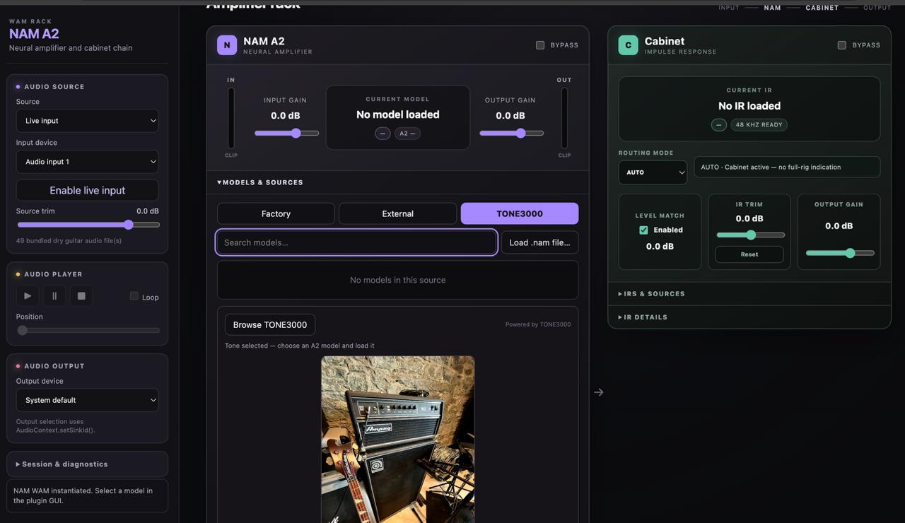

# NAM A2 WAM

## Recording latency calibration

In Studio, select a personal guitar/bass track, then open **Recording settings → Calibrate input latency**. Select the physical output (1/left or 2/right). The assistant physically disconnects microphone routes into both chains and app speaker outputs before opening input or connecting the cable; presets stay intact. Disable hardware direct monitoring, run the six probes, and explicitly **Apply compensation**. Close the assistant, remove the loopback cable and reconnect the instrument before re-enabling input. The input is disabled on close; playback stays paused.

**Speakers → microphone · acoustic test** uses chirps and reports an acoustic estimate (including propagation), which can be used as manual compensation. **Test signal level** is adjustable from -30 to -6 dBFS, default -18; no automatic volume escalation.

Measurements use normalized correlation in a Worker and retain bounded local profiles. Manual compensation/reset remain available. Reloaded profiles require **Use saved calibration**, after verifying the same hardware/buffer configuration. New takes store measurement provenance; existing audio is unchanged. Physical hardware qualification and the community calibration catalogue remain pending. See [RECORD_TRACKS_SPECIFICATION.md](RECORD_TRACKS_SPECIFICATION.md).

## Tuner

Open **Tuner** (or press **T**) after enabling live input. With two chains visible, **Tuner input** selects **Chain A** or **Chain B**, with its physical input channel shown. Analysis is taken before trim/effects and remains available while that chain is muted. If A feeds B, both selections analyse A’s raw input, explicitly marked as shared. Hiding B returns the tuner to A; unavailable physical channels are identified rather than silently replaced. No extra microphone permission is requested by opening the tuner.

## Serial effect chain

The main host shows the current NAM capture and Cabinet IR as photo cards. Click a `+` to choose a bundled effect at that position, then double-click its thumbnail/title or use **Insert module**. Click any photo to open its editor; **Replace** opens the catalog to replace that instance in place while preserving its input/output gains. Cancel or a failed load keeps the current module. Closing the editor preserves the running instance and its settings. Card controls and editor toolbars provide bypass. Cabinet AUTO still follows the selected NAM capture type.

NAM and Cabinet initialize their default assets without creating editors. Multiple instances keep independent WAM states. The **Session & diagnostics** save/restore controls now snapshot the whole chain in memory; factory/user preset management is a subsequent phase.

For a microphone-free real-browser test, open `examples/wam/fx-test/chain-validation.html` and click **Run headless and instance isolation tests**. The test renders audio into a muted measurement path and checks headless defaults, duplicate instances, state restoration and editor reuse. The same page is included under `dist/NAM_A2_WAM/fx-test/`.

Open-source WebAssembly/WAM audio effects prototype for guitar and bass. The project provides
a browser-based Web Audio host, a Neural Amp Modeler (NAM A2) plugin, a cabinet plugin based on
impulse responses (IRs), and TONE3000 Select Flow integration.

The repository contains the source code, the Factory assets required by the example host, and
the test suite. The `third_party/`, `dist/`, and build directories are not intended to be
committed.

## Features

- Web Audio/WAM host in [`examples/wam/`](examples/wam/).
- NAM A2 plugin in [`src/nam-wam/`](src/nam-wam/), with `.nam` model loading and safe replacement,
  a persistent Full/Lite rendering preference, rotary input/output gain, noise gate, three-band tone
  stack, six-band parametric EQ, bypass, and state restoration.
- Cabinet plugin in [`src/cabinet-wam/`](src/cabinet-wam/), with WAV IR loading, convolution,
  and level matching.
- Shared WASM/C++ backend in [`src/nam-wasm/`](src/nam-wasm/), built with
  NeuralAmpModelerCore.
- Shared assets and file browsing utilities in [`src/shared/`](src/shared/).
- TONE3000 model selection from the NAM panel through the Select Flow OAuth flow. Each user
  authenticates with their own TONE3000 account; the public `client_id` identifies the application
  and does not contain the author's session.
- A persistent Favorites library shared by Factory, External, and downloaded TONE3000 models.
  Favorites use IndexedDB; External favorites retain their model data and remain loadable after a
  browser restart.
- Automatic model-level compensation based on the loudness embedded in each NAM capture. It targets
  −18 dB, limits correction to ±12 dB, and leaves the manual Output gain control independent.

For `SlimmableContainer` captures, **Full** is the default network used for audio rendering. Open
**Preferences → A2 rendering mode** to select **Lite** when lower CPU usage is preferred. The current
model badge and details always report the network that is actually active.

Automatic model level is enabled by default and can be changed under **Preferences → Automatic
model level**. The correction currently applied to a capture is shown as a green `LEVEL ±x.x dB`
badge on the current-model card and in Model details. `LEVEL N/A` means that the file contains no
usable loudness metadata; such captures receive no automatic correction.

If a capture still sounds incorrectly matched, click **Calibrate level** on the current-model card.
This optional operation measures that model once with an internal low-level reference tone, applies
a static correction bounded to ±12 dB with peak protection, and resets the NAM state before normal
audio resumes. The reference tone is never routed to the output, and no adaptive gain runs while
playing. The badge changes to `MEASURED ±x.x dB`; click **Use metadata** to restore the default mode.
Measured values are remembered per capture and per Full/Lite variant in browser-local storage, so
reloading the same capture restores its calibration. Localhost and the deployed origin keep separate
calibration libraries.

The NAM faceplate follows the processing order used by the official TONE3000 desktop plugin:

```text
Input gain → Noise gate → optional PRE EQ → NAM → level correction → optional POST EQ
           → Bass/Middle/Treble → Output gain
```

Drag a rotary control vertically: upward increases its value and downward decreases it; hold Shift
for fine adjustment. Double-click restores its default value. Bass, Middle, and Treble are neutral
at `5`; the gate defaults to `−80 dB`. Click **EQ** to reveal the graphical six-band parametric
editor. Drag a point horizontally to change frequency and vertically to change gain; use the mouse
wheel for Q, or edit the selected band's numeric Frequency/Gain/Q fields. The plotted curve uses the
same RBJ coefficient equations as the audio processor. The EQ is disabled and POST NAM by default,
but can be moved before NAM. Its bands are low shelf at 100 Hz, four bells at 250 Hz, 650 Hz, 1.6 kHz
and 3.5 kHz, and high shelf at 8 kHz. Bypassed NAM and Cabinet modules use a red-tinted faceplate so
their inactive state remains immediately visible.

## Requirements

- Recent Node.js with npm.
- CMake 3.20 or newer and a C++20 compiler.
- Emscripten with `emcmake` available in the shell for the WASM build.
- The `third_party/NeuralAmpModelerCore` checkout. Third-party sources are intentionally ignored
  by Git.

## Dev container

[`.devcontainer/`](.devcontainer/) provides all of the above (Emscripten 6.0.9, CMake, Node 24,
ffmpeg, Python with numpy) plus Ruby 4.0.1 for the Rails app, without installing them on the host.

Prerequisites: a container runtime (Docker Desktop, OrbStack, Colima, Podman or Docker Engine on
Linux) and VS Code with the Dev Containers extension, a recent JetBrains IDE, or the
`@devcontainers/cli`. GitHub Codespaces also works and needs nothing locally.

Open the project and choose **Reopen in Container**. On first creation the container runs
`npm run setup` (fetches `third_party/` if it is missing and builds the WASM), then
`web/bin/setup --skip-server` (gems and database). Then, in the container terminal:

- `npm start` serves the static host on <http://127.0.0.1:8765/rack/>;
- `cd web && bin/rails server` serves the Rails app on <http://localhost:3000/rack/>.

Both ports are forwarded to the host browser, so audio devices work as usual. After changing
`.devcontainer/`, run **Dev Containers: Rebuild Container**.

Inside the container, `build-wasm/` and the gems are separate Docker volumes, so the container
never shares a CMake cache or native gems with the host. The servers listen on `0.0.0.0` there
through the `HOST` and `BINDING` environment variables; outside the container they keep their
localhost defaults. The rest of the repository is shared, including `web/storage/*.sqlite3` and
`web/tmp/pids/`: do not run Rails on the host and in the container at the same time.

## Run the host locally

Install dependencies, fetch third-party sources, build the WASM, then start the static server:

```sh
npm install
npm run setup
npm start
```

Then open <http://127.0.0.1:8765/rack/> (the same URL as the Rails app; the older
`/examples/wam/` path still works).

The isolated WAM effect registry and compatibility lab is available at
<http://127.0.0.1:8765/rack/fx-test/>. It discovers the bundled catalogue, categorizes
effects from descriptors and catalogue overrides, and validates plugin loading, GUI creation,
state round trips, bypass, and cleanup without changing the production NAM/Cabinet graph. See
[`docs/WAM_PLUGIN_REGISTRY.md`](docs/WAM_PLUGIN_REGISTRY.md).

The server automatically scans [`examples/wam/assets/audio/`](examples/wam/assets/audio/) to
discover `.wav`, `.mp3`, `.aac`, `.m4a`, `.ogg`, and `.flac` audio files. The host supports file
sources and live audio input, using the following signal chain:

```text
source → NAM A2 WAM → Cabinet WAM → audio output
```

The host requests a 48 kHz `AudioContext`, matching the sample rate used by the bundled and
TONE3000 NAM A2 models. If the browser or audio device cannot provide 48 kHz, the host displays a
diagnostic message and NAM model loading may be rejected by the core.

An automated validation page is available at
<http://127.0.0.1:8765/rack/index.html?auto=1>.

## Accounts, presets and sync (Rails app)

[`web/`](web/) is a Rails 8 + SQLite app that serves the same rack on one origin and adds
passwordless accounts (emailed magic link), server-side presets of the whole WAM chain,
synced NAM/IR favorites and preferences. Without an account the rack works as above (amps, cabinets,
pedals, Factory presets), but saving a preset asks to sign in first; the sound on screen is kept and
saved once signed in. Unsaved changes survive a reload as a draft in the browser (IndexedDB). Favorites
and preferences set as a guest stay in the browser, and the rack offers to import them after sign-in.
The static distribution, which has no accounts, keeps user presets in the browser.

```sh
npm run setup                 # once: third-party checkouts + WASM
cd web && bin/setup --skip-server
bin/rails server              # http://localhost:3000/rack/
```

In development Rails serves the rack straight from `examples/wam/` and `src/`: edit, reload, done.
`web/bin/rack-sync` is only needed to build a production image.

The page must be cross-origin isolated (`COOP: same-origin`, `COEP: require-corp`) because the
WAM SDK uses `SharedArrayBuffer`; the Rails app sends these headers on the page and every static
file. Installation, environment variables (SMTP via Brevo or Postmark), deployment with a
persistent SQLite volume and Litestream backups are documented in [`web/README.md`](web/README.md).

## TONE3000 authentication

The TONE3000 tab starts with an authentication step following the Select Flow guidelines. Click
**Continue to TONE3000**, sign in or create an account, then return to the host to browse and
select a model.



The public client ID and redirect URI are loaded from [`examples/wam/config.js`](examples/wam/config.js),
not embedded in `index.html`. The configuration derives the redirect URI from the page currently
being opened, so the same source host works locally and on Mainline:

```text
http://127.0.0.1:8765/rack/index.html
http://127.0.0.1:8765/examples/wam/index.html
```

For deployment, add the exact HTTPS host URL to the allowed redirect URIs in TONE3000. The
TONE3000 secret must never be placed in `index.html`, a JavaScript file, or this repository. The
public client ID may be distributed in browser code; the session and tokens belong to each user
in their own browser.

Implementation details are in [`Tone3000Auth.js`](src/nam-wam/tone3000/Tone3000Auth.js),
[`Tone3000Client.js`](src/nam-wam/tone3000/Tone3000Client.js), and the NAM GUI
([`gui.js`](src/nam-wam/gui.js)).

Maintainers can open the host with `?maintainer=1`, select the TONE3000 tab, and export an explicitly
selected NAM A2 or IR tone as a repository-ready ZIP containing `tone.json`, its local cover image,
selected captures, hashes, creator attribution, and license metadata. See
[`docs/FACTORY_LIBRARY.md`](docs/FACTORY_LIBRARY.md) before importing or redistributing any tone.

## Build the project

### Native C++ build

```sh
cmake -S . -B build-native -DCMAKE_BUILD_TYPE=Release
cmake --build build-native -j 8
ctest --test-dir build-native --output-on-failure
```

The native executables are `build-native/nam_native` and `build-native/cabinet_native`.

### WASM build

```sh
emcmake cmake -S . -B build-wasm -DCMAKE_BUILD_TYPE=Release
cmake --build build-wasm -j 8
```

WASM artifacts are written to `build-wasm/dist/`. The host uses the static artifacts generated
in `dist/` by the following command:

```sh
npm run dist
```

This rebuilds the Factory manifests and produces a deployable static distribution.
The default product build keeps Tone/Studio, their waveform dependencies and
the approved four/six-instrument separation runtimes, but excludes the standalone
source-separation laboratory and local model weights.
To include the research prototype from the current checkout, pass
`npm run dist -- --include-research`. The more recent research work remains on
branch `multitracks`; Studio integration is developed on `codex/studio-integration`.

Studio distinguishes personal parts from accompaniment audio. Choose **Track type**
when adding or importing audio: only personal guitar/bass parts use tone presets.
Existing projects retain their presets through the `legacy` migration origin.
Changing the instrument never converts an accompaniment into a personal DI.

After stopping a separation, **Keep instruments & arm** saves the partial
instruments as project tracks before arming the newly added guitar. A failed
save preserves the preview for retry. Ordinary Play auditions the recorded
track and its meter; live monitoring resumes on pause and stays active during
recording.

First recording increment: add an empty **personal guitar/bass** track, choose the
input/channel in Tone, then **Enable input / monitor → R · Arm track → Record →
Stop recording → Save project**. The current unsaved Tone sound is copied by
default; the take stores raw mono DI plus a preset snapshot as a lossless WAV.
Up to two takes can remain in RAM (100 MiB each); Discard unsaved take allows a
retry. Manual latency compensation is available, initially uncalibrated.
Assisted loopback calibration is available (hardware qualification pending).
After saving a take, click **FX** in its guitar/bass track header to edit its
sound in Tone. Choose a library preset as a starting point, or edit the chain;
**Play project** auditions the existing DI through the visible rack. **Save
project & return** asks whether to keep the sound **in this project only**
(default), or also create a **new reusable preset**. This choice happens when
validating sound edits, not after each audio take. The original DI, capture
preset and existing library presets stay intact. Cancel returns to Studio;
the previous Tone rack is restored. Save any RAM take before opening FX.
Recording over existing audio, take undo/redo and processed DI mix export remain pending. See
[RECORD_TRACKS_SPECIFICATION.md](RECORD_TRACKS_SPECIFICATION.md).

In **Studio**, import accompaniment audio, choose Demucs (4 instruments, guitar
in Other) or BS Roformer SW (6 instruments, dedicated guitar/piano), and click
**Separate instruments**. The default processes the entire song; short excerpts
are available in the main panel. WebGPU is preferred when initialized successfully;
CPU/WASM and cache checks are under **Change model / settings**; model notices remain in the distribution files.
The Stop button cancels computation and keeps any already available partial result.
**Original / project** and **Instruments** share playback, mute/solo, volume/pan and
A/B controls. When the calculation finishes (or after Stop), **Save project** stores
the instruments as lossless Float32 stereo WAV files, their mix and model/backend
provenance in Rails. Reopen the project to listen without recomputing. **Saved
separations** selects a previous result; only the selected deck is downloaded and
decoded. Unsaved previews remain in RAM and are lost on reload. Interrupted uploads
can be retried with Save project while the preview remains open; after reload,
completed uploads can be published and unfinished uploads discarded. Limits are
512 MiB per stem, 2 GiB per project and 5 GiB per account for separation uploads.
Shared listeners can listen/remix locally but cannot save over the owner's mix.
Use **Use mix in Tone** to render a persistent stereo MP3 (192 kbit/s) from the
saved deck. **Mix export range** defaults to the entire song; A/B-only is explicit.
The backing appears in Tone / Play along without autoplay, with **Download MP3**
and **Open in Studio**. A message beside the export button explains when saved
audio is loading or a track failed; **Retry audio loading** retries only failed
files. Transient server/network failures get bounded retries, without polling.
Live guitar and listening levels are excluded; a common
attenuation prevents PCM clipping. Studio exports support separated instruments
and dry recorded tracks. Preset-treated personal tracks remain blocked until
WAM rendering is qualified (P5.4b); a dry DI is never substituted silently.
See [Studio validation](docs/STUDIO_SEPARATION_VALIDATION.md).
Rails requires `bin/rails db:migrate` after this schema change; restart the server
to refresh its schema cache. A static deployment still has no account persistence.
`npm run build-static` is an alias for the same operation.

## Test

Run the complete JavaScript test suite:

```sh
npm test
```

The tests cover dynamic file discovery, the host, NAM-to-Cabinet routing, manifests, static
distribution, the AudioWorklet contract, and TONE3000 integration.

To compare native and WASM rendering for a reference model:

```sh
build-native/nam_native render \
  third_party/NeuralAmpModelerCore/example_models/A2.nam \
  /tmp/nam-native.f32
node tests/wasm_test.mjs \
  third_party/NeuralAmpModelerCore/example_models/A2.nam \
  /tmp/nam-wasm.f32
python3 tests/compare.py /tmp/nam-native.f32 /tmp/nam-wasm.f32
```

Regenerate asset analyses with:

```sh
node tools/analyze_models.mjs
node tools/analyze_ir_levels.mjs
```

## Modify the project

### Modify the host

- UI and styles: [`examples/wam/index.html`](examples/wam/index.html) and
  [`examples/wam/host.css`](examples/wam/host.css).
- Audio graph initialization and controls: [`examples/wam/main.js`](examples/wam/main.js).
- Audio source management: [`examples/wam/SourceManager.js`](examples/wam/SourceManager.js).
- NAM/Cabinet routing: [`examples/wam/CabinetRouting.js`](examples/wam/CabinetRouting.js).
- Local server and audio discovery: [`examples/wam/server.mjs`](examples/wam/server.mjs).

### Modify the plugins

- NAM: [`src/nam-wam/index.js`](src/nam-wam/index.js), [`NamNode.js`](src/nam-wam/NamNode.js),
  [`NamProcessor.js`](src/nam-wam/NamProcessor.js), and [`gui.js`](src/nam-wam/gui.js).
- Cabinet: [`src/cabinet-wam/index.js`](src/cabinet-wam/index.js),
  [`CabinetNode.js`](src/cabinet-wam/CabinetNode.js),
  [`CabinetProcessor.js`](src/cabinet-wam/CabinetProcessor.js), and [`gui.js`](src/cabinet-wam/gui.js).
- C++/WASM interface: [`src/nam-wasm/`](src/nam-wasm/).
- Bundled WAM pedals and amps ([`examples/wam/wamPlugins/`](examples/wam/wamPlugins/)): their editors share
  the TONELAB template [`utils/tonelab-pedal.js`](examples/wam/wamPlugins/utils/tonelab-pedal.js); each
  plugin's `createGui()` only lists its controls and its look (`skin`: picture, gradient, title font).

After changing a bundled plugin's look, refresh the catalogue and chain card pictures: with `npm start`
running, run `npm run thumbnails` (headless Chrome). It writes `<plugin>/tonelab-thumbnail.png` and the
`thumbnail` entries of `plugins.json`; add folder names to capture only those plugins, e.g.
`npm run thumbnails -- BigMuff temper`.

After changing code or assets, run `npm test`, then `npm run dist` if the deployed distribution
must be updated.

## Repository layout

```text
src/nam-wam/       NAM A2 plugin and TONE3000 integration
src/cabinet-wam/   Cabinet plugin and Factory IRs
src/nam-wasm/      C++ wrappers compiled to WASM
src/shared/        Shared utilities
examples/wam/      Web Audio/WAM host and demo audio files
tests/             Node.js tests, static contracts, and distribution tests
tools/             Builds, manifest generation, and asset analysis
docs/              Technical notes and integration phase reports
third_party/       External dependencies, not committed
dist/              Generated distribution, not committed
```

## Additional documentation

- [`docs/phase3d-model-analysis.md`](docs/phase3d-model-analysis.md) — NAM model and IR asset
  analysis.
- [`docs/phase4a-cabinet-wam.md`](docs/phase4a-cabinet-wam.md) — Cabinet WAM architecture.
- [`docs/phase4a1-usability.md`](docs/phase4a1-usability.md) — level matching and AUTO routing.
- [`docs/FACTORY_LIBRARY.md`](docs/FACTORY_LIBRARY.md) — rich NAM/IR Factory bundle format
  and maintainer-only TONE3000 import workflow.
- [`HANDOFF.md`](HANDOFF.md) — detailed project status and next steps.

## Git and files to commit

The `.gitignore` excludes builds, `dist/`, third-party dependencies, and out-of-scope prototypes.
To stage the code, host, plugins, and documentation:

```sh
git add .gitignore package.json CMakeLists.txt \
  src/nam-wam src/cabinet-wam src/nam-wasm src/shared \
  examples/wam tools tests HANDOFF.md docs README.md
```

Review the staged content before creating a commit:

```sh
git status --short
git diff --cached --stat
git diff --cached --name-only
```

Studio **Import audio** now offers **file / YouTube** through Rails; progress,
cancellation and source metadata are retained in the account. Tone's **Import audio**
offers a local file or YouTube too; **Use in Tone** loads the downloaded source
without separation or autoplay. YouTube originals stay in the private backing library.
**Download MP3** is available for every loaded backing (also via the download icon
in the collapsed dock). Existing MP3s download directly; other formats are converted
locally to MP3 in a worker. Downloads contain the full source, without the live guitar,
loop cropping or playback settings. The expanded player also has **Separate instruments**
to create a Studio original from the selected backing. YouTube needs the updated Rails container, not just a static
dist. See [Rails deployment and import limits](web/README.md#studio-audio-imports-26-october-2026).
Advanced WebNN CPU/GPU/NPU is experimental for Demucs4 only, with strict per-block
WASM comparison and initial fallback. Native WebNN qualification is still pending;
WebGPU/WASM remain the normal engines.

### WebNN in integrated Studio

On `codex/studio-integration`, choose **Execution engine** in Studio’s **Separate instruments** dialog, also used by imports from Tone/Play Along. WebNN CPU/GPU/NPU is opt-in for Demucs4; SW6 stays on WebGPU/WASM. Choices are disabled with an explanation if the browser does not expose WebNN. Firefox experimental builds and Canary use the same API detection. Closing the dialog preserves the previous engine.

### Use a stopped or unsaved instrument mix in Tone

After stopping separation once some audio is ready, click **Use mix in Tone** without saving. The available audio is mixed using current volume/pan/mute/solo and encoded as a temporary MP3. Completed RAM previews and unsaved recorded-track mixer changes work too. **Return to Studio** preserves the current unsaved preview. Temporary mixes are session-only (two recent entries, one per project); use **Save Project** separately to keep the stems or **Download MP3** to keep the mix file.
