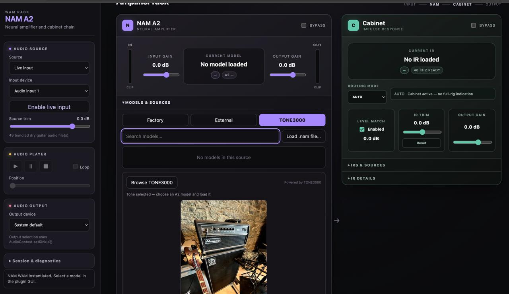

# Fretwork (NAM A2 WAM)

Fretwork is a browser-based guitar and bass rack with NAM A2 and WAM effects,
backing tracks in Play, and multitrack recording and instrument separation in Studio.

## Run locally

```sh
npm install
npm run setup
npm start
```

Open <http://127.0.0.1:8765/rack/>. Setup requires Node.js, CMake 3.20+,
a C++20 compiler and Emscripten. The [dev container](.devcontainer/) includes
these tools and Ruby. For accounts, shared projects, saved presets and deployment,
see the [Rails guide](web/README.md).

## Find the relevant code and documentation

| Area | Start here |
| --- | --- |
| Play, Studio and routing | [Host](examples/wam/main.js), [audio routing contract](docs/audio-routing.md), [Play Along](examples/wam/backing-track-player/README.md) |
| Recording and Undo/Redo | [Studio recording contract](RECORD_TRACKS_SPECIFICATION.md), [capture sources](examples/wam/projects/recording/) |
| Processed mix export | [Export contract](docs/PROCESSED_MIX_EXPORT.md) |
| Separation and tempo experiments | [Separation lab](examples/wam/source-separation/README.md), [tempo bench](examples/wam/projects/tempo/README.md) |
| NAM, Cabinet and bundled effects | [DSP and WAM sources](src/), [WAM integration](examples/wam/wamPlugins/HOW_TO_ADD_WAM_PLUGINS.md) |
| Factory assets and TONE3000 | [Maintainer guide](docs/FACTORY_LIBRARY.md), [TONE3000 configuration](examples/wam/config.js) |

The [compatibility lab](http://127.0.0.1:8765/rack/fx-test/) exercises plugins in isolation.

## Build and test

Run `npm run dist` to build the static distribution. Use `--include-research`
to include the standalone research lab. The ordinary build can run without
Direct WebNN exports. See the section below for native model preparation.

Run `npm test` for the JavaScript suite. Distribution checks expect a prepared
product dist. For a focused run, pass the relevant file to `node --test`.
Run `bin/rails test` from `web/` for Rails or use the
[system-test instructions](web/README.md) for browser flows.

<details>
<summary>Native DSP and WASM commands</summary>

### Native C++ build

```sh
cmake -S . -B build-native -DCMAKE_BUILD_TYPE=Release
cmake --build build-native -j 8
ctest --test-dir build-native --output-on-failure
```

The native executables are `build-native/nam_native` and `build-native/cabinet_native`.

### WASM build

```sh
emcmake cmake -S . -B build-wasm -DCMAKE_BUILD_TYPE=Release
cmake --build build-wasm -j 8
```

WASM artifacts are written to `build-wasm/dist/`.

To compare native and WASM rendering for a reference model:

```sh
build-native/nam_native render \
  third_party/NeuralAmpModelerCore/example_models/A2.nam \
  /tmp/nam-native.f32
node tests/wasm_test.mjs \
  third_party/NeuralAmpModelerCore/example_models/A2.nam \
  /tmp/nam-wasm.f32
python3 tests/compare.py /tmp/nam-native.f32 /tmp/nam-wasm.f32
```

</details>

## Direct WebNN build and release

Direct WebNN weights are **optional for the ordinary static build**. `npm run build`, `npm run dist` and `node tools/build-static-dist.mjs` work without the Git-ignored exports. Complete local exports are included automatically; absent/incomplete exports produce an availability index without weights and disable only the native **Direct WebNN** options in Studio. WebGPU, CPU/WASM and the separate ONNX→WebNN backend remain usable as supported by the browser. Model weights for those backends are downloaded explicitly through the model manager.

- `npm run dist -- --without-direct-webnn`: deliberately omit native exports, even if available locally.
- `npm run dist -- --require-direct-webnn`: release build requiring both complete pinned native exports; fails **before replacing the previous dist** if unavailable.
- For a CSS/UI-only rebuild using existing WASM/manifests: `node tools/build-static-dist.mjs --no-build --no-regenerate`.

To prepare native WebNN on a fresh checkout (explicit downloads, approximately 900 MB of generated constants afterwards):

```sh
npm run prepare:direct-webnn
python3.12 -m venv .venv-direct-webnn
. .venv-direct-webnn/bin/activate
python -m pip install onnx==1.20.0 onnxruntime==1.22.0 numpy
python tools/export-direct-webnn.py
npm run dist -- --require-direct-webnn
npm run test:direct-webnn:assets
```

`prepare:direct-webnn` retrieves the two pinned checkpoints from the URLs in `studio-models.json`, writes the exact paths expected by the exporter, and checks size/SHA-256 before installation. It reuses verified files, refuses to overwrite an existing mismatched checkpoint, and is **never run automatically by the build**. Generated graphs, index and weights must be deployed together. The browser still verifies hashes before inference. Existing checkpoint notices apply to converted constants; no new training is performed.

`web/bin/rack-sync` builds the distribution and copies it to Rails. If the local Ruby locale is US-ASCII, generate the template with `ruby -E UTF-8:UTF-8 web/lib/rack_view.rb`. Test the served rack at `http://localhost:3001/rack/`.

Generated source and distribution checks skip unavailable optional exports.
For a release with Direct WebNN, `npm run test:direct-webnn:assets` requires
all pinned assets. CI can also set `REQUIRE_DIRECT_WEBNN_ASSETS=1`.

## TONE3000 deployment

Add the exact deployed HTTPS callback URL to the allowed redirect URIs.
The public client ID and callback configuration live in
[`examples/wam/config.js`](examples/wam/config.js). Keep the client secret out
of browser code and the repository. See the [Factory guide](docs/FACTORY_LIBRARY.md)
for maintainer exports.

The previous feature walkthrough and phase notes are available in Git
with `git show 58338d7:README.md`.


