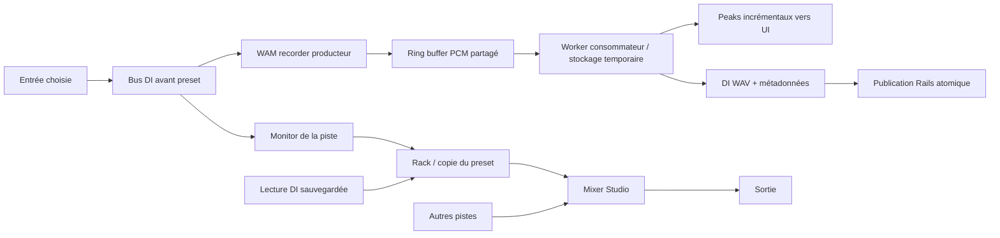
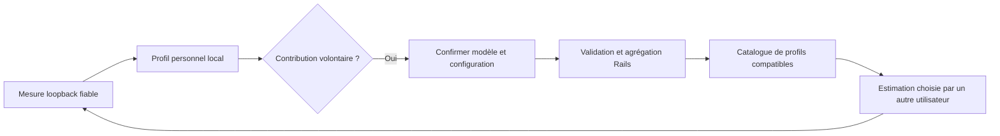
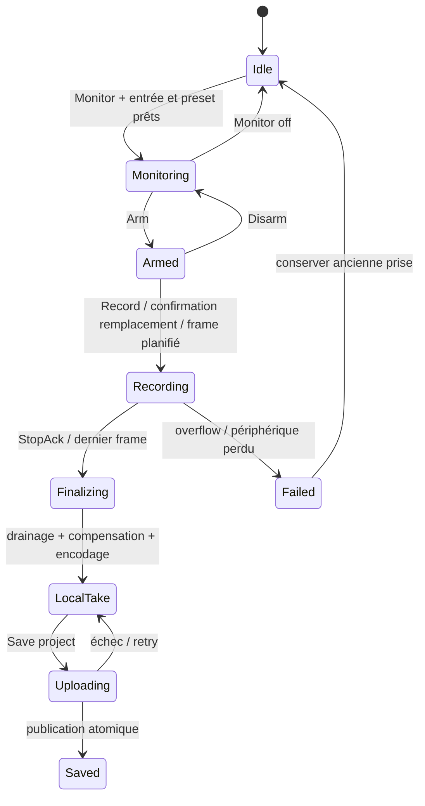

# Enregistrer une guitare ou une basse dans Studio

Mise à jour : 29 octobre 2026. **Implémenté sur `codex/studio-integration` : prise mono DI sur une piste personnelle vide et assistant de calibration aller-retour ; validation matérielle restante.**

Ergonomie corrigée : commandes regroupées dans le canvas Studio au-dessus des pistes (plus dans l’inspecteur hors écran), **R** directement sur les pistes personnelles et vumètres verticaux dans chaque en-tête de piste, tous types de pistes, niveau après volume/pan à 10 Hz. Le bouton **I** d’une piste vide initialise aussi le monitoring ; il n’est pas nécessaire de commencer à enregistrer pour écouter/voir son entrée. Réglage de compensation replié dans **Recording settings**. Tests : 481 JS passent après cette correction.

L’utilisateur ajoute une piste personnelle guitare/basse sans fichier, choisit son entrée/canal dans Tone, utilise **Enable input / monitor**, puis **R · Arm track**, **Record**, **Stop recording**. Sans preset de piste, le son courant de Tone est copié, même non sauvegardé ; **Use current Tone sound** permet de refaire cette copie avant la prise. Le monitoring reste indépendant de l’armement. Une seule piste est armée à la fois.

La capture WAM utilise le même AudioContext que les accompagnements, un timestamp commun en frames et un ring buffer SPSC de deux secondes vers un Worker. La DI mono est prélevée avant trim logiciel/effets ; le mix et le monitoring ne sont jamais réenregistrés. Le Worker publie des peaks compacts à 10 Hz et finalise uniquement après StopAck du producteur. Débordement, rupture de frames, perte/changement d’entrée et échec du processeur invalident la prise.

Après Stop, le WAV Float32 sans perte et le snapshot restent en RAM. **Save project** publie ensemble audio, métadonnées et snapshot sur une piste encore vide, avec contrôle de version, droits propriétaire, quotas et jeton de session idempotent. Un échec permet de réessayer les mêmes octets. **Discard unsaved take**, avec confirmation, rend la piste vide pour recommencer. Au maximum deux prises non sauvegardées ; 100 MiB par WAV, silence initial compris. Rechargement/abandon du projet perd les prises en RAM (avertissement).

**Limites explicites de cet incrément :** remplacement de pistes contenant déjà de l’audio désactivé ; undo/redo d’une prise et catalogue communautaire non implémentés. Assistant de calibration aller-retour désormais disponible, validé synthétiquement ; qualification matérielle restante. Compensation manuelle 0–2000 ms conservée, valeur initiale **14 ms** (estimation manuelle non mesurée, ajustable y compris à zéro) ; placement par padding/crop, une seule correction. La boucle n’est pas exécutée pendant une prise ; le transport continue au-delà de la fin des accompagnements. Les changements de transport/projet et la séparation sont bloqués pendant la capture/finalisation. Choix de preset d’une prise en RAM bloqué jusqu’à sa sauvegarde ; ensuite la lecture peut utiliser un autre preset sans réécrire la DI. Export de mix traité contenant ce preset encore bloqué, pour éviter d’exporter silencieusement la DI brute. Pas de régions, punch, overdub ou prise stéréo dans cet incrément.

Les exigences ci-dessous restent la cible complète ; les contrôles manuels ne constituent pas une mesure de latence matérielle.

## Décisions et périmètre

Un projet reste une liste nommée de pistes. Les pistes issues d’une séparation sont des accompagnements, sans preset associé. Une nouvelle piste personnelle de guitare/basse pourra recevoir une prise, en synchronisation avec les autres pistes.

Décisions confirmées par Michel :

- Conserver **la DI brute et une copie complète du preset**, pour changer le son après la prise.
- Sur une piste contenant déjà de l’audio, **demander confirmation avant remplacement**. Une annulation ou une prise échouée conserve l’ancien audio.
- Entendre son instrument traité avant d’enregistrer ; armer explicitement la piste avant Record.
- Aucune région, édition par découpage, prise en boucle ou gestion de plusieurs takes dans cette première version.

Hypothèses de première livraison : une seule piste armée à la fois, entrée mono sélectionnable, enregistrement depuis le playhead courant et jusqu’à Stop. Les pistes d’accompagnement continuent à jouer. Le compte propriétaire peut enregistrer ; le partage reste en lecture seule tant qu’un modèle de collaboration avec droits d’écriture n’a pas été spécifié.

## Analyse de wam-studio : code réellement consulté

Référence étudiée : [Brotherta/wam-studio](https://github.com/Brotherta/wam-studio), branche `main`, commit **`4c268f7b5791bcb11be3c1cf510b1a4a7728dd02`**. Cette analyse est statique : aucun test de boucle physique audio n’a été réalisé ici. Les comportements ci-dessous concernent cette révision, pas toutes les versions du DAW.

### Capture, armement et monitoring

[SampleRegionRecorder.ts](https://github.com/Brotherta/wam-studio/blob/4c268f7b5791bcb11be3c1cf510b1a4a7728dd02/public/src/Controllers/Recording/Recorders/SampleRegionRecorder.ts) construit splitter/merger à partir de `settingsController.soundInputNode`, puis un `SampleRecorderWAM`. La capture est branchée sur l’entrée, avant l’effet de piste. Le merger peut aussi être connecté au WAM destinataire pour écouter l’entrée. Les choix mono/stéréo et gauche/droite sont gérés par le routage.

[RegionRecorderManager.ts](https://github.com/Brotherta/wam-studio/blob/4c268f7b5791bcb11be3c1cf510b1a4a7728dd02/public/src/Controllers/Recording/Recorders/RegionRecorderManager.ts) conserve l’ensemble des recorders armés et connecte/déconnecte leur sortie de monitoring. [RecorderController.ts](https://github.com/Brotherta/wam-studio/blob/4c268f7b5791bcb11be3c1cf510b1a4a7728dd02/public/src/Controllers/Recording/RecorderController.ts) orchestre armement, monitoring, début et fin des prises. `startRecordingWith()` mémorise le playhead, crée une première région puis fusionne les ajouts à sa suite.

À reprendre : séparation entre capturer la DI et écouter la chaîne d’effets. À adapter : notre Studio n’aura ni région ni manager de recorders MIDI. Monitoring et armement seront deux états explicites ; il sera possible d’écouter avant d’armer.

### Transport PCM et waveform

[SampleRecorderProcessor.ts](https://github.com/Brotherta/wam-studio/blob/4c268f7b5791bcb11be3c1cf510b1a4a7728dd02/public/src/Audio/WAM/SampleRecorderProcessor.ts) intercale le PCM stéréo dans un tableau réutilisé de 256 valeurs pour les blocs de 128 frames, puis écrit dans un ring buffer SPSC partagé. Il détecte une écriture incomplète, mais se contente de journaliser le problème.

Le `SharedArrayBuffer` de `SampleRegionRecorder` a une capacité de `sampleRate * 2` valeurs Float32 : environ **une seconde stéréo**, et non deux secondes stéréo. Le [worker wav-writer.js](https://github.com/Brotherta/wam-studio/blob/4c268f7b5791bcb11be3c1cf510b1a4a7728dd02/public/src/Audio/Utils/wav-writer.js) vide la queue toutes les 100 ms. Toutes les 500 ms il envoie les nouveaux échantillons dans `audioBufferCurrentUpdated` et remet sa collection temporaire à zéro. `audioBufferFinal` contient le reliquat après drainage à l’arrêt : ce message n’est pas à lui seul la prise complète. Le main thread reconstruit des AudioBuffers, et le contrôleur assemble les ajouts en région.

À reprendre : AudioWorklet producteur → ring buffer → worker consommateur, indépendamment du rafraîchissement visuel. À améliorer : envoi de peaks incrémentaux plutôt que reconstruction de l’audio à chaque mise à jour ; blocs PCM transférables ; compteur d’overflow exploitable ; protocole Stop avec acquittement du producteur avant drainage final. Les commandes Stop séparées vers le worker et le processor ne constituent pas à elles seules cette garantie d’ordre.

### Mesure et compensation de latence

[LatencyProcessor.js](https://github.com/Brotherta/wam-studio/blob/4c268f7b5791bcb11be3c1cf510b1a4a7728dd02/public/src/Audio/LatencyProcessor.js) émet périodiquement une courte salve carrée de 64 frames, période de 16 frames, amplitude 0,8, puis détecte son retour au-dessus d’un seuil. Un historique circulaire local permet de rechercher le début du retour. Le délai est calculé en frames avec `currentFrame`, puis converti en secondes. Ce tampon d’analyse local n’est pas le ring buffer inter-thread de la capture. Le commentaire du code reconnaît que la détection devrait bénéficier d’une corrélation ; le code consulté n’en réalise pas une complète.

[LatencyController.ts](https://github.com/Brotherta/wam-studio/blob/4c268f7b5791bcb11be3c1cf510b1a4a7728dd02/public/src/Controllers/LatencyController.ts) crée un **autre AudioContext** de calibration, demande l’entrée et relie son worklet à la sortie. Il calcule `roundtripMs`, en soustrait `audioCtx.outputLatency * 1000` du contexte principal, affecte le résultat à `host.latency`, et le stocke sous `latency-compensation` dans localStorage. Le code prévoit aussi un réglage manuel. La valeur n’est pas indexée par configuration matérielle.

Dans `SampleRegionRecorder.start()`, `toIgnore` reçoit `host.latency`. Lors de la réception du PCM, le recorder supprime le début de l’audio, avec une conversion `toIgnore * sampleRate / 1000`. **Il ne déplace pas simplement la région finale après Stop** : la correction est appliquée lors de l’intégration des données.

Points à ne pas recopier sans validation :

- `toIgnore`, en millisecondes, est comparé à `audioBuffer.duration`, en secondes ; la branche qui ignore un buffer entier soustrait également des secondes à cette valeur. Cette incohérence peut fausser une compensation répartie sur plusieurs chunks.
- Soustraire la latence de sortie d’un autre contexte peut donner une estimation incohérente. Une valeur absente de `outputLatency` doit être gérée explicitement.
- Les commandes par `postMessage` ne fixent pas précisément le frame de début. La réception d’un message JS n’est pas une horloge musicale.
- La détection par seuil est sensible au bruit, au gain et au trajet acoustique. Une mesure unique ne permet pas d’annoncer une précision à l’échantillon.
- Les tailles 128/256 sont codées en dur ; le futur processor utilisera la taille effective des tableaux.

Ces observations sont des limites du code inspecté, pas des mesures de désynchronisation de l’application déployée.

## Parcours utilisateur proposé

1. Créer une piste personnelle guitare/basse, ou en sélectionner une existante. Le preset initial est une **copie de l’état courant de Tone**, y compris s’il n’a pas encore été sauvegardé.
2. Choisir l’entrée, activer Monitor et régler le niveau en jouant. Entendre uniquement la chaîne de cette piste, avec vumètre entrée/écrêtage.
3. Choisir un autre preset via un sélecteur simple ou « Edit in Tone ». Le retour retrouve le même projet et la même piste. Changer le preset ne modifie jamais la DI.
4. Armer la piste : bouton R distinct de Monitor. Afficher le preset et la calibration applicable. Désactiver Record tant que l’entrée, le rack et le recorder ne sont pas prêts.
5. Positionner le playhead puis Record. Si l’audio doit être remplacé, demander confirmation avec le nom de la piste, avant le départ. Pas de suppression anticipée.
6. Pendant la prise : écouter le backing et son instrument, afficher waveform, durée et vumètre. Le playhead suit l’horloge audio. La waveform représente la DI.
7. Stop : finaliser les derniers frames, appliquer une seule compensation, encoder hors UI, puis proposer/assurer la sauvegarde explicite. La lecture de la prise traverse la copie du preset.
8. Save project sauvegarde DI, snapshot et métadonnées. Recharger doit retrouver le même son ou signaler précisément une ressource manquante.

L’utilisateur doit distinguer « prise disponible localement » et « sauvegardée sur le serveur ». Une prise non envoyée est signalée avant navigation/rechargement. Un échec réseau offre Réessayer ou Exporter la DI, sans effacer l’ancienne version sauvegardée.

### Modification du son après une prise · implémenté le 29 octobre 2026

Le bouton **FX** de l’en-tête des pistes personnelles guitare/basse ouvre Tone dans le contexte explicite du projet et de la piste. Les accompagnements et stems séparés n’ont pas de preset. Le sélecteur permet de partir d’un preset existant ; sa sélection crée une copie propre à la piste et ne modifie pas le preset de bibliothèque. Les anciennes pistes liées à un preset restent compatibles ; aucune migration silencieuse de tous les projets n’est effectuée.

Pendant l’édition d’une DI existante, **Play project**, **Loop** et la barre de retour permettent d’écouter le projet avec le rack visible appliqué à cette piste. Les autres pistes conservent leurs propres racks. Le lecteur réutilise le même AudioBuffer DI ; le monitoring de l’entrée physique et le trajet Tone direct sont isolés pour cette audition. Sans audio sur la piste, Tone reste utilisable pour préparer son son et le monitoring peut être activé explicitement. Le rack Tone précédent, y compris ses modifications non sauvegardées, est restauré au retour.

**Précision utilisateur : le choix de destination se fait lors de la validation du son modifié dans Tone, pas à la fin d’une prise audio.** **Save project & return** (ou **Save project** dans le header Tone) ouvre un dialogue :

- **This project only** : sauvegarder le projet avec une copie indépendante du son de la piste ; choix par défaut.
- **Project + new reusable preset** : sauvegarder cette même copie dans le projet et créer un nouveau preset nommé dans la bibliothèque, sans écraser un preset existant.

Cette validation sauvegarde aussi les autres modifications en attente du projet. Le snapshot de lecture `presetSnapshot` est modifiable ; `recording.capturePresetSnapshot` reste la provenance immuable de la prise. Ni la DI, ni sa compensation temporelle, ni les pistes séparées ne sont réécrites. Cancel propose d’abandonner les modifications du son et revient au Studio. Les changements de snapshot participent à l’historique Studio existant.

Un échec de sauvegarde conserve l’éditeur ouvert et permet de réessayer. Le preset réutilisable est créé après la sauvegarde du projet ; un identifiant de requête côté Rails évite les doublons sur une réponse perdue. Les deux opérations ne sont pas une transaction serveur unique : si seul le projet a été sauvegardé, annuler ensuite conserve ce son déjà sauvegardé. Une prise encore en RAM doit d’abord être sauvegardée avant d’ouvrir FX ou de choisir une autre copie de preset. Une DI mono ne peut pas reproduire deux entrées physiques indépendantes ; choisir une chaîne ou un routage A→B.

Qualification : 11 tests unitaires du parcours FX, suite complète de 521 tests JavaScript et 138 tests Rails / 1194 assertions. Banc Chrome silencieux avec les vrais ProjectPlayer, TrackTones, ProjectTimeline et PresetsPanel et un rack GainNode synthétique : DI identique en mémoire, gain audible mesuré ×2, sélection du preset, sauvegardes projet seul et preset indépendant, restauration de Tone, aucune erreur console. Smoke test dans Rails : FX → Tone → dialogue → annulation, sans modifier les projets utilisateur. Cette qualification logicielle ne remplace pas un essai matériel guitare/interface.

## Architecture prévue

Réutiliser `ProjectPlayer`, le mixer et `TrackTones` : un AudioContext commun avec Tone et Studio, un transport de référence, pas un nouveau lecteur concurrent. La route Tone live doit être désactivée/transférée pendant le monitoring Studio pour éviter un doublage sec/traité. La capture reste avant les trims du preset ; les éventuels gains d’entrée matériels/digitaux sont documentés. Les gains de monitoring et du mix ne sont pas imprimés dans la DI.

Le matériel peut offrir un monitoring direct : indiquer de le couper si l’on veut entendre uniquement le preset logiciel. Aucun retour du mix ou du monitoring ne doit rentrer dans le bus DI.

### Contrat des données et threads

Préparer un `RecordingSession` propriétaire du cycle de vie, un WAM processor de capture et un worker dédiés. Ne pas réutiliser le ring buffer d’inférence : producteur, consommateur, format et durée de vie sont différents. Garder le principe [ringbuf.js de Paul Adenot](https://github.com/padenot/ringbuf.js/) : une queue a un seul producteur et un seul consommateur.

- PCM Float32 ; `sampleRate`, nombre de canaux et canal choisi explicites. La première version mono ne duplique pas inutilement la DI.
- Unité interne du temps : **frames entiers** à la fréquence effective du contexte. `currentFrame` donne le repère du worklet ; conversions ms/secondes limitées aux frontières UI/API. Voir la [spécification Web Audio](https://webaudio.github.io/web-audio-api/#AudioWorkletGlobalScope).
- Messages de contrôle versionnés : sessionId, trackId, startFrame, stopFrame, sequence, firstFrame, frames, statut final. Un message d’une ancienne session ne peut écrire dans un autre projet.
- Départ et fin planifiés à des frames communs à la lecture et à la capture, avec acquittement. Le worklet capture exactement l’intervalle accepté. Après StopAck, le worker draine jusqu’au dernier frame et publie une seule fin.
- Taille de queue proposée : deux secondes de PCM, calculée en **frames × canaux**, à qualifier sous charge. Mémoire allouée avant Record ; pas d’encodage, DOM, `fetch`, attente bloquante ou allocation par bloc dans le processor.
- Compteurs atomiques d’échantillons écrits/perdus, séquences et saturation. En cas de dépassement, invalider la prise et conserver l’ancienne ; ne pas compresser silencieusement le temps en sautant des échantillons.
- Worker : conserver le PCM par chunks, produire les peaks par fenêtres, envoyer seulement les nouveaux peaks à une cadence visuelle bornée (par exemple 10–20 Hz). Ne jamais retransmettre/reconstruire toute la prise à chaque update.
- RAM tant que raisonnable ; stockage temporaire local par blocs pour prises longues selon budget mémoire, avec échec de quota explicite. Pas d’upload sur le chemin temps réel. Encoder/finaliser dans le worker.
- `crossOriginIsolated`/SharedArrayBuffer vérifiés avant armement. Vérifier COOP/COEP et compatibilité des ressources WAM sur le déploiement Rails. Pas de fallback annoncé comme fiable sans qualification.
- Lecture et monitoring prioritaires : première version interdit une séparation en cours pendant Record. UI de sauvegarde, suppression, navigation, seek et changement de modèle/preset bloquée pendant la capture/finalisation ; arrêter proprement avant de changer de périphérique.

## Synchronisation et calibration

### Ce que l’on compense

Il faut différencier le retard physique du geste entendu, l’entrée ADC, la sortie DAC, le délai du graphe, et la position temporelle des données capturées. `baseLatency` ou `outputLatency` seuls ne décrivent pas le trajet aller-retour. Voir les définitions normatives de [latence dans Web Audio](https://webaudio.github.io/web-audio-api/#latency).

Pour notre contrat, une boucle matérielle entre sortie et entrée mesure un délai `D` entre un probe émis au frame `F` et son retour capturé au frame `F + D`. Cette mesure qualifie **ce routage et cette horloge**. On aligne les données DI sur le transport en retirant ce retard une fois, selon le protocole mesuré. Il faudra démontrer expérimentalement si le retard applicable est le RTL complet ou sa composante d’entrée pour le point d’horodatage retenu ; ne pas décider en soustrayant aveuglément une estimation navigateur. Une performance humaine ne se mesure pas comme un câble : le musicien peut anticiper le backing, ce que la compensation ne doit pas « corriger » automatiquement.

Contrat initial à qualifier : capture commençant au frame de départ du transport, restitution test en loopback et correction par `D` frames. Pour une capture brute d’index `k`, `projectFrame = startProjectFrame + k - compensationFrames`. Les frames avant zéro sont tronquées ; pour un départ plus tardif, padding silencieux jusqu’au placement corrigé. Ne pas appliquer en plus un décalage de lecture de la même valeur. Conserver le PCM de travail et les métadonnées nécessaires jusqu’à validation pour pouvoir corriger une estimation sans doubler le traitement.

### Assistant de mesure

Un écran avancé « Calibrate input latency » explique le câblage sortie → entrée et empêche une boucle de monitoring. Utiliser le **même AudioContext et le même chemin matériel** que la prise, bypass des effets non linéaires et de la réverbération ; signal bref à niveau modéré et fenêtre d’écoute bornée. Préférer corrélation d’une séquence connue plutôt que seuil seul, avec niveau de confiance et rejet du clipping/bruit/absence de retour.

Effectuer plusieurs probes, calculer médiane et dispersion, afficher RTL en frames et ms, correction appliquée, configuration et date. Une estimation variable n’est pas présentée comme calibrée. Permettre un réglage manuel (y compris zéro), avec statut « manuel / non mesuré ». La valeur initiale et le bouton « Reset to 14 ms » utilisent 14 ms comme estimation ; un changement de matériel/routage rétablit cette estimation. Une mesure appliquée explicitement la remplace. Sans câble, ne pas annoncer une mesure exacte de l’interface : l’acoustique ajoute propagation et réflexions.

Indexer le profil local par périphérique entrée, sortie quand identifiable, sampleRate, canaux, navigateur/version pertinente et configuration du contexte. Invalider/revalider sur changement matériel, fréquence ou routage. Déconnexion : arrêter, finaliser ou signaler l’échec sans écraser l’ancienne piste. Le profil personnel mesuré reste prioritaire ; les estimations communautaires décrites ci-dessous ne sont pas une calibration universelle.

La latence du preset est séparée : la DI étant enregistrée avant le rack, ne pas imprimer son retard dans la compensation de capture. Si un effet ajoute du délai, qualifier le playback/monitoring et l’éventuelle compensation du mixer. Copier le preset ne garantit pas que tous les WAM exposent correctement leur latence. Une première qualification utilisera une interface filaire ; Bluetooth ne reçoit pas de garantie de synchronisation stable.

### Identification de la carte son et calibration communautaire [SPECIFIED / NOT IMPLEMENTED]

Après une mesure fiable, proposer **« Contribuer cette calibration »**, sans conditionner l’enregistrement à cette contribution. Présenter la mesure, son contexte et les champs à publier avant validation. Demander marque, modèle, génération et référence ; exemple de saisie : « Focusrite Scarlett 2i2, 2e génération — compensation 11 ms ». **11 ms est un exemple, pas une mesure ni une valeur recommandée pour cette carte.**

#### Ce que permet le navigateur

`MediaDeviceInfo.label` peut aider à préremplir le modèle après autorisation de capture, mais son contenu n’est pas normalisé et peut être vide. La spécification interdit de présumer qu’il contient un modèle précis. `deviceId` identifie un périphérique dans le contexte de l’origine, peut changer et n’est pas une référence constructeur ; `groupId` aide à grouper des périphériques dans un document. Il n’existe pas de champ standard marque/modèle/génération dans cette interface. Identifier l’entrée réellement ouverte via `MediaStreamTrack.getSettings().deviceId`, puis proposer son libellé localement, avec confirmation manuelle. Un périphérique « default », virtuel ou ambigu exige un choix explicite. Sources : [MediaDeviceInfo.label](https://w3c.github.io/mediacapture-main/#dom-mediadeviceinfo-label), [deviceId](https://w3c.github.io/mediacapture-main/#dom-mediadeviceinfo-deviceid), [exposition des informations](https://w3c.github.io/mediacapture-main/#device-information-exposure).

Ne pas ajouter de sondage matériel pour contourner ces protections. Associer localement le périphérique courant au modèle confirmé ; ne jamais utiliser les identifiants navigateur comme clés publiques du catalogue.

#### Une mesure dépend de sa configuration

Une seule valeur par carte serait trompeuse. Chaque contribution contient :

- modèle canonique et génération de l’interface d’entrée, sortie utilisée (qui peut être différente), routage et canaux ;
- plateforme, famille/version du navigateur, fréquence effective du contexte, options de latence demandées et effectives lorsqu’exposées, traitements d’entrée activés ;
- pilote et taille de buffer uniquement s’ils sont connus et déclarés, sinon « inconnus » : ne pas les déduire du navigateur ;
- version du protocole et de l’application, date, nombre de probes, médiane, dispersion et confiance ;
- RTL mesuré **et** correction appliquée, chacun en frames et ms, avec fréquence et `compensationKind` explicitant le point d’horodatage. Ne pas mélanger retard d’entrée, aller-retour et retard du preset.

Les valeurs Web Audio de latence ne constituent pas à elles seules une identification ou une calibration matérielle : voir [Web Audio — latency](https://webaudio.github.io/web-audio-api/#latency). Le protocole physique décrit plus haut reste nécessaire pour qualifier l’alignement.

#### Réutilisation et confidentialité

Dans l’assistant, permettre de choisir son interface dans un catalogue avec alias, génération et option « autre / modèle inconnu ». Présenter une **estimation communautaire compatible** : médiane, dispersion, nombre de contributeurs distincts, date et configuration. Une mesure personnelle valide prévaut ; sinon l’utilisateur peut appliquer explicitement cette estimation ou faire une calibration. Afficher « estimation communautaire », sans promettre un alignement à l’échantillon. Un changement d’entrée, sortie, fréquence ou routage invalide/requalifie le profil. Exclure des agrégats les configurations incompatibles et les protocoles de compensation différents.

Ne publier ni audio de calibration, ni libellé matériel brut, ni deviceId/groupId, numéro de série ou identité personnelle. Le libellé peut contenir des informations privées : l’analyser localement puis envoyer uniquement les champs autorisés confirmés. Contribution facultative, liée au compte côté serveur, modifiable/supprimable par son auteur ; seules les statistiques agrégées sont publiques. Limiter les contributions répétées par utilisateur/configuration, distinguer répétitions de probes et contributeurs indépendants, modérer les alias et valeurs aberrantes. Une contribution ne devient pas « vérifiée » par son simple envoi.

Préparer côté Rails un catalogue `AudioInterfaceModel`, des `LatencyContribution` et agrégats recalculables (noms indicatifs), recherche publique et consultation filtrée, création authentifiée avec CSRF, modification/suppression limitée à l’auteur. Valider unités, bornes et protocole côté serveur, limiter le débit et les champs acceptés. Aucun de ces endpoints n’est implémenté ici.

Tests à prévoir : permissions refusées/libellés absents, entrée réelle différente du périphérique par défaut, alias et générations ambiguës, identifiants renouvelés, unités et protocole de compensation, filtrage des configurations, priorité du profil personnel, valeurs aberrantes et faux doublons, retrait d’une contribution et recalcul, contrôle d’accès, absence d’identifiants privés dans les payloads et agrégats. Valider ensuite sur plusieurs interfaces physiques ; aucun résultat matériel n’est revendiqué à ce stade.

## Undo / Redo et rétention des prises

Voir [UNDO_REDO_SPECIFICATION.md](UNDO_REDO_SPECIFICATION.md). Le mécanisme de session Studio est implémenté : 30 commandes au maximum, dont deux opérations audio. Le raccordement de la prise et les limites de récupération côté serveur restent à implémenter. Le remplacement confirmé d’une prise formera une commande unique après publication réussie : ancienne/nouvelle DI, snapshots et placement. Undo restaure une version déjà compensée sans appliquer une seconde correction ; Redo ne relance pas la capture. Ne pas garder toutes les anciennes prises ni supprimer leur audio tant qu’une référence courante ou une récupération valide en dépend. Les limites sont proposées, pas encore confirmées par l’utilisateur.

## Persistance Rails et preset

Modèle futur : audio DI sans perte, snapshot immuable du preset de la prise, métadonnées de session. Le snapshot doit inclure ordre/état des WAM, paramètres, versions et identifiants des ressources NAM/IR, plus les ressources privées ou leurs références persistantes avec droits d’accès. Une simple clé vers un preset modifiable ne suffit pas. Changer le son après prise crée/met à jour l’état de lecture de la piste sans réécrire la DI ni perdre la provenance de capture.

Champs proposés à préciser lors de l’implémentation : `recordingId`, `version`, `sampleRate`, `channels`, `frames`, `startProjectFrame`, `compensationFrames`, `calibrationProfileId`, `measuredRoundTripFrames`, `presetSnapshot`, `capturePresetSnapshot`, checksum DI et état de publication. Le snapshot de capture est immuable ; le snapshot utilisé pour la lecture peut évoluer. Éviter d’exposer les IDs matériels dans les projets partagés.

Une piste = un fichier audio plein démarrant au zéro du projet ; le padding matérialise un départ plus tardif. Le remplacement remplace **toute** la prise précédente, même si la nouvelle est plus courte : pas de conservation implicite de la fin ancienne. Le délai du snapshot peut évoluer sans devenir une région.

API future de publication en staging avec token idempotent : upload et validation de la DI + snapshot, puis publication atomique avec version attendue de piste. L’ancien blob n’est purgé qu’après publication réussie et politique de rétention ; conflit multi-onglets = demande explicite, jamais écrasement silencieux. Un cancel/erreur conserve l’ancienne prise. Droits propriétaire, CSRF, validation formats/durées/quota, nettoyage du staging et restrictions de partage comme les pistes actuelles. L’upload commence après la capture, indépendamment du rafraîchissement de la waveform.

Le MP3 reste pertinent pour **Use mix in Tone**, pas pour la DI d’édition : délai d’encodeur et pertes exigeraient une qualification supplémentaire. Le premier enregistrement sauvegardera un WAV sans perte. L’export du mix traité par les presets devra être qualifié avant d’être activé : le code actuel refuse justement un export DI qui prétendrait contenir un rendu WAM.

## États et interactions

Monitor peut rester actif après Stop, sans laisser le recorder écrire. Arm n’est pas persisté comme une autorisation de rouvrir le micro au rechargement. Le navigateur demande l’accès uniquement suite à une action utilisateur. Quitter Studio arrête/libère les ressources de capture selon la route de monitoring choisie ; aucun accès micro fantôme.

## Tâches incrémentales à venir

| Étape | Livraison | Validation avant essai utilisateur |
|---|---|---|
| R1 · PARTIEL | DI + snapshot et publication sur piste vide implémentés ; remplacement confirmé à venir | snapshot indépendant de Tone, ressources privées, autorisations et publication atomique |
| R2 · PARTIEL | Monitoring/armement/preset et entrée partagée Tone implémentés ; qualification matérielle restante | absence de doublage et de recapture du mix ; écoute du preset courant non sauvegardé |
| R3 · IMPLÉMENTÉ, VALIDATION SYNTHÉTIQUE | Capture WAM/ring buffer/worker, waveform incrémentale et StopAck | ordre, conservation exacte du PCM, débordement visible, fermeture propre |
| R4 · IMPLÉMENTÉ, VALIDATION MATÉRIELLE RESTANTE | Transport commun, assistant loopback et compensation mesurée ; profils locaux | alignement synthétique puis matériel, unités et dérive longue |
| R4b | Catalogue matériel, contribution volontaire et profils communautaires | permissions, confidentialité, compatibilité des configurations, agrégats et validation sur interfaces réelles |
| R5 · PARTIEL | Lecture/édition du son avec FX→Tone et copie de preset implémentées ; remplacement audio et undo des prises à venir | DI/provenance conservées, sauvegarde du son et preset indépendant, retries ; remplacement et qualification matérielle restent à valider |
| R6 | Qualification de performance et export traité vers Tone | plusieurs accompagnements, rack NAM, UI fluide, rendu preset réellement présent |

Chaque étape nécessite ses tests automatisés avant de demander un essai. Les tests de calibration matérielle complètent les tests unitaires ; ils ne peuvent pas être remplacés par des mocks de `outputLatency`.

## Plan de tests et critères d’acceptation

- Unités : conversion ms↔frames, arrondis à 44,1/48/96 kHz, compensation traversant plusieurs chunks, départ zéro/non-zéro, fins exactes et aucune double compensation.
- PCM : mono/stéréo et ordre des canaux, durée égale aux frames acquittés, ring wrap, fin partielle, Stop avant premier bloc, suites de prises sans reliquat, overflow provoqué.
- Horloge : retard synthétique connu corrigé à ±1 frame ; produire des probes en début/milieu/fin. Une tâche UI artificiellement longue ne modifie pas le placement audio.
- Matériel : boucle filaire avec signaux connus, au moins cinq mesures par configuration, médiane/dispersion et résidu publiés. Objectif initial résidu ≤2 ms sur matériel validé, sans le confondre avec une garantie universelle à l’échantillon. Répéter sur prise de dix minutes pour mesurer la dérive ; si elle est significative, ne pas masquer le problème par une correction fixe.
- Son : DI identique indépendamment du preset de monitoring ; changer le preset change la lecture, jamais la DI. Aucun doubling, larsen logiciel, backing ou effets imprimés dans la capture.
- UI : monitor avant arm, Record réellement désactivé pendant préparation, confirmation remplaçable/annulable, waveform append-only, boutons clavier accessibles, erreur audio lisible, aucune publication d’une session périmée.
- Serveur : propriétaire/partage/CSRF, formats et quotas, retries idempotents, conflits de version, maintien de l’ancien blob pendant échec/cancel, réouverture du même projet/preset.
- Performance : long backing + rack de guitare + waveform ; journaliser frames perdus, mémoire, temps de finalisation et longs blocages UI. La queue n’est pas une solution aux DSP trop coûteux : surveiller aussi les underruns de rendu et la charge des WAM.

Validation du premier incrément (28 octobre 2026) : **479 tests JavaScript et 134 tests Rails / 1123 assertions passent**, sans échec ni test ignoré. tests JS dédiés pour conservation des échantillons, quanta variables, absence de trous, débordement, padding/crop, limites mémoire, final drain/StopAck, transport commun et sauvegarde réessayable ; tests Rails pour publication/rechargement, version obsolète, données invalides, droits, idempotence et panne de stockage. Banc navigateur : `tests/phase7/fixtures/recording-capture.html`, entrée purement synthétique, aucune demande de microphone ; Chrome a capturé 24 032 frames avec une erreur maximale nulle, six mises à jour de waveform et un WAV de 99 212 octets (padding de 760 frames inclus). Cycle réel `StudioRecording` avec entrée synthétique également validé : monitoring → armement → capture → Stop, 24 287 frames, prise en RAM, ancienne piste sauvegardée toujours vide et transport déverrouillé. Création d’un projet et d’une piste vide vérifiée dans le Studio Rails.

Aucune calibration matérielle, session guitare réelle, endurance longue durée ou validation perceptuelle de la latence n’est revendiquée. Les parties restantes de R1/R2 et R4–R6, dont R4b communautaire, restent à réaliser.

Correction après essai utilisateur (28 octobre 2026) : le rendu de waveform en cours de capture accepte une piste sans fichier audio (nom provisoire « Recording DI… »). Test navigateur renforcé avec le vrai ProjectTimeline/Wavesurfer, et non un stub : peaks non nuls pendant la capture, 24 288 frames, crête 0,125, WAV décodé, lecture démarrée après Stop, aucune erreur console. Le bouton de transport **▶ Play** est explicite ; après Stop, la position revient au début de la prise pour l’écouter. Une prise silencieuse déclenche un avertissement ; le statut de prise en RAM indique sa crête dBFS. L’ancien vumètre global est remplacé par les vumètres verticaux de toutes les pistes, y compris accompagnements et stems en preview.

Validation finale de la correction : 481 tests JS passent ; banc navigateur avec vrai rendu, WAV décodé et vu-mètre natif en lecture (`liveWaveform`, `playReady`, `playing`, `metered` tous vrais ; signal synthétique de crête 0,125). Distribution et hôte Rails synchronisés.

Correction lecture/armement après séparation arrêtée (28 octobre 2026) : pendant **Play**, la piste lit son audio enregistré et son vumètre ne reçoit plus l’entrée live. Le monitoring de piste reprend en pause et reste actif pendant une vraie capture. Après **Stop separation**, **Keep instruments & arm** conserve les instruments partiels comme pistes du projet via la sauvegarde existante, puis arme la nouvelle guitare ; la sélection et la piste personnelle sont préservées. Si la sauvegarde échoue, pas d’armement et résultat partiel conservé en RAM pour réessayer. Sans échantillon séparé, conserver les pistes originales. Le départ de capture attend le décodage des accompagnements.

Validation : 486 tests JS et 135 tests Rails /1136 assertions passent. Test navigateur avec entrée live synthétique à0,75 et fichier enregistré à0,125 : vumètre avant Play -5,509dBFS et pendant Play -21,072dBFS, isolation de l’entrée confirmée, waveform/lecture valides. Test Rails de publication de séparation partielle puis enregistrement de la guitare, instruments conservés.

Correction des mises à jour en capture (28 octobre 2026) : le Worker ne transmet que les bins de peaks nouveaux ou modifiés (1024 frames/bin, dernier bin partiel inclus), environ 10 fois par seconde. Un canvas par tuile conserve les pixels précédents et ne redessine que les colonnes concernées, sans normalisation globale ni reconstruction Wavesurfer pendant la capture. Un changement de largeur/échelle temporelle nécessite légitimement un nouveau rendu de l’enveloppe ; Stop effectue une seule transition vers le rendu statique.

Le WAV Float32 se construit par paquets encodés au fil du drainage du ring buffer. Chaque échantillon conservé est encodé une fois ; padding/crop appliqués une fois, peaks calculés dans la même passe. Stop assemble l’en-tête et les Blob immuables sans concaténer/reparcourir tout le PCM. Des copies bornées restent nécessaires pour vider la queue et encoder les paquets ; le navigateur gère le stockage des Blob. Aucun AudioBuffer croissant n’est reconstruit pendant la capture : un décodage complet intervient après Stop pour la lecture, et le changement d’URL lors de Save project réutilise ce buffer (ou son décodage déjà en cours).

Validation : **490 tests JavaScript passent**. Chrome : 22 paquets de waveform, canvas stable, aucun rendu Wavesurfer pendant la capture ; fidélité WAV vérifiée indépendamment, 24 031 frames encodées pour 24 031 capturées, erreur maximale nulle. Les tests couvrent les colonnes sales, les paquets PCM, padding/crop, absence de rescans à Stop et réutilisation du buffer à la sauvegarde. Aucune qualification matérielle supplémentaire revendiquée.

Priorité R4 du 29 octobre : assistant de calibration désormais implémenté et validé synthétiquement (détails ci-dessous). Le prochain contrôle de R4 porte sur une boucle matérielle réelle. Le catalogue communautaire R4b reste une étape ultérieure. Le tuner utilise un tap mono partagé de SourceManager ; createDITap conserve le canal A sélectionné pour l’enregistrement et reste indépendant du choix A/B du tuner.

## R4 — Assistant de calibration implémenté le 29 octobre 2026

Dans Studio, sélectionner une piste personnelle guitare/basse puis ouvrir **Recording settings** (inutile d’activer le monitoring pour calibrer). Choisir **Calibration output** (sortie gauche 1 ou droite 2) et **Calibrate input latency**. L’entrée est le canal déjà choisi dans Tone, également utilisé par la DI ; aucun choix silencieux d’une autre entrée.

L’ouverture de l’assistant met en pause les lecteurs, déconnecte physiquement les routes micro vers A/B et les sorties Tone/Studio vers les haut-parleurs avant l’activation de l’entrée et le branchement du câble. Le monitoring reste coupé pendant tout l’assistant, y compris entre les mesures et après le résultat. Après branchement physique sortie choisie → entrée choisie, confirmer que le monitoring direct matériel et les enceintes sont coupés, puis **Measure**. Fermer/annuler arrête les sources programmées, libère worklet/worker/tap, désactive l’entrée live, puis rétablit les sorties : retirer le câble avant de réactiver l’entrée. Les transports ne redémarrent pas automatiquement. Aucun effet du preset ni signal d’entrée n’est envoyé dans le probe.

Protocole `loopback-correlation-v1` : cinq signaux pseudo-aléatoires bipolaires lissés de crête normalisée 0,126 (−18 dBFS par défaut ; niveau réglable de −30 à −6 dBFS), puis un sixième indépendant de la médiane pour vérifier le résidu. AudioBufferSources et capture AudioWorklet sont planifiés sur les mêmes frames du même AudioContext ; fenêtre de recherche bornée à 750 ms. Le worklet préalloue six fenêtres, produit seulement du silence et transfère chaque fenêtre une fois vers le Worker via le main thread. La corrélation normalisée FFT, l’analyse et les agrégats restent hors UI. Zéro seuil de déclenchement seul : un signal inversé ou atténué reste mesurable.

Rejets : clipping ≥0,98, absence de retour, valeurs non finies, corrélation <0,65, ambiguïté entre pics, SNR <8 dB, moins de quatre probes valides parmi les cinq, sixième probe invalide, dispersion >max(3 frames, 1 ms) ou résidu indépendant >max(2 frames, 0,5 ms). Interruption de frames, disparition de l’entrée, changement de source/sortie, échec worklet/worker, délai dépassé ou annulation invalident la mesure. Les seuils sont des critères logiciels initiaux, pas une garantie de précision physique.

Le résultat expose frames/ms, dispersion, confiance et résidu. **Apply compensation** est explicite. La correction appliquée vaut la médiane aller-retour entière ; aucune soustraction de `baseLatency`/`outputLatency` et aucun second décalage de lecture. Les prises existantes ne sont pas déplacées. Les métadonnées d’une nouvelle prise indiquent `calibration: loopback` et `calibrationDetails` ; Rails vérifie le protocole, la cohérence avec `compensationFrames`, les bornes et les clés autorisées avant publication. Il s’agit d’une provenance déclarée par le client, pas d’une certification matérielle du serveur.

Douze profils maximum dans le stockage local du navigateur, sans audio de probe. Clé : identifiant local d’entrée, canal, sortie/sink, canal de sortie, fréquence, baseLatency en frames, navigateur et traitements d’entrée exposés. Les identifiants matériels locaux ne sont pas envoyés avec les prises. Après une mesure explicitement appliquée, réactiver la même configuration restaure cette correction ; un changement l’invalide. Après rechargement, **Use saved calibration** nécessite une confirmation par clic. Vérifier aussi manuellement le buffer/pilote et le périphérique derrière « default » : le navigateur ne permet pas toujours d’observer leur changement. Une saisie manuelle ou Reset enlève le statut mesuré. Le catalogue communautaire R4b reste à faire.

Validation : **504 tests JS et 136 tests Rails /1165 assertions passent**. Nouveau fichier `tests/phase7/recording-latency.test.mjs` : délais, gains/polarités, bruit/echo/clipping, fréquences, stabilité, sixième probe indépendant, capture aux frames, silence en sortie du processor, arrêt, ordre du Worker, profils bornés et invalidation, placement compensé exact. Banc Chrome `tests/phase7/fixtures/recording-latency.html` : véritable DelayNode à11ms, worklet/Worker de mesure puis WAM/ring buffer d’enregistrement ; **528 frames mesurées à48kHz, dispersion/résidu zéro, erreur maximale du WAV compensé nulle**. Parcours UI Mesurer → Appliquer → Fermer → Réactiver vérifié, de même que l’annulation. Aucun microphone ou projet utilisateur modifié.

**Reste à qualifier sur matériel réel** : boucle filaire, plusieurs interfaces/buffers/fréquences, round trip physique et placement d’une prise loopback, stabilité sous charge et dérive longue. Le banc synthétique démontre l’horloge et la correction logicielle ; il ne prouve pas la précision ADC/DAC, le jeu humain ou la latence d’un preset WAM. Référence normative consultée : [Web Audio — latency](https://webaudio.github.io/web-audio-api/#latency).

### Correction après retour utilisateur — isolation et test acoustique (29 octobre)

Le test micro/haut-parleurs internes a échoué et l’utilisateur a signalé du larsen avec les effets Tone. L’ancien garde agissait sur les gains de sortie seulement : les entrées continuaient d’alimenter les effets. Correction : `SourceManager.suspendMonitoring()` retire les connexions du splitter vers le trim A et l’entrée B, sans retirer les taps d’analyse ; `CalibrationAudioGuard` retire aussi les connexions physiques Tone/Studio → destination. Les callbacks de routage, les changements de gains et la création d’une nouvelle entrée ne peuvent rétablir ces branches tant que le garde est actif. Les instances/presets ne sont ni supprimés ni réécrits. Fermer/annuler désactive l’entrée avant de libérer le garde. Un échec de fermeture de l’entrée laisse les sorties déconnectées.

**Calibrate input latency** peut maintenant être ouvert directement, sans **Enable input / monitor** préalable : le garde est installé avant la demande d’entrée. Les instructions de câblage sont affichées après l’ouverture de cette entrée isolée. Le mode câble reste strict. Le niveau était trop discret pour certains usages : crête désormais normalisée et réglable, défaut −18 dBFS (environ 10 dB au-dessus de l’ancien code), bornes −30 à −6 ; aucune augmentation automatique. Les rejets détaillent dBFS reçu, SNR et corrélation.

Option **Speakers → microphone · acoustic test**, protocole `acoustic-chirp-v1` : chirps logarithmiques 600–4500 Hz (borne adaptée à sampleRate), 80 ms, captures et corrélations dans le même pipeline. Critères propres au test acoustique : corrélation ≥0,30, ratio des pics ≥1,15, SNR ≥6 dB, dispersion ≤max(3 frames,2 ms), sixième vérification ≤max(2 frames,1 ms). Aucun relâchement des critères du protocole câble. Ce mode estime le trajet complet haut-parleur, pièce et micro ; une réflexion dominante peut décaler l’estimation. Le résultat est affiché comme **Acoustic estimate**, conservé dans un profil séparé du mode câble et appliqué aux prises uniquement sous le statut existant **manual**, sans revendication de calibration filaire. Le niveau d’émission n’est pas une mesure du volume acoustique des enceintes.

Validation logicielle : **510 tests JS passent** (16 dédiés à la latence), dont isolation A/B avec tap DI conservé, activation d’un nouveau périphérique sous garde, fermeture en échec, estimation sur retour coloré avec échos, bornes du signal et séparation des profils/provenances. Rails inchangé pour cette correction (136 tests /1165 assertions validés pour R4). Chrome : garde réellement partagé avec main.js, deux routes amplifiées ×1000, niveau avant garde3, maximum pendant les six mesures0, gains conservés, entrée désactivée avant restauration. Retour acoustique simulé : 530 frames (11,04 ms), confiance93%, dispersion/résidu0, résultat réutilisé comme compensation manuelle. Le test câble à528 frames et l’alignement exact du WAV continuent de passer. Aucun essai sur le micro/les haut-parleurs réels du Mac n’a été effectué par l’agent ; l’essai utilisateur reste nécessaire pour qualifier ce trajet.

Le démarrage attend désormais l’acquittement du processeur de capture avant de programmer les probes. Les interruptions de rendu avant le frame de début prévu (phase d’attente de l’AudioContext) ne sont pas considérées comme de l’audio perdu ; les trous après le début réel restent une erreur. Un test de régression vérifie cette distinction et la réutilisation des fenêtres préallouées.
