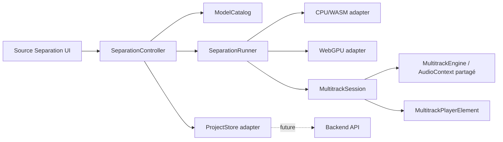

# Prototype de séparation de sources et lecteur multipiste

## État d’implémentation — 20 octobre 2026

- **[CURRENT] Workflow et lecteur unifié compact (P1 à P3 terminés) :** piste originale → bouton « Separate instruments » → pistes séparées, puis bascule réversible vers une ligne « Mix ». Parité avec le lecteur de backing track du host (volume/pan, balance guitare/backing, boucle et normalisation audio), densité verticale améliorée. Évaluer WaveSurfer et son module multitrack ; conserver une horloge et un routage audio uniques. Voir § 6.1, découpage et critères de validation. P1 à P3 sont implémentés dans le prototype ; P4.1 et P4.2 sont livrés ; P4.3 et P4.4 restent à faire.


- **[DONE] Phase 3 — premier backend WebGPU :** nouveau modèle ONNX 4 pistes distinct de 6s/FT, poids versionnés et vérifiés, ONNX Runtime Web 1.22.0 local. Pipeline hybride, FFT JavaScript corrigée/testée. Fenêtres 7,8 s / recouvrement 1,95 s, lecteur progressif existant, choix explicite CPU/GPU, repli CPU visible avant publication du premier bloc uniquement. Annulation, erreurs de données et blocs tardifs ne déclenchent pas de repli. Profilage : 3 244 kernels GPU observés. Comparaison mêmes poids, même extrait 13,65 s : GPU 5,83 s / CPU 22,51 s, RMS relatif 0,051 %. Test lecteur 30 s : 11,9 s GPU. Poids ONNX indiqués personnel/recherche par le fournisseur ; crédits/licence visibles. 6s et FT restent CPU.
- **[DONE] Validation GPU sur un mix multi-instruments stéréo :** exemple musical CC BY 3.0 fourni, diagnostic reproductible GPU/CPU sur les mêmes poids quatre pistes, huit canaux finis et stéréo conservée. Chrome / Apple Metal 3 : 10,88 s d’audio, GPU 15,85 s, CPU 71,45 s ; RMS relatif 0,077 %. Ce test ne mesure pas la qualité avec des stems de référence et ne garantit pas le temps réel. Mesures brutes et crédits dans le prototype.
- **[CURRENT] Étendre la validation GPU :** autres machines/navigateurs et comparaison UVR ; conversion 6s/FT compatible GPU à valider. Le diagnostic 6s termine désormais après extraction du réseau (3658 nœuds contre 24819) et reconstruction JS : douze canaux finis, 1856 kernels GPU observés. Le vrai mix présente toutefois 7,317 % d’écart RMS avec le CPU ; un spectrogramme CPU ne résout pas cette dérive réseau. Pas d’activation dans le catalogue avant correction. Voir `SIX_STEMS_GPU.md`.


- **[DONE] Lecture progressive initiale (6s)** : fenêtres de 5 s, recouvrement commun de 1 s, premier bloc publié de 4 s. Un seul modèle chargé par traitement. Play disponible avant la fin, disponibilité cumulative et formes d’onde progressives, pause/reprise automatique sur manque de données. Seek borné à la zone prête ; boucle intégrale après calcul complet. Annulation conserve les blocs prêts et invalide les messages tardifs. Extraits de 30/60 s proposés uniquement pour 6s progressif. FT/classique restent à 10 s. Pas de promesse de temps réel CPU ni de morceau entier.


- **[DONE] Suivi événementiel par piste :** indicateur de chargement du modèle stabilisé après le premier chargement, sans remise en animation pour chaque spécialiste FT et sans polling d’état. Réinitialisation lors du changement d’identité/version du modèle. Le choix d’un autre fichier avec le même modèle disponible n’entraîne pas de nouvelle vérification du cache. La progression affiche le numéro, le nom réel et la fin de chaque piste FT, avec historique visible. Pour 6s, le calcul est conjoint et les fins des six pistes sont annoncées seulement après réception du résultat.

- **[DONE] État du modèle sélectionné :** panneau visible dans la préparation, bouton de téléchargement avec taille, progression reçue/totale en pourcentage, annulation et lien licence. États distincts catalogue/cache, modèle absent, téléchargement, vérification, enregistrement, disponible, chargement en mémoire, inférence et erreur. La présence en cache ne signifie pas que le moteur est déjà chargé en RAM. Audio et modèle ont des statuts séparés ; « Séparer » ne s’active que lorsque les deux sont prêts. Le panneau et le gestionnaire partagent le même téléchargement et ses événements.

- **[DONE] Diagnostic de démarrage :** l’ouverture directe en `file://` affiche un message et le lien HTTP avant tout import de module ; les commandes inutilisables sont masquées. Sous HTTP(S), une aide indique pourquoi la séparation est désactivée (catalogue, modèle non installé, absence de fichier, décodage ou erreur). Les échecs de chargement des modules sont visibles. Le cache reste propre à l’origine choisie.

- **[DONE] Phase 1 — lecteur de base :** buffers audio réels, départ synchronisé, lecture/pause/stop/seek, boucle complète, mute/solo, volume/pan, formes d’onde PCM et zoom. L’import local décode à 44,1 kHz. Le redesign et la boucle A/B restent à venir.
- **[DONE] Phase 2b — premier modèle réel :** poids ORT compressés de `htdemucs_6s` et `htdemucs_ft`, épinglés par révision et SHA-256. Moteur WASM SIMD dans un Worker, annulable. FT sélectionne les sorties correspondantes de ses quatre spécialistes dans quatre Workers successifs, terminés chacun avant le suivant.
- **[CURRENT] Phase 2 — mesures :** premier test navigateur réussi sur les deux modèles (signal 1 s) et sur le fichier CleanChords.mp3 du projet. Extraits limités au début du fichier : 1, 5 ou 10 s en classique, jusqu’à 60 s en progressif 6s, fichier de 32 Mio maximum. Mémoire WASM observée : plus de 2 Gio. La comparaison musicale et numérique avec UVR reste à faire.
- **Phase 3a partielle :** sélection de trois modèles et recommandations d’usage présentes. WebGPU actif uniquement pour le modèle ONNX 4 pistes validé ; présence du device et compatibilité du modèle sont traitées séparément.
- Les kits de diagnostic restent disponibles mais ne constituent plus le seul téléchargement proposé. Pause/reprise Range, morceaux longs, export et sauvegarde backend restent à faire.

Voir `examples/wam/source-separation/FEASIBILITY.md` pour les résultats. Un test optionnel avec vrais poids, sans réseau : `npm run test:separation:wasm -- /chemin/htdemucs_6s.ort.gzipped`. Les poids ne sont pas inclus dans Git ni dans la dist ; le runtime et ses crédits le sont.

- **Phase 2a partielle :** catalogue, téléchargements HTTP, cache IndexedDB, SHA-256, annulation, nouvelle tentative, suppression, versions et état corrompu implémentés. La reprise Range/persistante reste à faire ; une nouvelle tentative repart de zéro.
- **Phase 5a partielle :** intégrité, quota, versions et suppression disponibles. Reprise persistante, nettoyage avancé, conservation des anciennes entrées de catalogue et mode hors ligne de la page restent à terminer.

Références techniques vérifiées : [Demucs : sorties 4 et 6 sources](https://github.com/facebookresearch/demucs), [ONNX Runtime Web : backend WebGPU](https://onnxruntime.ai/docs/tutorials/web/ep-webgpu.html). Le support des opérateurs et du format d’un modèle doit être testé, indépendamment de la présence de WebGPU.

Tests : `npm test` inclut `tests/phase6/`. Le gestionnaire teste les vrais octets de fichiers, l’intégrité, les transferts concurrents, l’annulation, la corruption, le quota et la publication atomique multi-fichiers. Validation navigateur : téléchargement, SHA-256, persistance après rechargement et relecture du cache.

## 1. Objectif

### Suivi de progression et lecture anticipée

**[DONE] Progression et disponibilité du transport :** barre avec pourcentage monotone, pondération cache/chargement/inférence/préparation audio, callbacks de vrais segments. 100 % uniquement après préparation des buffers et de l’AudioContext. En classique, Play est désactivé pendant séparation/préparation/démarrage ; en progressif, seulement tant qu’aucun bloc n’est prêt ou que l’audio démarre, et réactivé lorsque le moteur est prêt. Pas de temporisation arbitraire ; les états et promesses du moteur pilotent la disponibilité. La reprise audio est amorcée dès l’action de séparation afin de réduire la latence au premier Play. Une activation audio explicite est proposée si le navigateur reste suspendu.

**[DONE] Première lecture progressive pendant le démixage :** `ProgressiveDemucsRunner` publie les six stems d’un bloc ensemble ; `ProgressiveMultitrackEngine` programme les blocs sur la même horloge. Le premier résultat est écoutable sans attendre les suivants. La zone disponible est affichée et limite le seek. En manque de données, attente explicite puis reprise automatique au même échantillon ; Pause/Stop l’annulent. Les fondus de recouvrement emploient les mêmes poids sur tous les stems sans changer des échantillons déjà publiés. L’annulation rend l’extrait calculé disponible et ferme le Worker. La boucle complète commence après la fin ; son redémarrage comporte actuellement 30 ms de latence.

Tests unitaires : couverture exacte des échantillons, alignement des pistes, poids identiques des raccords, invariance des buffers publiés, starvation/rebuffering, seek hors tampon, course entre ajout d’un bloc et fin de lecture, annulation pendant préparation et messages tardifs. Validation avec les vrais poids sur CleanChords.mp3 dans le navigateur.

**[NEXT] Étendre et mesurer :** comparer musicalement les raccords et UVR, mesurer le rapport temps de calcul/durée et le préchargement nécessaire, supporter les morceaux entiers avec décodage/mémoire bornés, puis étendre la compatibilité GPU à 6s/FT et préparer FT progressif. Le CPU peut épuiser le tampon : le prototype ne promet pas une lecture continue sans interruption.

Ajouter au projet **NAM A2 WAM** un prototype isolé destiné aux guitaristes. À partir d’un morceau audio, l’application doit pouvoir produire plusieurs sources séparées — par exemple batterie, basse, voix, guitare et accompagnement — puis les écouter dans un lecteur multipiste.

Le prototype doit être accessible par une URL dédiée afin de pouvoir évoluer indépendamment du rack principal :

```text
/examples/wam/source-separation/
```

Une variante par query string peut être conservée pour les essais rapides :

```text
/examples/wam/?prototype=source-separation
```

La première URL est la cible d’intégration et de déploiement. Elle doit rester compatible avec le serveur statique et avec `dist/NAM_A2_WAM/`.

## 2. Contraintes du projet hôte

- Réutiliser les composants UI existants (`ui/tokens.css`, `ui/base.css`, `ui/components.css`, `tl-button`, `tl-slider`, `tl-select`, `tl-checkbox`, `tl-badge`, `tl-meter`) et les conventions visuelles du host NAM A2.
- Réutiliser le lecteur existant dans `examples/wam/backing-track-player/` lorsque ses responsabilités correspondent au besoin : chargement, décodage, transport, boucle, volume, normalisation optionnelle, lecture accélérée et mix guitare/backing.
- Ne pas dupliquer le moteur audio dans le prototype sans justification. Les nouvelles classes doivent rester indépendantes du rack afin de pouvoir être intégrées plus tard comme workspace ou module.
- Le prototype ne doit pas modifier le comportement du rack NAM, des plugins WAM, de l’authentification ou du backend existant.
- Toutes les opérations lourdes doivent être annulables et signaler leur progression. L’interface ne doit jamais être bloquée par une inférence longue.

## 3. Parcours utilisateur cible

1. L’utilisateur ouvre l’URL du prototype.
2. Il choisit un fichier local ou une piste déjà disponible dans la bibliothèque de backing tracks.
3. Il choisit un moteur d’exécution disponible : CPU/WASM par défaut, WebGPU si le navigateur le supporte.
4. L’application propose des modèles avec une recommandation adaptée au cas d’usage.
5. Il lance une séparation et observe la progression, les erreurs et l’estimation de la mémoire utilisée si elle est disponible.
6. Les stems apparaissent dans un lecteur multipiste.
7. Il peut lire, arrêter, boucler, muter, mettre en solo, régler le volume et le panoramique de chaque piste, zoomer horizontalement la forme d’onde, réinitialiser le zoom et relancer une séparation avec un autre modèle.
8. Le prototype permet d’exporter les stems localement. La sauvegarde backend des projets est préparée par l’architecture mais n’est pas nécessaire pour la première version.

## 4. Architecture proposée



### 4.1 Couche UI

Décision d’implémentation : un `MultitrackEngine` spécialisé coordonne tous les buffers sur le même instant de départ et la même position. Le lecteur mono existant (`BackingTrackEngine`) gère une seule source et ses commandes asynchrones ; en instancier un par stem ne fournirait pas de transport atomique commun. Le nouveau moteur reprend les contrats utiles du lecteur existant (AudioContext injecté, sortie `outputNode`, hôte responsable du routage, destruction explicite). Normalisation et time-stretch ne sont pas dupliqués ; ils restent reportés.

La page dédiée contient trois zones cohérentes avec le host :

- **Source et modèle** : fichier, bibliothèque, modèle, backend, bouton de séparation et état de progression.
- **Résultat** : lecteur multipiste, une ligne par stem, commandes mute/solo/volume/pan, durée et statut.
- **Analyse/diagnostic** : temps de calcul, backend effectivement choisi, mémoire ou avertissements de compatibilité.

La page doit être responsive et conserver les espacements, couleurs, badges et contrôles du host. Le lecteur multipiste peut être un Web Component autonome afin d’être inséré plus tard dans `TracksPanel`.

### 4.2 Contrat d’exécution des modèles

Définir une interface commune, indépendante du modèle :

```js
const runner = {
  id,
  backend,
  async canRun({sampleRate, channels, duration}) {},
  async separate(audioBuffer, options, onProgress) {},
  cancel() {},
  dispose() {}
};
```

`separate()` renvoie un manifeste normalisé :

```js
{
  version: 1,
  sampleRate,
  duration,
  stems: [{id, label, role, channels, audioBuffer, peak, rms}]
}
```

Les adaptateurs CPU/WASM et WebGPU ne doivent pas exposer leurs détails au lecteur. Un modèle peut produire quatre stems ou cinq stems ; l’UI se base sur le manifeste et non sur un nombre fixe de pistes.

### 4.3 Catalogue et recommandation

Chaque modèle doit déclarer :

- ses stems produits ;
- son format et sa taille ;
- les backends disponibles ;
- les navigateurs minimum ;
- la mémoire estimée ;
- la qualité et la vitesse attendues ;
- les cas d’usage recommandés.

Exemples de recommandations :

| Cas d’usage | Modèle recommandé | Justification |
|---|---|---|
| Isoler rapidement la guitare pour jouer par-dessus | Modèle 4 stems léger | Temps de calcul et mémoire réduits |
| Obtenir une séparation plus complète (voix, guitare, basse, batterie, autre) | Modèle 5 stems qualité | Plus adapté au remix et à l’analyse détaillée |
| Ordinateur sans WebGPU | Variante CPU/WASM | Compatibilité maximale |
| Navigateur avec WebGPU et mémoire suffisante | Variante WebGPU | Inférence potentiellement plus rapide |

La recommandation doit rester explicable : afficher « recommandé pour isoler la guitare » ou « recommandé pour machine sans WebGPU », et permettre de choisir un autre modèle.

## 5. Plan d’implémentation incrémental

### Phase 0 — Contrat et route prototype

**But :** créer la page dédiée, son routage statique et ses composants de base sans modèle de séparation.

Tests de faisabilité :

- la route dédiée répond dans le serveur de développement et dans `dist` ;
- les contrôles utilisent les composants UI du host ;
- l’AudioContext partagé peut être créé ou réutilisé après une interaction utilisateur ;
- un fichier local et une piste de la bibliothèque peuvent être sélectionnés.

Critère de sortie : une page vide fonctionnelle avec un état « prêt à séparer » et un test navigateur automatisé.

### Phase 1 — Lecteur multipiste avec stems synthétiques

**But :** valider le lecteur avant d’intégrer l’IA.

Créer un manifeste de test avec deux à cinq fichiers ou buffers audio existants. Chaque piste doit pouvoir être :

- lue et arrêtée ;
- mise en boucle ;
- mutée ou mise en solo ;
- réglée en volume et panoramique ;
- affichée avec une forme d’onde ou une représentation temporelle ;
- zoomée horizontalement puis réinitialisée.

Tests : lecture de plusieurs pistes dans un même AudioContext, cohérence des commandes mute/solo, boucle sans dérive de position, destruction propre des sources audio.

Critère de sortie : le lecteur est utile avec un manifeste artificiel, même sans séparation réelle.

### Phase 2 — Runner CPU/WASM minimal

**But :** mesurer la faisabilité d’un premier modèle de séparation sur un court extrait.

Actions :

- sélectionner un modèle petit ou un modèle de démonstration compatible navigateur ;
- charger le modèle à la demande, jamais au chargement initial de la page ;
- exécuter l’inférence dans un Worker ou AudioWorklet adapté, sans bloquer le thread UI ;
- limiter le premier test à un extrait court et à une durée maximale configurable ;
- produire un manifeste de stems normalisé pour le lecteur.

Mesures à enregistrer : durée de chargement, durée d’inférence, mémoire approximative, temps réel comparé à la durée audio, qualité subjective de l’isolation de la guitare et erreurs de compatibilité.

Critère de sortie : un fichier court peut être séparé de manière répétable et les stems sont audibles dans le lecteur.

### Phase 3 — [DONE pour ONNX 4 pistes] Détection et backend WebGPU

**But :** ajouter WebGPU sans rendre le prototype dépendant de WebGPU.

Actions :

- détecter `navigator.gpu` et vérifier réellement l’initialisation du device ;
- afficher séparément « disponible », « non disponible » et « échec d’initialisation » ;
- implémenter un adaptateur WebGPU du même contrat que CPU/WASM ;
- proposer un fallback CPU/WASM explicite ;
- comparer qualité, temps d’inférence et mémoire sur le même extrait.

Critère de sortie : le même manifeste peut être produit par les deux backends, avec une indication fiable du backend utilisé. Atteint pour ONNX 4 pistes ; test numérique reproductible et mesures dans `examples/wam/source-separation/benchmarks/`. Mémoire GPU totale et qualité sur mix complet restent à mesurer ; le GPU n’est pas activé pour les modèles non validés.

### Phase 4 — Catalogue multi-modèles et recommandations

**But :** rendre l’architecture configurable.

Actions :

- ajouter un catalogue versionné de modèles ;
- associer à chaque entrée ses contraintes et ses cas d’usage ;
- choisir automatiquement une recommandation selon le navigateur, le backend disponible, la durée et la mémoire ;
- conserver le choix manuel de l’utilisateur ;
- afficher les raisons du choix et les limitations.

Tests : sélection déterministe avec et sans WebGPU, navigateur aux capacités limitées, modèle absent ou téléchargement interrompu, annulation pendant le chargement.

### Phase 5 — Fichiers longs, cache et export

**But :** rendre le prototype exploitable sur des morceaux réels.

Actions :

- traiter les fichiers par blocs avec recouvrement si le modèle l’exige ;
- concaténer les stems sans discontinuité audible ;
- mettre en cache le modèle et éventuellement les résultats locaux ;
- exporter chaque stem dans un format documenté ;
- éviter de conserver plusieurs copies PCM inutiles en mémoire.

Le time-stretch et la normalisation avancée restent hors périmètre initial. La vitesse de lecture existante peut être réutilisée pour un premier essai, mais elle ne doit pas être présentée comme un time-stretch de qualité studio. Si le time-stretch devient nécessaire, prévoir une étape séparée ou un rendu fusionné contrôlé.

### Phase 6 — Projet persistant et intégration au host

**But :** préparer le stockage backend et l’intégration durable dans le workspace Tracks.

Le projet sauvegardé doit contenir des métadonnées, pas nécessairement les gros fichiers audio dans le même document :

```js
{
  version: 1,
  source: {id, name, duration, sampleRate, contentHash},
  model: {id, version, backend},
  stems: [{id, role, assetId, label}],
  mix: {tracks: [{id, muted, solo, volumeDb, pan}], zoom, loop},
  createdAt,
  updatedAt
}
```

Le stockage des fichiers et l’authentification seront branchés derrière un `ProjectStore` asynchrone. Une session locale doit rester possible lorsque le backend est indisponible.

## 6. Lecteur multipiste : exigences fonctionnelles

- transport commun : play, pause, stop, position et durée ;
- mute et solo par piste, avec règle claire lorsqu’il y a plusieurs solos ;
- volume et panoramique par piste ;
- boucle globale, puis éventuellement boucle par sélection temporelle ;
- zoom horizontal avec boutons `+`, `−` et `Reset` ;
- déplacement dans la timeline sans arrêter les autres pistes ;
- indication visuelle des pistes chargées, en cours de chargement ou en erreur ;
- remise à zéro complète de la session ;
- destruction explicite des `AudioBufferSourceNode`, gains et nœuds de visualisation.

Le lecteur doit utiliser une horloge commune et un transport centralisé. Chaque piste doit être synchronisée sur la même position plutôt que démarrée indépendamment au clic.

### 6.1 [CURRENT] Workflow et lecteur unifié compact

**Objectif :** intégrer la séparation dans le parcours naturel du lecteur de backing track, avec le look & feel du host et une vue beaucoup plus compacte. Les fichiers `BackingTrackEngine`, `BackingTrackPlayerElement` et `BackingTrackMix` sont les références fonctionnelles ; conserver leur contrat d’AudioContext partagé et de sortie routée par le host.

Trois vues d’une même session :

| Vue | Contenu | Actions principales |
|---|---|---|
| Piste originale | Une waveform du morceau importé ou de la bibliothèque | Transport, boucle, volume, normalisation, « Separate instruments » |
| Instruments | Une waveform compacte par stem synchronisé | Mute/solo, volume et pan par instrument, volume backing global, zoom partagé |
| Mix réduit | Une seule waveform du mix courant des stems | Même transport, boucle, volume global ; « Afficher les instruments » |

Le mode « Mix réduit » représente **le remix effectivement entendu**, avec mute/solo/volumes/pans/normalisation actuels ; ce n’est pas la réutilisation de la waveform originale. C’est une réduction d’affichage, sans rendre ou remplacer définitivement les stems. Les réglages restent accessibles au retour dans la vue détaillée. Le retour au fichier original est une action distincte et non destructive.

Parcours :

1. Importer/choisir un morceau : le lecteur simple existant est immédiatement utilisable.
2. Cliquer **Separate instruments** depuis ce lecteur. Afficher modèle/backend et progression dans un panneau compact ; garder les téléchargements et diagnostics dans un panneau avancé repliable.
3. Conserver l’original et son état pendant le calcul. En cas d’erreur/annulation avant des pistes utilisables, il reste disponible. Ne pas démarrer une seconde horloge audio ni superposer original et stems.
4. Dès que le résultat requis est prêt, remplacer la présentation simple par les stems. Préserver position, état lecture/pause, boucle, volume global et balance guitare/backing ; gérer explicitement une position hors de la zone déjà calculée. Si seul un extrait est traité, le signaler et ne pas remplacer silencieusement tout le morceau par cet extrait.
5. Basculer librement entre instruments et mix réduit, sans interrompre ou redémarrer le son ni perdre les réglages. Exporter le remix est une action ultérieure distincte.

Parité fonctionnelle et routage :

- Volume backing global en dB, mute global, volume/pan par stem ; conserver le panoramique guitare global et la balance guitare/backing tels que fournis par `BackingTrackMix`. Le bus backing additionne les stems avant cette balance et avant l’unique sortie du host.
- Boucle intégrale et sélection A/B par glisser/déposer et champs numériques, activation/désactivation, reset ; zoom horizontal commun, défilement synchronisé et reset du zoom. Conserver position et boucle au changement de vue.
- Normalisation **audio** réversible : un gain commun sur le backing/remix préserve les proportions entre stems. Recalculer le gain et signaler les limites si le mix change ; traiter le silence sans division par zéro, afficher le niveau et éviter la saturation. Une normalisation séparée de chaque stem, si proposée, doit être une option explicite car elle modifie les équilibres. La normalisation visuelle des waveforms ne remplace pas cette fonction.
- Conserver les fonctions déjà présentes du lecteur simple : bibliothèque/import, indicateur de chargement/décodage, progression, raccourcis et réglage de vitesse lorsqu’il est disponible. Ne pas annoncer de time-stretch multipiste de qualité équivalente avant une tâche dédiée et ses tests ; toute restriction doit être visible.
- Mix réduit : calcul des peaks à partir du mix courant, y compris volume/pan/mute/solo et gain de normalisation. Recalculs asynchrones et annulables, aucun second moteur audio. La guitare live garde son bus séparé : elle est audible dans la balance globale, pas figée dans la waveform backing.
- État de session versionné : mode original/stems, vue détaillée/réduite, références des sources, paramètres audio/transport, backend/modèle, région disponible. Ne pas embarquer les gros buffers PCM dans les métadonnées de sauvegarde.

Présentation : lignes de stems de **48–64 px** de hauteur cible sur ordinateur, marges verticales réduites, un seul transport et une seule règle temporelle. Nom et commandes alignés, couleurs stables par instrument ; hauteur adaptable pour l’accessibilité et le tactile. Un morceau de quatre à six stems doit rester lisible sans grande page de réglages. Respecter clavier, labels ARIA, contraste et focus pendant l’arrivée de nouveaux blocs.

Choix de bibliothèque à valider : [WaveSurfer](https://wavesurfer.xyz/docs/) fournit waveforms et plugins Regions/Timeline/Minimap ; [wavesurfer-multitrack](https://github.com/katspaugh/wavesurfer-multitrack) est une piste complémentaire. Comparer au moteur Web Audio déjà testé : AudioContext commun, précision de synchronisation, ajouts progressifs, coûts PCM/peaks et routage gain/pan. Privilégier une couche d’affichage pilotée par le moteur commun si le module multitrack impose des lecteurs/horloges concurrents. Épingler la version retenue, conserver sa licence et livrer les fichiers localement dans la dist. Décision P1 : retenir uniquement le renderer WaveSurfer 7.12.4, sans son moteur de lecture ni le super-plugin multitrack. Celui-ci crée son propre AudioContext et des lecteurs par piste ; notre moteur existant gère déjà la synchronisation des blocs et le routage. Voir la notice locale et les hashes dans `vendor/wavesurfer/`. Cette API de rendu de bas niveau est épinglée : revérifier son contrat à chaque mise à jour.

Sous-tâches incrémentales :

1. **[DONE] P1 — Vue compacte / preuve WaveSurfer** : rendu WaveSurfer 7.12.4 local, lignes de 56 px sur ordinateur, couleurs stables, volume/pan avec valeurs, mute/solo, règle et viewport horizontal partagés, lecture/seek au clavier, zoom commun. Aucun lecteur WaveSurfer ni AudioContext supplémentaire : seul son renderer reçoit des peaks des deux canaux. Le mixeur garde ses éléments DOM pendant les blocs, les réglages et le zoom. Dix tests unitaires ajoutés ; essai réel Chrome de 10 s en GPU, quatre pistes prêtes en 5,8 s, volume conservé à 99 % pendant le calcul, lecture vérifiée. Distribution reconstruite.
2. **[DONE] P2 — Original → instruments (prototype)** : import/exemples immédiatement écoutables en piste originale complète, sans modèle téléchargé. « Separate instruments » dans le lecteur avec progression et annulation. Un candidat est calculé dans le même AudioContext, avec sortie déconnectée ; l’original continue à jouer. La première zone couvrant la position courante permet une bascule automatique, sans superposition audio, avec position, lecture/pause, boucle, zoom et gain/pan conservés. Les commandes du mixeur focalisées retardent la bascule automatique pour préserver l’interaction. Une position hors extrait garde l’original et exige « Écouter l’extrait séparé depuis le début ». L’extrait et la durée originale sont affichés distinctement. Retour original/instruments réversible ; retour manuel empêche les blocs suivants de reprendre la main. Échec/annulation restaure l’original ; les stems partiels restent accessibles explicitement. Un nouvel import libère les anciens lecteurs. Treize tests unitaires ajoutés, cas réels Chrome validés. L’intégration au panneau Tracks du host reste P4.
3. **[DONE] P3 — Mix réduit réversible** : boutons « Réduire au mix » / « Afficher les instruments », sans changer de moteur, de voix, de route ou de transport. Une seule waveform représente la somme PCM stéréo après volume/pan/mute/solo et gain de sortie commun. La réduction ne lit pas le fichier original et n’additionne pas les enveloppes des stems. Calcul coopératif asynchrone, annulable ; seul le dernier résultat est publié. Les blocs progressifs restent alignés sur la durée totale ; zone future vide et seek limité à la zone publiée. Instruments masqués en gardant leur DOM, réglages et focus ; zoom/scroll et état lecture/boucle conservés. Le mode est mémorisé dans la session, y compris après un aller-retour par l’original. Pic du mix affiché sans écrêtage ni normalisation automatique. Validation native Web Audio sur 20 cas mono/stéréo : erreur maximale 7,45e-9. Seize tests ajoutés (290 au total). Vérification navigateur en lecture et durant le calcul progressif d’un extrait de 30 s. Normalisation audio et bus guitare/backing restent P4.
4. **[CURRENT] P4 — Parité host** : gains/pans, balance guitare/backing, régions A/B, normalisation audio et vumètre, sauvegarde de l’état et intégration Tracks.

Découpage de P4 :

- **[DONE] P4.1 — Bus et mix global** : `SeparationMixer` adapte le moteur de séparation à `BackingTrackMix`, déjà utilisé par le host après son rack. Un seul AudioContext et une seule destination finale ; sortie des lecteurs vers une entrée backing stable. Volume backing −60 à +6 dB (0 dB par défaut additionnel à la marge interne 0,7), mute sans pause, balance guitare/backing et pan guitare, mesure stéréo de sortie et indication de saturation. La politique existante du host est conservée : centre à gain unitaire pour chaque bus, guitare à son niveau normal quand le backing est en pause. Réglages globaux conservés au changement original/instruments et pris en compte dans la waveform réduite. Guitare de test optionnelle pour écouter la balance. Le module accepte la sortie du rack du host comme entrée guitare ; l’insertion dans Tracks appartient à P4.4.
- **[DONE] P4.2 — Boucles A/B** : bornes A/B déplaçables sur la timeline commune (souris, tactile et flèches au clavier), champs numériques en secondes, boutons A/B = position et « Toute la piste ». Parties hors A/B légèrement grisées uniquement lorsque Loop est actif, sans intercepter les clics. Région visible dans les vues instruments et mix, conservée au zoom/reset du zoom. Le reset de région ne change pas le zoom. Toutes les pistes partagent les mêmes bornes et la même horloge ; pause/seek/lecture et mix restent disponibles. Une région compatible est transférée en secondes entre original et instruments ; si l’extrait est trop court, il conserve sa propre région et les bornes de l’original sont gardées. La boucle peut être désactivée sans perdre A/B. En progressif, B peut attendre des blocs non publiés : aucun retour prématuré à A. Dès que la région est disponible au lancement, seule cette fenêtre est assemblée en buffers stéréo puis bouclée nativement, sans callback JavaScript entre les tours. Une fenêtre par piste reste en mémoire, remplacée à la prochaine édition et libérée au reset/destruction. Si B devient disponible pendant une lecture déjà commencée, le premier retour utilise la reprise planifiée existante de 30 ms, puis les tours suivants sont natifs. Annulation partielle : bornes ramenées à la durée conservée. Sept tests ajoutés ; suite complète 306 tests réussis. Normalisation audio : prochaine tâche P4.3.
- **[CURRENT] P4.3 — Normalisation audio** : gain commun réversible, niveau, silence et saturation.
- **[TODO] P4.4 — Intégration Tracks et état** : remplacer le lecteur simple par le lecteur unifié dans le host, brancher sa vraie sortie de rack, restaurer fichiers/réglages/vues/régions sans double sortie.

**[CURRENT] Diagnostic 6s GPU :** inverse STFT déroulée contournée par extraction du réseau + reconstruction JS. Les douze sorties GPU sont maintenant obtenues, mais le vrai mix présente un écart RMS de 7,317 % avec la référence native CPU, au-delà du seuil de 1 %. L’injection d’un spectrogramme CPU ne le corrige pas. Le catalogue 6s reste CPU/WASM ; localiser la dérive réseau avant activation. Mesures et plan dans `examples/wam/source-separation/SIX_STEMS_GPU.md`.

Tests avant proposition d’essai : identité des réglages/du transport au changement de vue, absence de double sommation ou de nouveau départ audio, contenu des peaks du mix, changement de mute/solo/pan/volume, normalisation/silence/saturation, région A/B et seek/zoom, ajout progressif et focus pendant un drag, annulation et restauration de l’original, destruction sans fuite, restauration de session et de fichiers manquants. Tests navigateur avec le host et sa guitare routée (signal synthétique de référence), responsive et vérification visuelle de la densité.

## 7. Faisabilité et critères de décision

Avant de généraliser l’inférence, mesurer sur un extrait de 10 à 30 secondes :

1. compatibilité du modèle avec les contraintes navigateur ;
2. mémoire de chargement et mémoire d’exécution ;
3. temps CPU/WASM et WebGPU ;
4. stabilité sur AudioContext à 48 kHz et sur les fichiers stéréo ;
5. qualité de séparation de la guitare, notamment sur distorsion et accompagnement dense ;
6. coût de conversion entre tenseurs, `AudioBuffer` et blocs du Worker ;
7. annulation et reprise après erreur.

Une implémentation ne sera retenue pour les fichiers longs que si elle reste annulable, ne bloque pas l’interface et produit des stems synchronisés. Les résultats de qualité seront documentés comme mesures de prototype, pas comme garantie de qualité musicale universelle.

## 8. Tests attendus

- **Tests unitaires** : catalogue, recommandation, manifeste, état mute/solo, zoom, boucle, annulation et sérialisation.
- **Tests d’intégration audio** : plusieurs pistes dans un même contexte, synchronisation, silence après mute, sortie finie et absence de valeurs non finies.
- **Tests navigateur** : URL dédiée, sélection locale, détection WebGPU, fallback CPU/WASM, progression, erreur et destruction.
- **Tests de distribution** : la route et les assets présents dans `dist/NAM_A2_WAM/`, sans dépendance à un chemin de développement.
- **Tests manuels** : écoute comparative des stems, transitoires de batterie, guitare saturée, loop et zoom.

Les tests automatisés doivent précéder toute proposition de test manuel. Les vérifications d’écoute servent à évaluer la qualité musicale et ne remplacent pas les tests de synchronisation ou d’état.

## 9. Risques et décisions différées

- Les modèles de séparation peuvent être lourds pour un navigateur ; le premier prototype doit imposer une durée maximale et un modèle court.
- WebGPU n’est pas disponible partout et peut échouer malgré la présence de `navigator.gpu` ; le fallback est obligatoire.
- La séparation par blocs peut introduire des artefacts aux frontières ; elle sera traitée en Phase 5.
- Les gros stems ne doivent pas être sérialisés dans les presets du host ; ils doivent être référencés par des assets.
- Le time-stretch, la normalisation avancée et le remix automatique sont reportés après les mesures de faisabilité.
- Le choix précis de la bibliothèque ou du modèle de séparation sera fait après le benchmark Phase 2, selon licence, taille, qualité et support navigateur.

## 10. Livrables du prototype initial

1. Route `/examples/wam/source-separation/` avec le look & feel NAM A2.
2. Catalogue de modèles et détection CPU/WASM/WebGPU, même si un seul runner est d’abord actif.
3. Runner CPU/WASM sur extrait court ou modèle de démonstration.
4. Lecteur multipiste fonctionnel avec stems de test et commandes mute/solo/loop/zoom/reset.
5. Tests automatisés et rapport de faisabilité comparant les backends disponibles.
6. Documentation de l’URL, du format de manifeste et des limites connues.

## 11. Catalogue, téléchargement et cache des modèles

Le prototype doit permettre de choisir un modèle et de le rendre disponible localement avant de lancer une séparation. L’expérience s’inspire du catalogue de modèles d’Ultimate Vocal Remover : un mode de traitement, un choix de stems, un modèle sélectionné et une action explicite de téléchargement, avec conservation des modèles déjà installés.

Le dépôt de référence est [Ultimate Vocal Remover GUI](https://github.com/anjok07/ultimatevocalremovergui). Nous reprenons les idées d’ergonomie et de gestion du catalogue, pas son interface Tk ni ses dépendances Python. Les licences, crédits et conditions de redistribution de chaque modèle devront être vérifiés séparément avant publication.

### 11.1 Modèle de données du catalogue

Le catalogue distant est un manifeste signé ou servi en HTTPS, versionné et validé avant utilisation :

```json
{
  "version": 1,
  "models": [
    {
      "id": "exemple-manifeste-fictif",
      "version": "1.0.0",
      "label": "Guitare — 4 stems",
      "description": "Séparation batterie, basse, voix et guitare/accompagnement",
      "roles": ["drums", "bass", "vocals", "guitar"],
      "processing": "demucs",
      "backends": ["wasm", "webgpu"],
      "files": [{"url": "…", "size": 123456789, "sha256": "…"}],
      "license": {"name": "…", "url": "…"},
      "recommendation": "Isoler la guitare pour jouer par-dessus",
      "requirements": {"sampleRate": 44100, "maxChannels": 2, "minMemoryBytes": 1073741824}
    }
  ]
}
```

Cet exemple est fictif et ne décrit pas les sorties d’un modèle Demucs existant. Le manifeste doit indiquer la taille totale, les fichiers nécessaires, un hash SHA-256 par fichier, la licence, la version du modèle, les backends compatibles et les rôles de stems. Le catalogue ne doit pas exécuter de code téléchargé : seuls des poids et des métadonnées sont acceptés.

### 11.2 Écran de sélection

L’écran de préparation comporte :

- un sélecteur de **méthode** ou famille de modèles ;
- un sélecteur **stems** : tous les stems, stem principal, stem secondaire, ou sous-ensemble quand le modèle le permet ;
- un sélecteur de **modèle**, avec nom, version, taille, qualité attendue et recommandation ;
- un badge indiquant `Installé`, `Télécharger`, `Mise à jour`, `Partiellement téléchargé` ou `Indisponible` ;
- une indication du backend choisi (`WebGPU`, `WASM/CPU`) et un bouton pour afficher les détails ;
- une action `Télécharger le modèle` avant `Séparer` si le modèle n’est pas en cache ;
- une liste ou un panneau `Modèles installés` pour vérifier la taille, la date de dernière utilisation, la version et supprimer un modèle.

Le bouton de séparation doit être désactivé tant que le modèle et ses fichiers requis ne sont pas prêts. Le choix d’un modèle déjà installé doit démarrer immédiatement, sans téléchargement implicite.

### 11.3 Gestionnaire de téléchargement

Créer un `ModelDownloadManager` indépendant de l’UI avec les opérations :

```js
listCatalog();
getStatus(modelId);
download(modelId, {onProgress});
pause(modelId);
resume(modelId);
cancel(modelId);
remove(modelId);
verify(modelId);
clearUnused({keep: [...]});
```

Comportement attendu :

1. télécharger chaque fichier dans une destination temporaire ;
2. afficher progression, octets reçus, taille totale et débit lorsque disponibles ;
3. reprendre un téléchargement interrompu si le serveur accepte `Range`, sinon repartir proprement ;
4. vérifier le hash avant de rendre le modèle utilisable ;
5. renommer ou déplacer atomiquement vers le cache final après vérification ;
6. supprimer les fichiers temporaires en cas d’annulation ou d’échec ;
7. signaler clairement manque d’espace, erreur réseau, hash invalide ou licence manquante.

La progression doit survivre à un changement d’onglet et, si possible, à une fermeture/réouverture de la page grâce à l’état persistant du téléchargement. Une seconde demande du même modèle doit rejoindre le téléchargement existant au lieu d’en lancer un autre.

### 11.4 Cache local

Le cache doit utiliser IndexedDB pour les métadonnées et les blobs, avec une abstraction permettant d’évoluer vers Origin Private File System lorsque disponible. `localStorage` ne doit contenir que des préférences légères et les identifiants de modèles, jamais les poids volumineux.

Clé logique d’un artefact : `modelId + modelVersion + fileSha256 + backend`. Un modèle est considéré utilisable uniquement lorsque tous ses fichiers requis sont présents et vérifiés.

Le cache expose :

- taille utilisée et taille estimée restante si l’API est disponible ;
- date de dernière utilisation ;
- état `complete`, `partial`, `corrupt`, `evicted` ;
- suppression manuelle ;
- nettoyage des modèles non utilisés, jamais automatique sans information à l’utilisateur ;
- invalidation par changement de version ou de hash ;
- migration de schéma versionnée.

La politique par défaut conserve les modèles installés jusqu’à suppression explicite. Une option « libérer les modèles inutilisés après… » pourra être ajoutée plus tard, avec confirmation et affichage de l’espace récupéré.

### 11.5 Sécurité et confiance

- Les URL du catalogue doivent utiliser HTTPS et être limitées à des origines autorisées.
- Les poids sont vérifiés par hash avant chargement dans WASM ou WebGPU.
- Aucun script ou module JavaScript téléchargé depuis le catalogue ne doit être exécuté.
- Les licences et crédits sont affichés avant le premier téléchargement et dans les détails du modèle.
- Une mise à jour ne remplace jamais directement un modèle fonctionnel : elle est téléchargée dans une version temporaire puis validée.
- Un modèle supprimé du catalogue reste utilisable localement tant que l’utilisateur ne l’a pas supprimé, mais il est marqué comme ancien ou non recommandé.

### 11.6 Phases supplémentaires

**Phase 2a — Catalogue local et cache simulé.** Utiliser un manifeste statique avec deux modèles fictifs, simuler téléchargement, reprise, hash et suppression, puis brancher le lecteur sur un modèle déjà installé. Tester les états de l’interface sans réseau.

**Phase 2b — Téléchargement réel d’un petit modèle.** Ajouter un modèle de démonstration de faible taille, vérifier le hash, tester annulation/reprise et mesurer le temps de chargement. Ne pas commencer avec un modèle de plusieurs centaines de mégaoctets.

**Phase 3a — Plusieurs modèles et recommandation.** Afficher le catalogue, les stems disponibles, la licence, la taille et la recommandation. Le choix manuel reste prioritaire sur la recommandation automatique.

**Phase 5a — Maintenance du cache.** Ajouter gestion des versions, modèles partiels/corrompus, nettoyage manuel et diagnostics exportables. Les résultats de séparation ne seront mis en cache qu’après mesure de leur coût mémoire.

### 11.7 Tests spécifiques

- manifeste valide, version inconnue, fichier manquant et hash invalide ;
- modèle déjà installé : aucun téléchargement supplémentaire ;
- téléchargement interrompu puis repris ;
- deux demandes concurrentes du même modèle partagent une seule tâche ;
- annulation nettoie les fichiers temporaires ;
- manque d’espace ou quota IndexedDB dépassé ;
- changement de version invalide correctement l’ancien artefact ;
- modèle WebGPU indisponible : repli explicite vers WASM/CPU ;
- suppression d’un modèle utilisé par une session active ;
- rechargement de la page pendant un téléchargement ;
- absence de réseau après installation : les modèles vérifiés restent utilisables hors ligne.


### Sélection automatique du backend et du modèle

À l’ouverture et au changement de cas d’usage, privilégier les modèles du catalogue compatibles avec le backend WebGPU validé lorsque l’adaptateur est disponible. Actuellement : ONNX 4 pistes, avec guitare dans « Autres ». Sans WebGPU, préférer CPU/WASM (6s pour la guitare dédiée). Aucun téléchargement automatique. Une sélection manuelle CPU ou 6s/FT est respectée jusqu’au prochain choix explicite de modèle/cas d’usage. Le repli CPU du runner ONNX reste disponible avant publication du premier bloc. Le modèle 6s expérimental GPU ne fait pas partie de cette recommandation.
