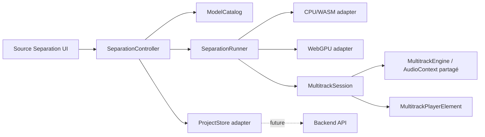
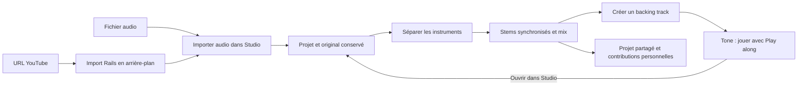

## 27 octobre 2026 — Édition du rack et calibration communautaire

**[DONE]** Double-clic sur la vignette/le titre d’un WAM : insertion dans le connecteur choisi. Le bouton **Replace** de l’éditeur ouvre le même catalogue ; remplacement au même emplacement, gains conservés, ancien module conservé si le chargement échoue. Annuler laisse l’éditeur et le module intacts. Une action en cours bloque les doublons. Le téléchargement MP3 reste dans Play Along, hors du dialogue Import audio.

**[SPECIFIED / NOT IMPLEMENTED]** Calibration personnelle + contribution volontaire de profils matériels contextualisés : voir [RECORD_TRACKS_SPECIFICATION.md](RECORD_TRACKS_SPECIFICATION.md). Préremplissage éventuel depuis le libellé du périphérique, confirmation du modèle/génération, estimations agrégées compatibles et protection des identifiants privés.

## 27 octobre 2026 — Import et téléchargement dans Tone / Play Along

**[DONE]** Import audio de Tone propose fichier local / vidéo YouTube. Le dialogue YouTube réutilise Rails (progression, annulation, compte, choix de destination), avec **Use in Tone** pour charger la source sans séparation ni autoplay. Les sources YouTube sont répertoriées comme backings privés, chargées uniquement à la demande et retirées du catalogue après suppression ; leurs blobs peuvent être réutilisés pour Separate instruments sans nouveau téléchargement.

Download MP3 est disponible pour toutes les origines : bibliothèque, fichier local, YouTube, mix Studio. Icône dans le dock replié, bouton dans la vue ouverte Le dialogue d’import contient uniquement les choix fichier et YouTube. Un MP3 existant est téléchargé directement ; sinon conversion locale 44,1kHz/stéréo/192k dans le worker MP3 existant, resampling hors contexte live si nécessaire, progression et annulation sur changement de morceau/compte. Conversion plafonnée à512MiB de PCM de travail ; les copies MP3 directes ne requièrent pas ce buffer. Le fichier contient toute la source, indépendamment de loop, speed, normalization/mix live et guitare. Les contrôles sont désactivés pendant chargement/conversion. YouTube reste indisponible en déploiement purement statique ; l’import fichier et la conversion locale y fonctionnent.

## 27 octobre 2026 — Undo / Redo de Studio

**[DONE] Historique de session** : commandes locales (mix, noms, ordre, preset associé, tempo, boucle), ajout/suppression/restauration de piste, imports dans le projet ouvert et groupes de séparation publiés. Deux flèches SVG près de Save project ; ⌘Z/⌘⇧Z sur Mac, Ctrl+Z/Ctrl+Shift+Z/Ctrl+Y sur Windows/Linux. Un drag = une commande, limite30dont2opérations audio, aucune copie PCM ; Save conserve la pile, rechargement/changement de projet ou de compte la réinitialise. Les champs texte/dialogues/WAM gardent leurs raccourcis. Publication/Undo de visibilité d’un groupe atomique, préconditions de conflit, retries idempotents. Les previews RAM utilisent Stop/Cancel jusqu’à publication.

**[TODO] Rétention durable bornée** : récupération après rechargement, budget512MiB, délai24h et purge protégée des blobs ; pas de suppression de fichiers historiques dans cette livraison. Le remplacement de prise sera raccordé avec l’enregistrement futur. Détails et statut dans [UNDO_REDO_SPECIFICATION.md](UNDO_REDO_SPECIFICATION.md).

## 27 octobre 2026 — Undo / Redo borné à préparer

**[SPECIFIED / NOT IMPLEMENTED]** Voir [UNDO_REDO_SPECIFICATION.md](UNDO_REDO_SPECIFICATION.md). Proposition : 30 commandes Studio, avec au maximum deux opérations audio retenues au total Undo/Redo ; un import ou une séparation complète compte pour une opération. Surcoût audio plafonné à 512 MiB par projet selon les quotas, récupération récente proposée pendant 24 h après inactivité. Ces valeurs ne sont pas encore des choix confirmés. Prévoir commandes groupées, bouton Undo après suppression, récupération après rechargement des opérations audio publiées, références partagées protégées et purge hors UI. La suppression actuelle reste restaurable et aucun audio n’est purgé par cette tâche documentaire. Pas de modification de l’application.

## 27 octobre 2026 — Retrait des pistes et préparation de l’enregistrement

**[DONE] Suppression confirmée d’une piste** : corbeille sur chaque ligne du propriétaire, confirmation avant retrait immédiat de la timeline et du mix. Retrait persisté (`removed_at`, monitoring coupé), fichiers et provenance conservés, restauration dans **Options → Removed tracks → Restore track**. Réactiver une séparation n’annule pas un retrait. L’export accepte le sous-ensemble restant d’un batch publié ; la publication initiale exige toujours tous les instruments. Les sources réservées et les mixes générés ne sont pas supprimables par cette action. Les données retirées occupent encore du stockage : aucune purge définitive dans cette livraison. Les réglages non sauvegardés des autres pistes sont préservés.

**[SPECIFIED / NOT IMPLEMENTED] Enregistrement synchronisé** : voir [RECORD_TRACKS_SPECIFICATION.md](RECORD_TRACKS_SPECIFICATION.md). Décisions utilisateur : **DI + snapshot du preset**, remplacement complet de l’audio existant **après confirmation**. Monitoring traité avant armement, transport commun, capture WAM → ring buffer → worker, waveform incrémentale, calibration aller-retour et compensation en frames, publication atomique sans régions. Analyse du code wam-studio épinglée à son commit ; incohérence ms/secondes identifiée, à ne pas reproduire. Aucune prise ni mesure matérielle effectuée ici. Les étapes R1–R6 restent à implémenter.

# Prototype de séparation de sources et lecteur multipiste

## État d’implémentation — 20 octobre 2026

- **[CURRENT] Workflow et lecteur unifié compact (P1 à P3 terminés) :** piste originale → bouton « Separate instruments » → pistes séparées, puis bascule réversible vers une ligne « Mix ». Parité avec le lecteur de backing track du host (volume/pan, balance guitare/backing, boucle et normalisation audio), densité verticale améliorée. Évaluer WaveSurfer et son module multitrack ; conserver une horloge et un routage audio uniques. Voir § 6.1, découpage et critères de validation. P1 à P3 sont implémentés dans le prototype ; P4.1 et P4.2 sont livrés ; P4.3 et P4.4 restent à faire.


- **[DONE] Phase 3 — premier backend WebGPU :** nouveau modèle ONNX 4 pistes distinct de 6s/FT, poids versionnés et vérifiés, ONNX Runtime Web 1.22.0 local. Pipeline hybride, FFT JavaScript corrigée/testée. Fenêtres 7,8 s / recouvrement 1,95 s, lecteur progressif existant, choix explicite CPU/GPU, repli CPU visible avant publication du premier bloc uniquement. Annulation, erreurs de données et blocs tardifs ne déclenchent pas de repli. Profilage : 3 244 kernels GPU observés. Comparaison mêmes poids, même extrait 13,65 s : GPU 5,83 s / CPU 22,51 s, RMS relatif 0,051 %. Test lecteur 30 s : 11,9 s GPU. Poids ONNX indiqués personnel/recherche par le fournisseur ; crédits/licence visibles. 6s et FT restent CPU.
- **[DONE] Validation GPU sur un mix multi-instruments stéréo :** exemple musical CC BY 3.0 fourni, diagnostic reproductible GPU/CPU sur les mêmes poids quatre pistes, huit canaux finis et stéréo conservée. Chrome / Apple Metal 3 : 10,88 s d’audio, GPU 15,85 s, CPU 71,45 s ; RMS relatif 0,077 %. Ce test ne mesure pas la qualité avec des stems de référence et ne garantit pas le temps réel. Mesures brutes et crédits dans le prototype.
- **[CURRENT] Étendre la validation GPU :** autres machines/navigateurs et comparaison UVR ; conversion 6s/FT compatible GPU à valider. Le diagnostic 6s termine désormais après extraction du réseau (3658 nœuds contre 24819) et reconstruction JS : douze canaux finis, 1856 kernels GPU observés. Le vrai mix présente toutefois 7,317 % d’écart RMS avec le CPU ; un spectrogramme CPU ne résout pas cette dérive réseau. Pas d’activation dans le catalogue avant correction. Voir `SIX_STEMS_GPU.md`.


- **[DONE] Lecture progressive initiale (6s)** : fenêtres de 5 s, recouvrement commun de 1 s, premier bloc publié de 4 s. Un seul modèle chargé par traitement. Play disponible avant la fin, disponibilité cumulative et formes d’onde progressives, pause/reprise automatique sur manque de données. Seek borné à la zone prête ; boucle intégrale après calcul complet. Annulation conserve les blocs prêts et invalide les messages tardifs. Extraits de 30/60 s proposés uniquement pour 6s progressif. FT/classique restent à 10 s. Pas de promesse de temps réel CPU ni de morceau entier.


- **[DONE] Suivi événementiel par piste :** indicateur de chargement du modèle stabilisé après le premier chargement, sans remise en animation pour chaque spécialiste FT et sans polling d’état. Réinitialisation lors du changement d’identité/version du modèle. Le choix d’un autre fichier avec le même modèle disponible n’entraîne pas de nouvelle vérification du cache. La progression affiche le numéro, le nom réel et la fin de chaque piste FT, avec historique visible. Pour 6s, le calcul est conjoint et les fins des six pistes sont annoncées seulement après réception du résultat.

- **[DONE] État du modèle sélectionné :** panneau visible dans la préparation, bouton de téléchargement avec taille, progression reçue/totale en pourcentage, annulation et lien licence. États distincts catalogue/cache, modèle absent, téléchargement, vérification, enregistrement, disponible, chargement en mémoire, inférence et erreur. La présence en cache ne signifie pas que le moteur est déjà chargé en RAM. Audio et modèle ont des statuts séparés ; « Séparer » ne s’active que lorsque les deux sont prêts. Le panneau et le gestionnaire partagent le même téléchargement et ses événements.

- **[DONE] Diagnostic de démarrage :** l’ouverture directe en `file://` affiche un message et le lien HTTP avant tout import de module ; les commandes inutilisables sont masquées. Sous HTTP(S), une aide indique pourquoi la séparation est désactivée (catalogue, modèle non installé, absence de fichier, décodage ou erreur). Les échecs de chargement des modules sont visibles. Le cache reste propre à l’origine choisie.

- **[DONE] Phase 1 — lecteur de base :** buffers audio réels, départ synchronisé, lecture/pause/stop/seek, boucle complète, mute/solo, volume/pan, formes d’onde PCM et zoom. L’import local décode à 44,1 kHz. Le redesign et la boucle A/B restent à venir.
- **[DONE] Phase 2b — premier modèle réel :** poids ORT compressés de `htdemucs_6s` et `htdemucs_ft`, épinglés par révision et SHA-256. Moteur WASM SIMD dans un Worker, annulable. FT sélectionne les sorties correspondantes de ses quatre spécialistes dans quatre Workers successifs, terminés chacun avant le suivant.
- **[CURRENT] Phase 2 — mesures :** premier test navigateur réussi sur les deux modèles (signal 1 s) et sur le fichier CleanChords.mp3 du projet. Extraits limités au début du fichier : 1, 5 ou 10 s en classique, jusqu’à 60 s en progressif 6s, fichier de 32 Mio maximum. Mémoire WASM observée : plus de 2 Gio. La comparaison musicale et numérique avec UVR reste à faire.
- **Phase 3a partielle :** sélection de trois modèles et recommandations d’usage présentes. WebGPU actif uniquement pour le modèle ONNX 4 pistes validé ; présence du device et compatibilité du modèle sont traitées séparément.
- Les kits de diagnostic restent disponibles mais ne constituent plus le seul téléchargement proposé. Pause/reprise Range, morceaux longs, export et sauvegarde backend restent à faire.

Voir `examples/wam/source-separation/FEASIBILITY.md` pour les résultats. Un test optionnel avec vrais poids, sans réseau : `npm run test:separation:wasm -- /chemin/htdemucs_6s.ort.gzipped`. Les poids ne sont pas inclus dans Git ni dans la dist ; le runtime et ses crédits le sont.

- **Phase 2a partielle :** catalogue, téléchargements HTTP, cache IndexedDB, SHA-256, annulation, nouvelle tentative, suppression, versions et état corrompu implémentés. La reprise Range/persistante reste à faire ; une nouvelle tentative repart de zéro.
- **Phase 5a partielle :** intégrité, quota, versions et suppression disponibles. Reprise persistante, nettoyage avancé, conservation des anciennes entrées de catalogue et mode hors ligne de la page restent à terminer.

Références techniques vérifiées : [Demucs : sorties 4 et 6 sources](https://github.com/facebookresearch/demucs), [ONNX Runtime Web : backend WebGPU](https://onnxruntime.ai/docs/tutorials/web/ep-webgpu.html). Le support des opérateurs et du format d’un modèle doit être testé, indépendamment de la présence de WebGPU.

Tests : `npm test` inclut `tests/phase6/`. Le gestionnaire teste les vrais octets de fichiers, l’intégrité, les transferts concurrents, l’annulation, la corruption, le quota et la publication atomique multi-fichiers. Validation navigateur : téléchargement, SHA-256, persistance après rechargement et relecture du cache.

## 1. Objectif

### Suivi de progression et lecture anticipée

**[DONE] Progression et disponibilité du transport :** barre avec pourcentage monotone, pondération cache/chargement/inférence/préparation audio, callbacks de vrais segments. 100 % uniquement après préparation des buffers et de l’AudioContext. En classique, Play est désactivé pendant séparation/préparation/démarrage ; en progressif, seulement tant qu’aucun bloc n’est prêt ou que l’audio démarre, et réactivé lorsque le moteur est prêt. Pas de temporisation arbitraire ; les états et promesses du moteur pilotent la disponibilité. La reprise audio est amorcée dès l’action de séparation afin de réduire la latence au premier Play. Une activation audio explicite est proposée si le navigateur reste suspendu.

**[DONE] Première lecture progressive pendant le démixage :** `ProgressiveDemucsRunner` publie les six stems d’un bloc ensemble ; `ProgressiveMultitrackEngine` programme les blocs sur la même horloge. Le premier résultat est écoutable sans attendre les suivants. La zone disponible est affichée et limite le seek. En manque de données, attente explicite puis reprise automatique au même échantillon ; Pause/Stop l’annulent. Les fondus de recouvrement emploient les mêmes poids sur tous les stems sans changer des échantillons déjà publiés. L’annulation rend l’extrait calculé disponible et ferme le Worker. La boucle complète commence après la fin ; son redémarrage comporte actuellement 30 ms de latence.

Tests unitaires : couverture exacte des échantillons, alignement des pistes, poids identiques des raccords, invariance des buffers publiés, starvation/rebuffering, seek hors tampon, course entre ajout d’un bloc et fin de lecture, annulation pendant préparation et messages tardifs. Validation avec les vrais poids sur CleanChords.mp3 dans le navigateur.

**[NEXT] Étendre et mesurer :** comparer musicalement les raccords et UVR, mesurer le rapport temps de calcul/durée et le préchargement nécessaire, supporter les morceaux entiers avec décodage/mémoire bornés, puis étendre la compatibilité GPU à 6s/FT et préparer FT progressif. Le CPU peut épuiser le tampon : le prototype ne promet pas une lecture continue sans interruption.

Ajouter au projet **NAM A2 WAM** un prototype isolé destiné aux guitaristes. À partir d’un morceau audio, l’application doit pouvoir produire plusieurs sources séparées — par exemple batterie, basse, voix, guitare et accompagnement — puis les écouter dans un lecteur multipiste.

Le prototype doit être accessible par une URL dédiée afin de pouvoir évoluer indépendamment du rack principal :

```text
/examples/wam/source-separation/
```

Une variante par query string peut être conservée pour les essais rapides :

```text
/examples/wam/?prototype=source-separation
```

La première URL est la cible d’intégration et de déploiement. Elle doit rester compatible avec le serveur statique et avec `dist/NAM_A2_WAM/`.

## 2. Contraintes du projet hôte

- Réutiliser les composants UI existants (`ui/tokens.css`, `ui/base.css`, `ui/components.css`, `tl-button`, `tl-slider`, `tl-select`, `tl-checkbox`, `tl-badge`, `tl-meter`) et les conventions visuelles du host NAM A2.
- Réutiliser le lecteur existant dans `examples/wam/backing-track-player/` lorsque ses responsabilités correspondent au besoin : chargement, décodage, transport, boucle, volume, normalisation optionnelle, lecture accélérée et mix guitare/backing.
- Ne pas dupliquer le moteur audio dans le prototype sans justification. Les nouvelles classes doivent rester indépendantes du rack afin de pouvoir être intégrées plus tard comme workspace ou module.
- Le prototype ne doit pas modifier le comportement du rack NAM, des plugins WAM, de l’authentification ou du backend existant.
- Toutes les opérations lourdes doivent être annulables et signaler leur progression. L’interface ne doit jamais être bloquée par une inférence longue.

## 3. Parcours utilisateur cible

1. L’utilisateur ouvre l’URL du prototype.
2. Il choisit un fichier local ou une piste déjà disponible dans la bibliothèque de backing tracks.
3. Il choisit un moteur d’exécution disponible : CPU/WASM par défaut, WebGPU si le navigateur le supporte.
4. L’application propose des modèles avec une recommandation adaptée au cas d’usage.
5. Il lance une séparation et observe la progression, les erreurs et l’estimation de la mémoire utilisée si elle est disponible.
6. Les stems apparaissent dans un lecteur multipiste.
7. Il peut lire, arrêter, boucler, muter, mettre en solo, régler le volume et le panoramique de chaque piste, zoomer horizontalement la forme d’onde, réinitialiser le zoom et relancer une séparation avec un autre modèle.
8. Le prototype permet d’exporter les stems localement. La sauvegarde backend des projets est préparée par l’architecture mais n’est pas nécessaire pour la première version.

## 4. Architecture proposée



### 4.1 Couche UI

Décision d’implémentation : un `MultitrackEngine` spécialisé coordonne tous les buffers sur le même instant de départ et la même position. Le lecteur mono existant (`BackingTrackEngine`) gère une seule source et ses commandes asynchrones ; en instancier un par stem ne fournirait pas de transport atomique commun. Le nouveau moteur reprend les contrats utiles du lecteur existant (AudioContext injecté, sortie `outputNode`, hôte responsable du routage, destruction explicite). Normalisation et time-stretch ne sont pas dupliqués ; ils restent reportés.

La page dédiée contient trois zones cohérentes avec le host :

- **Source et modèle** : fichier, bibliothèque, modèle, backend, bouton de séparation et état de progression.
- **Résultat** : lecteur multipiste, une ligne par stem, commandes mute/solo/volume/pan, durée et statut.
- **Analyse/diagnostic** : temps de calcul, backend effectivement choisi, mémoire ou avertissements de compatibilité.

La page doit être responsive et conserver les espacements, couleurs, badges et contrôles du host. Le lecteur multipiste peut être un Web Component autonome afin d’être inséré plus tard dans `TracksPanel`.

### 4.2 Contrat d’exécution des modèles

Définir une interface commune, indépendante du modèle :

```js
const runner = {
  id,
  backend,
  async canRun({sampleRate, channels, duration}) {},
  async separate(audioBuffer, options, onProgress) {},
  cancel() {},
  dispose() {}
};
```

`separate()` renvoie un manifeste normalisé :

```js
{
  version: 1,
  sampleRate,
  duration,
  stems: [{id, label, role, channels, audioBuffer, peak, rms}]
}
```

Les adaptateurs CPU/WASM et WebGPU ne doivent pas exposer leurs détails au lecteur. Un modèle peut produire quatre stems ou cinq stems ; l’UI se base sur le manifeste et non sur un nombre fixe de pistes.

### 4.3 Catalogue et recommandation

Chaque modèle doit déclarer :

- ses stems produits ;
- son format et sa taille ;
- les backends disponibles ;
- les navigateurs minimum ;
- la mémoire estimée ;
- la qualité et la vitesse attendues ;
- les cas d’usage recommandés.

Exemples de recommandations :

| Cas d’usage | Modèle recommandé | Justification |
|---|---|---|
| Isoler rapidement la guitare pour jouer par-dessus | Modèle 4 stems léger | Temps de calcul et mémoire réduits |
| Obtenir une séparation plus complète (voix, guitare, basse, batterie, autre) | Modèle 5 stems qualité | Plus adapté au remix et à l’analyse détaillée |
| Ordinateur sans WebGPU | Variante CPU/WASM | Compatibilité maximale |
| Navigateur avec WebGPU et mémoire suffisante | Variante WebGPU | Inférence potentiellement plus rapide |

La recommandation doit rester explicable : afficher « recommandé pour isoler la guitare » ou « recommandé pour machine sans WebGPU », et permettre de choisir un autre modèle.

## 5. Plan d’implémentation incrémental

### Phase 0 — Contrat et route prototype

**But :** créer la page dédiée, son routage statique et ses composants de base sans modèle de séparation.

Tests de faisabilité :

- la route dédiée répond dans le serveur de développement et dans `dist` ;
- les contrôles utilisent les composants UI du host ;
- l’AudioContext partagé peut être créé ou réutilisé après une interaction utilisateur ;
- un fichier local et une piste de la bibliothèque peuvent être sélectionnés.

Critère de sortie : une page vide fonctionnelle avec un état « prêt à séparer » et un test navigateur automatisé.

### Phase 1 — Lecteur multipiste avec stems synthétiques

**But :** valider le lecteur avant d’intégrer l’IA.

Créer un manifeste de test avec deux à cinq fichiers ou buffers audio existants. Chaque piste doit pouvoir être :

- lue et arrêtée ;
- mise en boucle ;
- mutée ou mise en solo ;
- réglée en volume et panoramique ;
- affichée avec une forme d’onde ou une représentation temporelle ;
- zoomée horizontalement puis réinitialisée.

Tests : lecture de plusieurs pistes dans un même AudioContext, cohérence des commandes mute/solo, boucle sans dérive de position, destruction propre des sources audio.

Critère de sortie : le lecteur est utile avec un manifeste artificiel, même sans séparation réelle.

### Phase 2 — Runner CPU/WASM minimal

**But :** mesurer la faisabilité d’un premier modèle de séparation sur un court extrait.

Actions :

- sélectionner un modèle petit ou un modèle de démonstration compatible navigateur ;
- charger le modèle à la demande, jamais au chargement initial de la page ;
- exécuter l’inférence dans un Worker ou AudioWorklet adapté, sans bloquer le thread UI ;
- limiter le premier test à un extrait court et à une durée maximale configurable ;
- produire un manifeste de stems normalisé pour le lecteur.

Mesures à enregistrer : durée de chargement, durée d’inférence, mémoire approximative, temps réel comparé à la durée audio, qualité subjective de l’isolation de la guitare et erreurs de compatibilité.

Critère de sortie : un fichier court peut être séparé de manière répétable et les stems sont audibles dans le lecteur.

### Phase 3 — [DONE pour ONNX 4 pistes] Détection et backend WebGPU

**But :** ajouter WebGPU sans rendre le prototype dépendant de WebGPU.

Actions :

- détecter `navigator.gpu` et vérifier réellement l’initialisation du device ;
- afficher séparément « disponible », « non disponible » et « échec d’initialisation » ;
- implémenter un adaptateur WebGPU du même contrat que CPU/WASM ;
- proposer un fallback CPU/WASM explicite ;
- comparer qualité, temps d’inférence et mémoire sur le même extrait.

Critère de sortie : le même manifeste peut être produit par les deux backends, avec une indication fiable du backend utilisé. Atteint pour ONNX 4 pistes ; test numérique reproductible et mesures dans `examples/wam/source-separation/benchmarks/`. Mémoire GPU totale et qualité sur mix complet restent à mesurer ; le GPU n’est pas activé pour les modèles non validés.

### Phase 4 — Catalogue multi-modèles et recommandations

**But :** rendre l’architecture configurable.

Actions :

- ajouter un catalogue versionné de modèles ;
- associer à chaque entrée ses contraintes et ses cas d’usage ;
- choisir automatiquement une recommandation selon le navigateur, le backend disponible, la durée et la mémoire ;
- conserver le choix manuel de l’utilisateur ;
- afficher les raisons du choix et les limitations.

Tests : sélection déterministe avec et sans WebGPU, navigateur aux capacités limitées, modèle absent ou téléchargement interrompu, annulation pendant le chargement.

### Phase 5 — Fichiers longs, cache et export

**But :** rendre le prototype exploitable sur des morceaux réels.

Actions :

- traiter les fichiers par blocs avec recouvrement si le modèle l’exige ;
- concaténer les stems sans discontinuité audible ;
- mettre en cache le modèle et éventuellement les résultats locaux ;
- exporter chaque stem dans un format documenté ;
- éviter de conserver plusieurs copies PCM inutiles en mémoire.

Le time-stretch et la normalisation avancée restent hors périmètre initial. La vitesse de lecture existante peut être réutilisée pour un premier essai, mais elle ne doit pas être présentée comme un time-stretch de qualité studio. Si le time-stretch devient nécessaire, prévoir une étape séparée ou un rendu fusionné contrôlé.

### Phase 6 — Projet persistant et intégration au host

**But :** préparer le stockage backend et l’intégration durable dans le workspace Tracks.

Le projet sauvegardé doit contenir des métadonnées, pas nécessairement les gros fichiers audio dans le même document :

```js
{
  version: 1,
  source: {id, name, duration, sampleRate, contentHash},
  model: {id, version, backend},
  stems: [{id, role, assetId, label}],
  mix: {tracks: [{id, muted, solo, volumeDb, pan}], zoom, loop},
  createdAt,
  updatedAt
}
```

Le stockage des fichiers et l’authentification seront branchés derrière un `ProjectStore` asynchrone. Une session locale doit rester possible lorsque le backend est indisponible.

## 6. Lecteur multipiste : exigences fonctionnelles

- transport commun : play, pause, stop, position et durée ;
- mute et solo par piste, avec règle claire lorsqu’il y a plusieurs solos ;
- volume et panoramique par piste ;
- boucle globale, puis éventuellement boucle par sélection temporelle ;
- zoom horizontal avec boutons `+`, `−` et `Reset` ;
- déplacement dans la timeline sans arrêter les autres pistes ;
- indication visuelle des pistes chargées, en cours de chargement ou en erreur ;
- remise à zéro complète de la session ;
- destruction explicite des `AudioBufferSourceNode`, gains et nœuds de visualisation.

Le lecteur doit utiliser une horloge commune et un transport centralisé. Chaque piste doit être synchronisée sur la même position plutôt que démarrée indépendamment au clic.

### 6.1 [CURRENT] Workflow et lecteur unifié compact

**Objectif :** intégrer la séparation dans le parcours naturel du lecteur de backing track, avec le look & feel du host et une vue beaucoup plus compacte. Les fichiers `BackingTrackEngine`, `BackingTrackPlayerElement` et `BackingTrackMix` sont les références fonctionnelles ; conserver leur contrat d’AudioContext partagé et de sortie routée par le host.

Trois vues d’une même session :

| Vue | Contenu | Actions principales |
|---|---|---|
| Piste originale | Une waveform du morceau importé ou de la bibliothèque | Transport, boucle, volume, normalisation, « Separate instruments » |
| Instruments | Une waveform compacte par stem synchronisé | Mute/solo, volume et pan par instrument, volume backing global, zoom partagé |
| Mix réduit | Une seule waveform du mix courant des stems | Même transport, boucle, volume global ; « Afficher les instruments » |

Le mode « Mix réduit » représente **le remix effectivement entendu**, avec mute/solo/volumes/pans/normalisation actuels ; ce n’est pas la réutilisation de la waveform originale. C’est une réduction d’affichage, sans rendre ou remplacer définitivement les stems. Les réglages restent accessibles au retour dans la vue détaillée. Le retour au fichier original est une action distincte et non destructive.

Parcours :

1. Importer/choisir un morceau : le lecteur simple existant est immédiatement utilisable.
2. Cliquer **Separate instruments** depuis ce lecteur. Afficher modèle/backend et progression dans un panneau compact ; garder les téléchargements et diagnostics dans un panneau avancé repliable.
3. Conserver l’original et son état pendant le calcul. En cas d’erreur/annulation avant des pistes utilisables, il reste disponible. Ne pas démarrer une seconde horloge audio ni superposer original et stems.
4. Dès que le résultat requis est prêt, remplacer la présentation simple par les stems. Préserver position, état lecture/pause, boucle, volume global et balance guitare/backing ; gérer explicitement une position hors de la zone déjà calculée. Si seul un extrait est traité, le signaler et ne pas remplacer silencieusement tout le morceau par cet extrait.
5. Basculer librement entre instruments et mix réduit, sans interrompre ou redémarrer le son ni perdre les réglages. Exporter le remix est une action ultérieure distincte.

Parité fonctionnelle et routage :

- Volume backing global en dB, mute global, volume/pan par stem ; conserver le panoramique guitare global et la balance guitare/backing tels que fournis par `BackingTrackMix`. Le bus backing additionne les stems avant cette balance et avant l’unique sortie du host.
- Boucle intégrale et sélection A/B par glisser/déposer et champs numériques, activation/désactivation, reset ; zoom horizontal commun, défilement synchronisé et reset du zoom. Conserver position et boucle au changement de vue.
- Normalisation **audio** réversible : un gain commun sur le backing/remix préserve les proportions entre stems. Recalculer le gain et signaler les limites si le mix change ; traiter le silence sans division par zéro, afficher le niveau et éviter la saturation. Une normalisation séparée de chaque stem, si proposée, doit être une option explicite car elle modifie les équilibres. La normalisation visuelle des waveforms ne remplace pas cette fonction.
- Conserver les fonctions déjà présentes du lecteur simple : bibliothèque/import, indicateur de chargement/décodage, progression, raccourcis et réglage de vitesse lorsqu’il est disponible. Ne pas annoncer de time-stretch multipiste de qualité équivalente avant une tâche dédiée et ses tests ; toute restriction doit être visible.
- Mix réduit : calcul des peaks à partir du mix courant, y compris volume/pan/mute/solo et gain de normalisation. Recalculs asynchrones et annulables, aucun second moteur audio. La guitare live garde son bus séparé : elle est audible dans la balance globale, pas figée dans la waveform backing.
- État de session versionné : mode original/stems, vue détaillée/réduite, références des sources, paramètres audio/transport, backend/modèle, région disponible. Ne pas embarquer les gros buffers PCM dans les métadonnées de sauvegarde.

Présentation : lignes de stems de **48–64 px** de hauteur cible sur ordinateur, marges verticales réduites, un seul transport et une seule règle temporelle. Nom et commandes alignés, couleurs stables par instrument ; hauteur adaptable pour l’accessibilité et le tactile. Un morceau de quatre à six stems doit rester lisible sans grande page de réglages. Respecter clavier, labels ARIA, contraste et focus pendant l’arrivée de nouveaux blocs.

Choix de bibliothèque à valider : [WaveSurfer](https://wavesurfer.xyz/docs/) fournit waveforms et plugins Regions/Timeline/Minimap ; [wavesurfer-multitrack](https://github.com/katspaugh/wavesurfer-multitrack) est une piste complémentaire. Comparer au moteur Web Audio déjà testé : AudioContext commun, précision de synchronisation, ajouts progressifs, coûts PCM/peaks et routage gain/pan. Privilégier une couche d’affichage pilotée par le moteur commun si le module multitrack impose des lecteurs/horloges concurrents. Épingler la version retenue, conserver sa licence et livrer les fichiers localement dans la dist. Décision P1 : retenir uniquement le renderer WaveSurfer 7.12.4, sans son moteur de lecture ni le super-plugin multitrack. Celui-ci crée son propre AudioContext et des lecteurs par piste ; notre moteur existant gère déjà la synchronisation des blocs et le routage. Voir la notice locale et les hashes dans `vendor/wavesurfer/`. Cette API de rendu de bas niveau est épinglée : revérifier son contrat à chaque mise à jour.

Sous-tâches incrémentales :

1. **[DONE] P1 — Vue compacte / preuve WaveSurfer** : rendu WaveSurfer 7.12.4 local, lignes de 56 px sur ordinateur, couleurs stables, volume/pan avec valeurs, mute/solo, règle et viewport horizontal partagés, lecture/seek au clavier, zoom commun. Aucun lecteur WaveSurfer ni AudioContext supplémentaire : seul son renderer reçoit des peaks des deux canaux. Le mixeur garde ses éléments DOM pendant les blocs, les réglages et le zoom. Dix tests unitaires ajoutés ; essai réel Chrome de 10 s en GPU, quatre pistes prêtes en 5,8 s, volume conservé à 99 % pendant le calcul, lecture vérifiée. Distribution reconstruite.
2. **[DONE] P2 — Original → instruments (prototype)** : import/exemples immédiatement écoutables en piste originale complète, sans modèle téléchargé. « Separate instruments » dans le lecteur avec progression et annulation. Un candidat est calculé dans le même AudioContext, avec sortie déconnectée ; l’original continue à jouer. La première zone couvrant la position courante permet une bascule automatique, sans superposition audio, avec position, lecture/pause, boucle, zoom et gain/pan conservés. Les commandes du mixeur focalisées retardent la bascule automatique pour préserver l’interaction. Une position hors extrait garde l’original et exige « Écouter l’extrait séparé depuis le début ». L’extrait et la durée originale sont affichés distinctement. Retour original/instruments réversible ; retour manuel empêche les blocs suivants de reprendre la main. Échec/annulation restaure l’original ; les stems partiels restent accessibles explicitement. Un nouvel import libère les anciens lecteurs. Treize tests unitaires ajoutés, cas réels Chrome validés. L’intégration au panneau Tracks du host reste P4.
3. **[DONE] P3 — Mix réduit réversible** : boutons « Réduire au mix » / « Afficher les instruments », sans changer de moteur, de voix, de route ou de transport. Une seule waveform représente la somme PCM stéréo après volume/pan/mute/solo et gain de sortie commun. La réduction ne lit pas le fichier original et n’additionne pas les enveloppes des stems. Calcul coopératif asynchrone, annulable ; seul le dernier résultat est publié. Les blocs progressifs restent alignés sur la durée totale ; zone future vide et seek limité à la zone publiée. Instruments masqués en gardant leur DOM, réglages et focus ; zoom/scroll et état lecture/boucle conservés. Le mode est mémorisé dans la session, y compris après un aller-retour par l’original. Pic du mix affiché sans écrêtage ni normalisation automatique. Validation native Web Audio sur 20 cas mono/stéréo : erreur maximale 7,45e-9. Seize tests ajoutés (290 au total). Vérification navigateur en lecture et durant le calcul progressif d’un extrait de 30 s. Normalisation audio et bus guitare/backing restent P4.
4. **[CURRENT] P4 — Parité host** : gains/pans, balance guitare/backing, régions A/B, normalisation audio et vumètre, sauvegarde de l’état et intégration Tracks.

Découpage de P4 :

- **[DONE] P4.1 — Bus et mix global** : `SeparationMixer` adapte le moteur de séparation à `BackingTrackMix`, déjà utilisé par le host après son rack. Un seul AudioContext et une seule destination finale ; sortie des lecteurs vers une entrée backing stable. Volume backing −60 à +6 dB (0 dB par défaut additionnel à la marge interne 0,7), mute sans pause, balance guitare/backing et pan guitare, mesure stéréo de sortie et indication de saturation. La politique existante du host est conservée : centre à gain unitaire pour chaque bus, guitare à son niveau normal quand le backing est en pause. Réglages globaux conservés au changement original/instruments et pris en compte dans la waveform réduite. Guitare de test optionnelle pour écouter la balance. Le module accepte la sortie du rack du host comme entrée guitare ; l’insertion dans Tracks appartient à P4.4.
- **[DONE] P4.2 — Boucles A/B** : bornes A/B déplaçables sur la timeline commune (souris, tactile et flèches au clavier), champs numériques en secondes, boutons A/B = position et « Toute la piste ». Région visible dans les vues instruments et mix, conservée au zoom/reset du zoom. Le reset de région ne change pas le zoom. Toutes les pistes partagent les mêmes bornes et la même horloge ; pause/seek/lecture et mix restent disponibles. Une région compatible est transférée en secondes entre original et instruments ; si l’extrait est trop court, il conserve sa propre région et les bornes de l’original sont gardées. La boucle peut être désactivée sans perdre A/B. En progressif, B peut attendre des blocs non publiés : aucun retour prématuré à A. Dès que la région est disponible au lancement, seule cette fenêtre est assemblée en buffers stéréo puis bouclée nativement, sans callback JavaScript entre les tours. Une fenêtre par piste reste en mémoire, remplacée à la prochaine édition et libérée au reset/destruction. Si B devient disponible pendant une lecture déjà commencée, le premier retour utilise la reprise planifiée existante de 30 ms, puis les tours suivants sont natifs. Annulation partielle : bornes ramenées à la durée conservée. Sept tests ajoutés ; suite complète 306 tests réussis. Normalisation audio : prochaine tâche P4.3.
- **[TODO] P4.3 — Normalisation audio** : gain commun réversible, niveau, silence et saturation.
- **[TODO] P4.4 — Intégration Tracks et état** : remplacer le lecteur simple par le lecteur unifié dans le host, brancher sa vraie sortie de rack, restaurer fichiers/réglages/vues/régions sans double sortie.

**[CURRENT] Diagnostic 6s GPU :** inverse STFT déroulée contournée par extraction du réseau + reconstruction JS. Les douze sorties GPU sont maintenant obtenues, mais le vrai mix présente un écart RMS de 7,317 % avec la référence native CPU, au-delà du seuil de 1 %. L’injection d’un spectrogramme CPU ne le corrige pas. Le catalogue 6s reste CPU/WASM ; localiser la dérive réseau avant activation. Mesures et plan dans `examples/wam/source-separation/SIX_STEMS_GPU.md`.

Tests avant proposition d’essai : identité des réglages/du transport au changement de vue, absence de double sommation ou de nouveau départ audio, contenu des peaks du mix, changement de mute/solo/pan/volume, normalisation/silence/saturation, région A/B et seek/zoom, ajout progressif et focus pendant un drag, annulation et restauration de l’original, destruction sans fuite, restauration de session et de fichiers manquants. Tests navigateur avec le host et sa guitare routée (signal synthétique de référence), responsive et vérification visuelle de la densité.

## 7. Faisabilité et critères de décision

Avant de généraliser l’inférence, mesurer sur un extrait de 10 à 30 secondes :

1. compatibilité du modèle avec les contraintes navigateur ;
2. mémoire de chargement et mémoire d’exécution ;
3. temps CPU/WASM et WebGPU ;
4. stabilité sur AudioContext à 48 kHz et sur les fichiers stéréo ;
5. qualité de séparation de la guitare, notamment sur distorsion et accompagnement dense ;
6. coût de conversion entre tenseurs, `AudioBuffer` et blocs du Worker ;
7. annulation et reprise après erreur.

Une implémentation ne sera retenue pour les fichiers longs que si elle reste annulable, ne bloque pas l’interface et produit des stems synchronisés. Les résultats de qualité seront documentés comme mesures de prototype, pas comme garantie de qualité musicale universelle.

## 8. Tests attendus

- **Tests unitaires** : catalogue, recommandation, manifeste, état mute/solo, zoom, boucle, annulation et sérialisation.
- **Tests d’intégration audio** : plusieurs pistes dans un même contexte, synchronisation, silence après mute, sortie finie et absence de valeurs non finies.
- **Tests navigateur** : URL dédiée, sélection locale, détection WebGPU, fallback CPU/WASM, progression, erreur et destruction.
- **Tests de distribution** : la route et les assets présents dans `dist/NAM_A2_WAM/`, sans dépendance à un chemin de développement.
- **Tests manuels** : écoute comparative des stems, transitoires de batterie, guitare saturée, loop et zoom.

Les tests automatisés doivent précéder toute proposition de test manuel. Les vérifications d’écoute servent à évaluer la qualité musicale et ne remplacent pas les tests de synchronisation ou d’état.

## 9. Risques et décisions différées

- Les modèles de séparation peuvent être lourds pour un navigateur ; le premier prototype doit imposer une durée maximale et un modèle court.
- WebGPU n’est pas disponible partout et peut échouer malgré la présence de `navigator.gpu` ; le fallback est obligatoire.
- La séparation par blocs peut introduire des artefacts aux frontières ; elle sera traitée en Phase 5.
- Les gros stems ne doivent pas être sérialisés dans les presets du host ; ils doivent être référencés par des assets.
- Le time-stretch, la normalisation avancée et le remix automatique sont reportés après les mesures de faisabilité.
- Le choix précis de la bibliothèque ou du modèle de séparation sera fait après le benchmark Phase 2, selon licence, taille, qualité et support navigateur.

## 10. Livrables du prototype initial

1. Route `/examples/wam/source-separation/` avec le look & feel NAM A2.
2. Catalogue de modèles et détection CPU/WASM/WebGPU, même si un seul runner est d’abord actif.
3. Runner CPU/WASM sur extrait court ou modèle de démonstration.
4. Lecteur multipiste fonctionnel avec stems de test et commandes mute/solo/loop/zoom/reset.
5. Tests automatisés et rapport de faisabilité comparant les backends disponibles.
6. Documentation de l’URL, du format de manifeste et des limites connues.

## 11. Catalogue, téléchargement et cache des modèles

Le prototype doit permettre de choisir un modèle et de le rendre disponible localement avant de lancer une séparation. L’expérience s’inspire du catalogue de modèles d’Ultimate Vocal Remover : un mode de traitement, un choix de stems, un modèle sélectionné et une action explicite de téléchargement, avec conservation des modèles déjà installés.

Le dépôt de référence est [Ultimate Vocal Remover GUI](https://github.com/anjok07/ultimatevocalremovergui). Nous reprenons les idées d’ergonomie et de gestion du catalogue, pas son interface Tk ni ses dépendances Python. Les licences, crédits et conditions de redistribution de chaque modèle devront être vérifiés séparément avant publication.

### 11.1 Modèle de données du catalogue

Le catalogue distant est un manifeste signé ou servi en HTTPS, versionné et validé avant utilisation :

```json
{
  "version": 1,
  "models": [
    {
      "id": "exemple-manifeste-fictif",
      "version": "1.0.0",
      "label": "Guitare — 4 stems",
      "description": "Séparation batterie, basse, voix et guitare/accompagnement",
      "roles": ["drums", "bass", "vocals", "guitar"],
      "processing": "demucs",
      "backends": ["wasm", "webgpu"],
      "files": [{"url": "…", "size": 123456789, "sha256": "…"}],
      "license": {"name": "…", "url": "…"},
      "recommendation": "Isoler la guitare pour jouer par-dessus",
      "requirements": {"sampleRate": 44100, "maxChannels": 2, "minMemoryBytes": 1073741824}
    }
  ]
}
```

Cet exemple est fictif et ne décrit pas les sorties d’un modèle Demucs existant. Le manifeste doit indiquer la taille totale, les fichiers nécessaires, un hash SHA-256 par fichier, la licence, la version du modèle, les backends compatibles et les rôles de stems. Le catalogue ne doit pas exécuter de code téléchargé : seuls des poids et des métadonnées sont acceptés.

### 11.2 Écran de sélection

L’écran de préparation comporte :

- un sélecteur de **méthode** ou famille de modèles ;
- un sélecteur **stems** : tous les stems, stem principal, stem secondaire, ou sous-ensemble quand le modèle le permet ;
- un sélecteur de **modèle**, avec nom, version, taille, qualité attendue et recommandation ;
- un badge indiquant `Installé`, `Télécharger`, `Mise à jour`, `Partiellement téléchargé` ou `Indisponible` ;
- une indication du backend choisi (`WebGPU`, `WASM/CPU`) et un bouton pour afficher les détails ;
- une action `Télécharger le modèle` avant `Séparer` si le modèle n’est pas en cache ;
- une liste ou un panneau `Modèles installés` pour vérifier la taille, la date de dernière utilisation, la version et supprimer un modèle.

Le bouton de séparation doit être désactivé tant que le modèle et ses fichiers requis ne sont pas prêts. Le choix d’un modèle déjà installé doit démarrer immédiatement, sans téléchargement implicite.

### 11.3 Gestionnaire de téléchargement

Créer un `ModelDownloadManager` indépendant de l’UI avec les opérations :

```js
listCatalog();
getStatus(modelId);
download(modelId, {onProgress});
pause(modelId);
resume(modelId);
cancel(modelId);
remove(modelId);
verify(modelId);
clearUnused({keep: [...]});
```

Comportement attendu :

1. télécharger chaque fichier dans une destination temporaire ;
2. afficher progression, octets reçus, taille totale et débit lorsque disponibles ;
3. reprendre un téléchargement interrompu si le serveur accepte `Range`, sinon repartir proprement ;
4. vérifier le hash avant de rendre le modèle utilisable ;
5. renommer ou déplacer atomiquement vers le cache final après vérification ;
6. supprimer les fichiers temporaires en cas d’annulation ou d’échec ;
7. signaler clairement manque d’espace, erreur réseau, hash invalide ou licence manquante.

La progression doit survivre à un changement d’onglet et, si possible, à une fermeture/réouverture de la page grâce à l’état persistant du téléchargement. Une seconde demande du même modèle doit rejoindre le téléchargement existant au lieu d’en lancer un autre.

### 11.4 Cache local

Le cache doit utiliser IndexedDB pour les métadonnées et les blobs, avec une abstraction permettant d’évoluer vers Origin Private File System lorsque disponible. `localStorage` ne doit contenir que des préférences légères et les identifiants de modèles, jamais les poids volumineux.

Clé logique d’un artefact : `modelId + modelVersion + fileSha256 + backend`. Un modèle est considéré utilisable uniquement lorsque tous ses fichiers requis sont présents et vérifiés.

Le cache expose :

- taille utilisée et taille estimée restante si l’API est disponible ;
- date de dernière utilisation ;
- état `complete`, `partial`, `corrupt`, `evicted` ;
- suppression manuelle ;
- nettoyage des modèles non utilisés, jamais automatique sans information à l’utilisateur ;
- invalidation par changement de version ou de hash ;
- migration de schéma versionnée.

La politique par défaut conserve les modèles installés jusqu’à suppression explicite. Une option « libérer les modèles inutilisés après… » pourra être ajoutée plus tard, avec confirmation et affichage de l’espace récupéré.

### 11.5 Sécurité et confiance

- Les URL du catalogue doivent utiliser HTTPS et être limitées à des origines autorisées.
- Les poids sont vérifiés par hash avant chargement dans WASM ou WebGPU.
- Aucun script ou module JavaScript téléchargé depuis le catalogue ne doit être exécuté.
- Les licences et crédits sont affichés avant le premier téléchargement et dans les détails du modèle.
- Une mise à jour ne remplace jamais directement un modèle fonctionnel : elle est téléchargée dans une version temporaire puis validée.
- Un modèle supprimé du catalogue reste utilisable localement tant que l’utilisateur ne l’a pas supprimé, mais il est marqué comme ancien ou non recommandé.

### 11.6 Phases supplémentaires

**Phase 2a — Catalogue local et cache simulé.** Utiliser un manifeste statique avec deux modèles fictifs, simuler téléchargement, reprise, hash et suppression, puis brancher le lecteur sur un modèle déjà installé. Tester les états de l’interface sans réseau.

**Phase 2b — Téléchargement réel d’un petit modèle.** Ajouter un modèle de démonstration de faible taille, vérifier le hash, tester annulation/reprise et mesurer le temps de chargement. Ne pas commencer avec un modèle de plusieurs centaines de mégaoctets.

**Phase 3a — Plusieurs modèles et recommandation.** Afficher le catalogue, les stems disponibles, la licence, la taille et la recommandation. Le choix manuel reste prioritaire sur la recommandation automatique.

**Phase 5a — Maintenance du cache.** Ajouter gestion des versions, modèles partiels/corrompus, nettoyage manuel et diagnostics exportables. Les résultats de séparation ne seront mis en cache qu’après mesure de leur coût mémoire.

### 11.7 Tests spécifiques

- manifeste valide, version inconnue, fichier manquant et hash invalide ;
- modèle déjà installé : aucun téléchargement supplémentaire ;
- téléchargement interrompu puis repris ;
- deux demandes concurrentes du même modèle partagent une seule tâche ;
- annulation nettoie les fichiers temporaires ;
- manque d’espace ou quota IndexedDB dépassé ;
- changement de version invalide correctement l’ancien artefact ;
- modèle WebGPU indisponible : repli explicite vers WASM/CPU ;
- suppression d’un modèle utilisé par une session active ;
- rechargement de la page pendant un téléchargement ;
- absence de réseau après installation : les modèles vérifiés restent utilisables hors ligne.


### Sélection automatique du backend et du modèle

À l’ouverture et au changement de cas d’usage, privilégier les modèles du catalogue compatibles avec le backend WebGPU validé lorsque l’adaptateur est disponible. Actuellement : ONNX 4 pistes, avec guitare dans « Autres ». Sans WebGPU, préférer CPU/WASM (6s pour la guitare dédiée). Aucun téléchargement automatique. Une sélection manuelle CPU ou 6s/FT est respectée jusqu’au prochain choix explicite de modèle/cas d’usage. Le repli CPU du runner ONNX reste disponible avant publication du premier bloc. Le modèle 6s expérimental GPU ne fait pas partie de cette recommandation.

## 12. P5 — Intégration Guitar Studio : Tone / Studio et Rails

**Statut : P5.1 [DONE] ; P5.2 [DONE] ; P5.3 [DONE] ; P5.4 accompagnement [DONE] ; P5.4b rendu WAM [TODO]. Branche d’intégration : `codex/studio-integration`.**

Cette section consigne les échanges et décisions du 25 octobre 2026. Elle prévaut sur les anciens choix d’intégration P4.5 et de persistance locale pour la nouvelle version produit. Les autres résultats techniques et scientifiques conservent leurs statuts ; leur présence dans ce document ne vaut pas admission dans l’interface publique.

### 12.1 Objectif et socle retenu

Construire un **guitar studio** pour jouer, préparer un accompagnement, mixer quelques parties et, ultérieurement, enregistrer sa guitare ou sa basse. La navigation cible comporte uniquement **Tone** et **Studio**. Un projet peut être personnel ou partagé entre amis, musiciens, professeur et élèves ; le fonctionnement n’est pas spécialisé pour un scénario pédagogique.

Référence analysée : `main` distant au commit **`f7ffec6b1285b89098352262656be5fdb1295e91`**, consulté dans une copie temporaire en lecture seule. Cette révision renomme Projects en Studio ; l’identifiant interne `projects` reste inchangé. Le 26 octobre, le socle a été actualisé depuis `origin/main` (`f7ffec6b`), puis la branche `codex/studio-integration` a été créée. La branche `multitracks` conserve le laboratoire et ses évaluations. Les intégrations produit ne remplacent pas les fichiers de l’interface par ceux du prototype.

Réutiliser comme socle :

- `examples/wam/projects/ProjectsWorkspace.js` : projets, import, inspecteur, sauvegarde et partage ;
- `ProjectPlayer.js`, `ProjectTimeline.js` et `TrackTones.js` : transport commun, pistes, boucles, contrôles TONELAB et racks de presets ;
- le lecteur **Play along** de Tone ;
- les comptes et API Rails, `Project`, `Track`, `ProjectShare`, Active Storage et Solid Queue.

Importer les moteurs de séparation de `multitracks` derrière ces interfaces : catalogue produit restreint, cache vérifié des modèles, Workers, publication progressive, ring buffer, annulation et encodage MP3. L’intégration se fera module par module ; les versions anciennes de `main.js`, `index.html`, des styles et du backend dans `multitracks` ne doivent pas écraser le travail plus récent de `main`.

La bibliothèque de projets Rails devient la référence persistante. La RAM reste le support du travail en cours ; le cache navigateur est une optimisation locale, pas une seconde bibliothèque présentée comme synchronisée avec le compte. Une éventuelle reprise des projets locaux du prototype devra être explicite et ne devra pas les supprimer silencieusement.

### 12.2 Parcours et interface



**Tone** conserve le jeu live, les presets, le rack et le lecteur Play along compact/agrandi de `main`. Un backing généré depuis Studio apparaît dans la bibliothèque personnelle du lecteur et peut être retrouvé après reconnexion. Depuis un backing chargé, **Séparer les instruments…** ouvre Studio avec cet original, sans changer spontanément le son de Tone. Un backing issu d’un projet propose **Ouvrir dans Studio**.

**Studio** conserve le sélecteur des projets, leur timeline et l’inspecteur de `main`. Les actions principales sont :

1. **Importer audio** : fichier local ou URL d’une vidéo YouTube ;
2. **Séparer les instruments** : choix entre les deux modèles produit ;
3. **Lire / pause, retour au début, boucle et zoom horizontal/reset** ;
4. réglages volume/pan/mute/solo des pistes et comparaison original/résultat ;
5. **Enregistrer le projet**, **Partager**, **Utiliser ce mix dans Tone**.

Traiter le morceau entier par défaut. Le traitement d’un extrait reste une option secondaire de préparation. Les options techniques, le cache des modèles et WebNN se trouvent dans **Options avancées**, fermées par défaut. Afficher dans l’interface principale le modèle choisi, le moteur effectif connu, les téléchargements nécessaires, la progression et les erreurs utiles.

Les bancs de performances, classements de recherche, fixtures, tableaux scientifiques et outils de mesures n’apparaissent pas dans le parcours utilisateur. Prévoir une distribution produit qui exclut leurs pages et assets dédiés, tout en conservant les crédits, licences et manifestes nécessaires au fonctionnement des modèles. Les travaux de recherche restent accessibles séparément dans le dépôt.

L’original est conservé comme référence. L’écoute de l’original et celle des stems sont exclusives : aucune addition automatique des deux. Une nouvelle séparation ne supprime ni les contributions personnelles ni un résultat précédent sans choix explicite. Les états **en RAM**, **enregistrement en cours** et **enregistré sur le compte** sont distincts.

### 12.3 Deux modèles et choix du moteur

| Modèle proposé | Sources et présentation |
| --- | --- |
| **Demucs 4 pistes ONNX**, `htdemucs_4s_onnx` | Batterie, basse, voix, autres. La guitare est généralement incluse dans « autres » ; ne pas annoncer une guitare dédiée. Modèle initial par défaut. |
| **BS Roformer SW 6 pistes**, `bs_roformer_sw_6s` | Batterie, basse, voix, guitare, piano, autres. Choix pour obtenir des pistes guitare/piano dédiées. |

Le six pistes visé ici est **BS Roformer SW**, pas l’ancien Demucs6 GPU dont l’admission numérique reste ouverte. La liste produit ne propose ni les autres modèles du laboratoire ni le profil Preview à fenêtre courte. Les huit/douze canaux stéréo, leurs rôles et leur ordre doivent conserver le contrat de chaque modèle ; le rôle `piano` pourra s’afficher Piano et se mapper à `keys` dans Rails en conservant son rôle source dans les métadonnées.

- Préférer **WebGPU** si un adaptateur/device peut être initialisé et si le modèle/pipeline est compatible. La seule présence de `navigator.gpu` ne suffit pas.
- Utiliser **CPU/WASM** si WebGPU est absent ; si sa préparation échoue, proposer ou signaler clairement le repli avant publication de PCM. Ne pas mélanger des backends silencieusement dans un résultat déjà commencé.
- Réutiliser les sessions préparées et les modèles en cache. Une fois le modèle prêt, pas de polling ni de remise en animation de son chargement à chaque segment. Modèle, backend et préférence WebNN font partie de l’identité de session.
- **WebNN est expérimental**, uniquement dans Options avancées, désactivé par défaut et conditionné à la présence de l’API et à la validation du modèle. Proposer CPU/GPU/NPU comme préférences demandées, avec matériel effectif indiqué inconnu lorsqu’il n’est pas vérifiable.
- Les mesures W4 ne suffisent pas à admettre toutes les configurations WebNN : SW CPU perd le contexte ; la parité inter-backend SW WebNN et le streaming restent à valider. Un mode non admis reste indisponible avec explication ; le menu avancé ne doit pas promettre qu’il fonctionne.

Voir [WebNN_SUPPORT_SPECIFICATIONS.md](https://github.com/micbuffa/NAM_A2_WAM/blob/multitracks/WebNN_SUPPORT_SPECIFICATIONS.md) et [MODEL_EVALUATIONS.MD, §23](https://github.com/micbuffa/NAM_A2_WAM/blob/multitracks/MODEL_EVALUATIONS.MD#23-w4--comparaison-retenue-en-session-avec-et-sans-webnn). Aucun calcul IA serveur n’est nécessaire à cette intégration.

### 12.4 Nature des pistes et règles de presets

**Décision validée : un preset n’est pertinent que pour une piste personnelle créée par le guitariste/bassiste pour jouer ou s’enregistrer. Aucun preset n’est associé à un stem séparé.** La règle dépend de l’origine de la piste, pas seulement de son instrument.

| Nature | Utilisation | Preset associé |
| --- | --- | --- |
| Original importé | Référence et entrée de séparation | Aucun |
| Stem séparé, y compris guitare/basse | Accompagnement, écoute et remix | Aucun ; sélecteur absent |
| Piste personnelle guitare/basse | Contribution, pratique et futur enregistrement | Autorisé ; son et monitoring de cette piste |
| Mix rendu pour Tone | Backing stéréo prêt à jouer | Aucun rack de piste réappliqué |

Persister la nature/origine de chaque nouvelle piste, son auteur lorsqu’il s’agit d’une contribution, et le lien avec l’original/la séparation. Distinguer ces informations du rôle instrumental. L’API doit rejeter un preset sur un stem, même si une requête contourne l’interface. Le nom d’une piste ou son passage à l’instrument Guitar ne doit pas transformer son origine en prise personnelle.

Les pistes historiques de `main` peuvent déjà contenir des prises DI et des presets. La migration doit conserver leur audio et leurs associations ; une origine non documentée ne justifie pas d’effacer automatiquement un preset existant. La classification des données historiques doit être explicitée et testée avant migration.

Une piste personnelle utilise le moteur de presets/racks existant, de manière non destructive pour son audio source. Les stems ne déclenchent pas la création de racks NAM. Les noms et l’attribution des contributions sont visibles, sans multiplier les contrôles pour les pistes d’accompagnement.

### 12.5 Lecture progressive, routage et rendu

`ProjectPlayer` de `main` charge des fichiers complets. L’intégration doit accepter aussi le PCM déjà produit en RAM et le PCM progressif, sans exiger un upload Rails puis un nouveau téléchargement avant la préécoute. Conserver l’interface Studio et une seule horloge/règle de transport ; ne pas juxtaposer deux lecteurs concurrents visibles.

Les formes d’onde progressent par blocs, avec une timeline stable, un playhead monotone et une zone disponible explicite. Play reste désactivé jusqu’à disponibilité réelle du premier audio. Une insuffisance de données déclenche une attente explicite, puis une reprise au bon échantillon ; aucune promesse de lecture une seconde après le clic indépendamment du modèle et de la machine.

- Garder calcul, DSP, encodage et gros transferts hors du thread UI ; réutiliser ringbuf.js et la publication bornée existants.
- Conserver le contexte audio partagé de l’hôte à 48 kHz pour NAM ; maîtriser le passage à 44,1 kHz pour les modèles puis la lecture/rendu, sans dérive de durée entre pistes.
- Adapter explicitement les réglages du prototype aux conventions de `main` : volume 0–100 avec 80 = 0 dB, pan −100 à 100. Ne pas copier les valeurs linéaires du prototype comme si elles avaient la même unité.
- Garder l’arbitrage entre Play along et le projet, le monitoring et les racks de Tone de `main`. Une commutation ne crée pas de double accompagnement ou de double guitare live.
- Annulation, changement de modèle confirmé, changement de projet et déconnexion invalident les réponses tardives. Les blocs déjà calculés restent utilisables et clairement identifiés comme incomplets.

**Utiliser ce mix dans Tone** produit un vrai fichier audio stéréo et une entrée personnelle persistante, liée au projet source et à la version de son mix. L’utilisateur conserve la possibilité de télécharger le fichier. Le chargement dans Tone ne lance pas automatiquement la lecture.

Le rendu respecte les volumes, pans, mute/solo et traitements applicables aux pistes personnelles, avec une prévention explicite de l’écrêtage. Le niveau d’écoute, la balance guitare/backing et la guitare live ne sont pas imprimés dans le fichier. Par défaut, rendre le morceau entier ; un export de la boucle est un choix explicite.

**Limite actuelle :** l’encodeur MP3 du prototype ne rend que le mix des buffers, sans exécuter les inserts WAM. Avant d’exporter un projet comportant une prise personnelle traitée, valider le rendu de son preset et sa fidélité à l’écoute. Ne pas présenter un export sec comme le mix entendu. Le choix technique de rendu des WAM, y compris ceux non compatibles avec un contexte offline, fera l’objet d’un essai dédié.

### 12.6 Persistance Rails et import YouTube

Étendre les modèles et API de `main`, en réutilisant `AccountApi`, la session, le CSRF, les contrôles d’accès et Active Storage. Le backend conserve projets, originaux, stems, contributions, métadonnées de séparation et mix rendus ; le cache des poids des modèles reste côté navigateur.

Une séparation conserve au minimum l’identité/hash/version du modèle, son original, les rôles des stems, la durée totale/prête, le backend demandé et celui observé lorsqu’il est connu, ainsi que son état complet/incomplet. Une modification de mix ne doit pas réuploader les fichiers inchangés.

La liste des projets charge seulement leurs métadonnées. Les fichiers du projet sélectionné sont chargés à la demande ; les autres projets ne sont pas décodés. Prévoir une publication groupée cohérente d’une séparation : un résultat ne devient pas complet après le seul upload du premier stem. En cas d’échec, signaler et permettre de reprendre/nettoyer les fichiers partiels. Utiliser les routes audio privées déjà présentes, y compris pour les mix destinés à Tone.

Revoir les limites et quotas : `main` limite actuellement chaque piste à 100 Mio ; un WAV stéréo Float32 de cinq minutes à 44,1 kHz dépasse cette limite. Choisir et valider le format de conservation, les plafonds par fichier/projet/utilisateur et le stockage disque persistant du conteneur. Une sauvegarde de métadonnées seule ne vaut pas sauvegarde audio.

**YouTube** reste une des sources de l’action Importer audio :

1. Rails reçoit une URL validée d’une seule vidéo et crée une tâche liée à l’utilisateur/projet.
2. Un job Solid Queue récupère l’audio avec yt-dlp ; la requête HTTP de création ne reste pas bloquée pendant le téléchargement.
3. Le navigateur reçoit progression, succès/erreur et possibilité d’annuler ; l’audio prêt rejoint le même flux d’import que le fichier local.
4. L’annulation ferme le processus et nettoie ses temporaires ; un résultat tardif ne remplace pas un autre morceau.

Le conteneur de production doit inclure les dépendances épinglées nécessaires (Python, yt-dlp et runtime JavaScript si requis). Rails porte l’API : un serveur HTTP Node séparé n’est pas une obligation. Le service Node local actuel reste un prototype de contrat et n’est pas exposé tel quel sur Internet. Reprendre ses validations/limites utiles, avec authentification, propriété des tâches, quotas et expiration côté Rails.

L’interface affiche l’indisponibilité du service sans empêcher l’import de fichiers. Ne pas importer de cookies/comptes YouTube ni étendre implicitement le prototype aux playlists ou directs. Conserver la provenance de l’audio ; les détails et limites de la source YouTube figurent dans [YOUTUBE_IMPORT.md](https://github.com/micbuffa/NAM_A2_WAM/blob/multitracks/YOUTUBE_IMPORT.md).

### 12.7 Projet partagé : collaboration asynchrone

**Orientation retenue : plusieurs personnes contribuent au même projet partagé.** Créer une copie personnelle ne constitue pas le mécanisme de collaboration par défaut. Le scénario fonctionne entre amis ou musiciens autant que dans un cadre pédagogique. L’enregistrement simultané à distance et le jeu live synchronisé sur Internet ne font pas partie de cette première collaboration.

`main` ne propose actuellement que le partage en lecture seule. **Il faut donc une évolution explicite du backend**, pas seulement afficher des boutons d’ajout aux invités.

Base proposée pour les rôles, à confirmer avant l’implémentation P5.7 :

| Rôle | Permissions proposées |
| --- | --- |
| Propriétaire | Gérer le projet, l’accompagnement, les participants et leurs droits ; publier le mix commun |
| Contributeur | Ajouter ses pistes personnelles et modifier ses propres contributions ; écouter l’accompagnement commun |
| Auditeur | Écouter le projet et essayer un mix temporaire sans modifier les données communes |

Chaque contribution porte son auteur. Par défaut proposé, un contributeur ne supprime ni les stems d’accompagnement ni les contributions d’un autre. Les droits existants de lecture seule restent inchangés tant qu’aucune invitation n’a été explicitement étendue ; une migration ne transforme pas tous les invités actuels en éditeurs. Les autorisations sont contrôlées sur les API et sur les fichiers audio/presets, pas seulement dans le navigateur.

Distinguer :

- le **mix commun enregistré** du projet, versionné et publié par une personne autorisée ;
- le **mix temporaire d’écoute** d’un participant (par exemple baisser la guitare pour travailler), sans écrasement automatique du mix commun.

Deux utilisateurs ne doivent pas s’écraser silencieusement : prévoir des révisions et une détection de conflits au niveau approprié du projet/piste/mix. Une sauvegarde fondée sur une ancienne révision signale le conflit et propose de recharger ou résoudre les changements. L’arrivée de nouvelles contributions est annoncée et chargée sans remplacer silencieusement le travail local non enregistré. La technologie de notification reste à choisir ; cette collaboration asynchrone ne promet pas une édition simultanée au caractère près.

**Décisions encore ouvertes pour P5.7 :** qui peut publier le mix commun ou renommer le projet, les pouvoirs exacts du propriétaire sur les pistes d’autrui, la présentation et la résolution des conflits, et l’accès aux presets d’un contributeur lors du partage. Le rendu devra figer les réglages/presets utilisés sans modifier les réglages d’écoute des autres. La référence à un preset et son état au moment d’un rendu sont à distinguer.

Les fonctions de réseau social public (fil d’actualité, profils publics, commentaires) ne sont pas nécessaires pour ce premier espace de contribution partagé ; elles pourront s’appuyer ultérieurement sur la même attribution des projets et pistes.

### 12.8 Découpage incrémental et critères de passage

Chaque incrément d’implémentation nécessite des tests unitaires pertinents et des tests d’intégration sur ses frontières. Proposer un essai utilisateur seulement après réussite des contrôles de l’incrément et publication de leurs résultats réels. Les anciens effectifs de tests et les validations du laboratoire ne valident pas l’intégration encore à faire.

| Tâche | État | Contenu et critères principaux |
| --- | --- | --- |
| **P5.0 — Analyse et spécification** | **[DONE]** | Analyse de `main` au commit cité, choix Tone/Studio, séparation des natures de pistes, orientation collaborative et contraintes consignés. Les décisions ouvertes restent identifiées. |
| **P5.1 — Socle et interface produit** | **[DONE]** | Intégrer depuis le `main` à jour ; deux onglets, composants TONELAB et comptes/projets préservés ; nature des pistes et absence de preset sur stems ; aucun outil de mesure dans la distribution produit. Tests de non-régression Tone/projets/presets historiques et migration. |
| **P5.2 — Séparation dans Studio** | **[DONE]** | Deux modèles, téléchargement/cache, GPU préféré et CPU visible, original préservé, preview progressive et stop. Vérifier les 4/6 sources stéréo, alignement, raccords, starvation, seek, fluidité UI, changement de modèle/projet et messages tardifs sur de vrais extraits. |
| **P5.3 — Sauvegarde des résultats Rails** | **[DONE]** | Originaux/stems, métadonnées et statuts, publication cohérente, quotas et chargement à la demande. Test de réouverture sur une autre session/navigateur, accès propriétaire/partagé, refus des accès étrangers, uploads partiels et échecs de stockage. |
| **P5.4 — Mix Studio vers Tone** | **[DONE — stems et pistes sèches]** | Créer un backing persistant, le retrouver dans Play along et revenir au projet source. Tests audio volume/pan/mute/solo, durée/stéréo, non-inclusion du live, absence de double routage et lecture non automatique. Validation dédiée du rendu WAM avant export de pistes personnelles traitées. |
| **P5.4b — Qualification du rendu WAM** | **[TODO]** | Rendre et comparer les inserts des prises personnelles (NAM, cabinet, pédales), queues d’effets, états/automations et plugins ne supportant pas OfflineAudioContext. Export traité bloqué jusque-là, sans fallback sec trompeur. |
| **P5.4a — Backing Tone vers Studio** | **[DONE]** | Import local/bibliothèque/mix autorisé comme original privé ; réutilisation du blob Rails, provenance, ouverture sans calcul automatique. |
| **P5.5 — YouTube dans Rails** | **[DONE]** | Jobs, dépendances du conteneur, progression/annulation, provenance et quotas. Tests API/CSRF/propriété des tâches, URL et métadonnées, interruption/nettoyage, limites, service absent ; essai réel documenté après les tests contrôlés. |
| **P5.6 — WebNN avancé expérimental** | **[CURRENT — essai natif effectué, admission refusée]** | Admission par modèle/configuration après parité et lecture progressive ; préférences CPU/GPU/NPU, runtime isolé, perte de contexte et invalidation de session. Mesurer réellement préparation/premier audio/débit et vérifier le repli annoncé, sans promettre un NPU physique. |
| **P5.7 — Contributions au projet partagé** | **[TODO — règles à préciser]** | Confirmer les permissions puis étendre le partage actuel : auteur des pistes, rôles, mix temporaire/commun, révisions et conflits. Tests à deux comptes modifiant le même projet, sauvegarde périmée, droits révoqués, contribution d’autrui, fichiers privés et presets partagés. |
| **P5.8 — Enregistrement personnel** | **[TODO — étape ultérieure]** | Ajouter une piste guitare/basse personnelle, choisir son preset, monitoring, prise alignée au projet, sauvegarde et réécoute. Préparer les contrats dans P5.1/P5.3/P5.7 ; implémenter et tester l’enregistrement séparément, notamment latence, permissions micro, pause/reprise et séparation source DI/rendu. |

P5.1 à P5.5 constituent le premier parcours intégré de préparation d’accompagnement. P5.6 et P5.7 restent des incréments identifiés ; P5.8 introduit ensuite l’enregistrement. Ne pas annoncer la contribution enregistrée d’un ami tant que P5.7 et P5.8 ne sont pas opérationnels. L’ordre peut être ajusté après discussion sans déplacer une tâche non réalisée en DONE.

### 12.9 Scénarios d’acceptation de bout en bout

- **Préparation individuelle :** importer un fichier, choisir le 4 ou 6 pistes, préécouter les segments prêts, terminer, mixer, enregistrer, rouvrir et retrouver les stems sans recalcul. Aucun stem n’affiche de preset.
- **Accompagnement live :** créer le backing du mix, le sélectionner dans Tone, jouer avec son preset Tone, revenir au projet ; aucune guitare live n’est imprimée dans le backing et un seul accompagnement joue.
- **Source YouTube :** importer via Rails avec progression/annulation ; après réussite, retrouver le même parcours de séparation et la provenance sauvegardée. Une panne du service ne bloque pas les fichiers locaux.
- **Collaboration, après P5.7/P5.8 :** un utilisateur partage un projet commun, un contributeur ajoute/enregistre sa partie personnelle avec son preset, le propriétaire la retrouve dans ce même projet. Le contributeur ne doit pas créer obligatoirement une copie du projet ni pouvoir effacer une partie d’autrui sans droit explicite.
- **Écoute et conflits :** un auditeur essaie un mix local sans modifier celui du projet ; deux sauvegardes concurrentes ne s’écrasent pas silencieusement ; les changements non enregistrés restent récupérables.
- **Compatibilité :** absence de WebGPU → CPU annoncé ; absence de WebNN → option expérimentale indisponible ; aucune régression des comptes, presets, projets existants et du lecteur Play along de `main`.


### 12.9 Contrat P5.1 — origine et compatibilité (26 octobre 2026)

- `Track.origin` : `personal` (prise personnelle), `original` (audio d’accompagnement importé), `stem` (source séparée), `mix` (mix rendu), `legacy` (piste préexistante). L’origine est immuable après création ; le changement d’instrument ne la modifie pas.
- Seuls `personal` et `legacy`, avec instrument Guitar/Bass, utilisent un preset et le monitoring. L’API refuse un preset sur les autres origines ; le monitoring y reste désactivé. Le mixage volume/pan/mute/solo reste disponible.
- Migration non destructive : toutes les pistes préexistantes deviennent `legacy`, sans effacer leurs fichiers ni leurs presets. Les anciens clients qui ne précisent pas d’origine créent une piste personnelle, pour compatibilité. La nouvelle UI explicite le type de piste ; l’import d’un morceau est un accompagnement par défaut. Une DI peut être explicitement importée comme partie personnelle.
- L’API d’ajout manuel accepte `personal` et `original`. Les workflows serveur futurs créeront `stem`/`mix` avec leurs métadonnées ; le client ne peut pas choisir l’origine de migration `legacy`.
- Les identités d’auteurs, liens de séparation et rôles de collaboration sont prévus par P5.3/P5.7 ; ils ne sont pas encore implémentés. Aucune fonction d’enregistrement n’est ajoutée par P5.1.
- Distribution produit par défaut : dépendances de formes d’onde conservées, pages et moteurs du laboratoire de séparation exclus. `npm run dist -- --include-research` permet une distribution du prototype historique du checkout courant, sans les poids locaux `model-assets`. Le laboratoire plus récent reste sur `multitracks`.
- Lancer `web/bin/rack-sync` pour reconstruire la distribution et synchroniser les assets servis par Rails. Le conteneur local sert `http://localhost:3001/rack/`.

Validation P5.1 : **348 tests Node**, **87 tests Rails / 544 assertions**, aucun échec. Vérification Chrome sur Rails : compte connecté, Tone accessible, création d’un projet distinct, partie personnelle avec sélecteur de preset, accompagnement Guitar sans sélecteur et avec monitoring désactivé. Distribution reconstruite et synchronisée ; le conteneur a été redémarré pour recharger le schéma après migration.


### 12.10 P5.2 — Séparation intégrée dans Studio (26 octobre 2026)

L’entrée **Separate instruments** utilise la timeline Studio de `main`, sans intégrer les pages de laboratoire. Elle accepte un original importé ou une piste historique munie d’audio ; une DI personnelle ne devient pas une entrée de séparation par défaut. Le sélecteur de modèle est limité à Demucs 4 ONNX et BS Roformer SW 6. **Entire song** est la durée initiale ; les extraits 5/10/30/60 s restent directement accessibles.

Le GPU est préféré après création réussie d’un adaptateur et d’un device, avec CPU/WASM disponible dans **Change model / settings**. L’interface indique le moteur effectif, le téléchargement en pourcentage, la vérification du cache, le chargement puis le calcul. Les téléchargements sont explicites au clic Separate, épinglés par version/taille/SHA-256. Les poids ne sont pas dans la dist : Demucs vient de son dépôt GitHub épinglé ; SW vient de la révision Hugging Face épinglée et de ses CDN autorisés explicitement, dont `us.aws.cdn.hf.co`. Aucun audio n’est envoyé aux fournisseurs de modèles. Cache persistant pour les poids, PCM de travail en RAM. Vérifier/effacer un modèle ne supprime aucun audio du compte. Aucun polling de l’état des modèles.

**Original / project** et **Instruments** utilisent un seul transport et une seule sortie de l’AudioContext 48 kHz du host. L’audio de séparation est décodé nativement à 44,1 kHz ; ses buffers sont lus dans le contexte du host. L’original et le résultat ne sont jamais sommés. La vue Instruments est un aperçu des stems uniquement ; les prises personnelles, leurs presets et leur monitoring restent dans le projet d’origine. Le mélange des contributions enregistrées et d’un résultat persistant sera traité avec P5.3/P5.8.

Les stems sont des pistes transitoires distinctes des pistes Rails, sans preset, avec les faders 0–100, pan, mute/solo et A/B de Studio. Leur état **Instruments in RAM** est explicite, y compris dans l’en-tête : **Save project ne sauvegarde pas encore ces stems ni leur mix**. Aucune piste persistante n’est ajoutée, supprimée ou remplacée par le calcul. La sauvegarde des stems est P5.3 ; le rendu mix vers Tone est P5.4. WebNN et YouTube Rails restent respectivement P5.6/P5.5.

Les Workers reprennent les pipelines validés de `multitracks`, avec les mêmes fenêtres/recouvrements : Demucs 7,8 s / 25 %, SW 4 s / 1 s. La publication est découpée en paquets audio d’au plus une seconde ; cela ne promet pas une inférence ou un premier Play en une seconde. Le ring buffer de Paul Adenot est utilisé sous isolation cross-origin, avec transfert de buffers en secours. Validation PCM et calcul des enveloppes dans les producteurs ; fusion des petites enveloppes et rafraîchissement des formes d’onde au plus quatre fois par seconde dans la UI. Le playhead suit l’horloge audio et une durée fixe, indépendamment de la quantité d’audio publiée.

Le Play s’active seulement après le premier paquet prêt. En cas de manque de données, mise en tampon et reprise automatique ; Pause reste disponible pendant l’attente. Une boucle dont B n’est pas encore calculé attend les données. **Stop separation** annule aussi les téléchargements/préparations, termine le Worker et conserve un aperçu partiel écoutable si du PCM était prêt. Le changement de modèle/moteur demande confirmation, annule le calcul puis repart de l’original. Les jetons de génération empêchent les messages tardifs de modifier un nouveau projet. Un changement de projet avertit si un aperçu en RAM sera abandonné.

Les sessions de calcul sont réutilisées pour une nouvelle séparation avec le même modèle/moteur : session préparée SW et Worker qualité Demucs conservé après réussite. Stop et changement de modèle/moteur les libèrent ; aucun repli CPU ne mélange deux backends dans un résultat déjà publié.

La distribution produit inclut désormais l’allowlist `StudioRuntimeAssets.js` : moteurs, DSP, plan coopératif SW, ring buffer, ONNX Runtime et crédits nécessaires. Elle exclut les pages de mesures, corpus, évaluations et poids locaux. L’option `--include-research` reste séparée. Voir `docs/STUDIO_SEPARATION_VALIDATION.md` pour la portée des tests d’intégration ; ces vérifications d’interface ne remplacent pas les évaluations scientifiques de la branche `multitracks`.

Validation P5.2 : **378 tests JavaScript**, **88 tests Rails / 572 assertions**, aucun échec. Chrome/Rails : Demucs 4 et SW 6 terminés sur le même extrait musical en WebGPU et CPU/WASM ; morceaux complets testés sur GPU, lecture progressive, faders, solo, A/B, changement de modèle/moteur, protection de navigation et arrêt CPU avec résultat partiel encore lisible. Distribution reconstruite et synchronisée. **Prochaine tâche : P5.3, persistance atomique Rails des séparations.**


### 12.11 P5.3 — Résultats persistants Rails [DONE] (26 octobre 2026)

Ce contrat remplace les limites « RAM uniquement / Save project ne sauvegarde pas les stems » décrites pour l'incrément historique P5.2.

- **Save project** sauvegarde un résultat terminé ou arrêté ayant de l'audio, même sans autre modification du projet. Encodage WAV IEEE Float32 stéréo à 44,1 kHz, sans gain, quantification ni normalisation ; interlacement dans un Worker, paquet par paquet, sans fusion PCM du morceau entier dans le thread UI.
- Un `Separation` conserve source et checksum, auteur, modèle/version/hashes, ordre des sources, moteur demandé/effectif, nombre de frames et caractère partiel. Les nouveaux résultats enregistrent aussi la durée source et la sélection d'extrait. Chaque `SeparationPart` porte audio privé, SHA-256, enveloppe d'affichage et mix volume/pan/mute/solo.
- Envoi séquentiel avec jeton idempotent ; les fichiers déjà reçus ne sont pas réencodés/réenvoyés à la reprise. **Aucune piste stem n'est visible dans le projet avant publication transactionnelle de toutes les sources.** Un retry de publication ne duplique pas les pistes. Une panne conserve le PCM et le jeton dans la page ouverte. Après reload, un envoi intégral peut être publié ; un envoi incomplet peut être supprimé. Sans PCM restant, les fichiers manquants nécessitent un nouveau calcul. Au maximum deux lots inachevés par projet.
- Originaux et anciennes prises/presets sont conservés. La source d'une séparation sauvegardée et les fichiers stems ne peuvent pas être remplacés/supprimés via l'édition de piste générique. Importer un nouvel original pour une autre version. Les éditions de mix persistantes ne réenvoient aucun audio.
- **Saved separations** choisit un lot publié ; le dernier lot activé par le propriétaire est rouvert. Les anciennes versions restent disponibles. Les auditeurs partagés ont accès aux fichiers publiés et à un mix local ; création/publication/suppression/activation persistante sont réservées au propriétaire. Un compte étranger reçoit 404 pour l'audio. Les permissions collaboratives étendues restent P5.7.
- Métadonnées seulement pour les listes de projets ; aucun préchargement des autres morceaux ou lots. Seul le deck sélectionné est téléchargé/décodé. Play attend tous les fichiers de ce lot. Les enveloppes sauvegardées évitent de rescanner tout le PCM dans le thread UI à la réouverture. Original et stems ne sont pas sommés ; les contributions personnelles restent dans Original / project dans cet incrément.
- Limites d'envoi de séparation : **512 MiB/stem, 2 GiB/projet, 5 GiB/compte**, blobs uniques comptés, y compris staging. Verrou propriétaire pour sérialiser quotas, upload et publication ; échec d'upload avant attachement visible. Les imports originaux gardent leur plafond existant de 100 MiB/fichier. Ces limites sont distinctes d'une admission mémoire pour morceaux longs.
- Le lien de licence demandé est retiré de la GUI ; les notices et fichiers de licence restent distribués. Aucun changement de licence des poids.

Validation : **386 tests JavaScript**, **96 tests Rails / 715 assertions**, aucun échec. Chrome/Rails : deux résultats musicaux réels (4 et 6 instruments, extraits de 5 s, GPU) sauvegardés et relus après reload ; réglages volume/pan conservés. Les tests automatisés couvrent fraîche authentification, privé/partagé, WAV exact, reprise, publication idempotente, stockage défaillant, quotas et migration avec pistes/DI/partages existants. Migration rejouée avec succès sur une copie de la base préexistante. Voir le journal de validation pour l'incident SQLite détecté puis réparé pendant la validation. Distribution reconstruite/synchronisée.

**Prochaine tâche : P5.4 — rendre le mix Studio en backing persistant pour Tone.** YouTube Rails et WebNN restent P5.5/P5.6. Pas d'enregistrement ni de nouvelles permissions de collaboration dans P5.3.


### 12.12 P5.4 — Mix d’accompagnement Studio vers Tone [DONE] (26 octobre 2026)

**Use mix in Tone**, après sauvegarde des instruments, crée un MP3 stéréo persistant (44,1 kHz, 192 kbit/s) à partir du deck affiché. Le bouton attend la fin du calcul et le chargement de tous ses fichiers ; les modifications de mix ordinaires sont sauvegardées avant le rendu. Le menu **Mix export range** propose le morceau entier par défaut ou uniquement une boucle A/B explicitement choisie. Un résultat interrompu exporte uniquement sa durée disponible sauvegardée.

Rendu dans un graphe OfflineAudioContext indépendant, avec la même courbe Studio (80=0 dB), StereoPanner natif, mute prioritaire et solo. Les durées différentes des pistes sont respectées ; le contexte de rendu rééchantillonne les fichiers 48 kHz vers 44,1 kHz. Aucune entrée micro, balance guitare/backing, volume d’écoute de Tone, vitesse ni normalisation de son lecteur n’est imprimé. Aucun changement des racks live. Un gain commun réduit seulement les crêtes dépassant −1 dBFS avant quantification/MP3 ; aucune amplification automatique du fichier. Les proportions entre pistes sont conservées. Le MP3 ajoute un léger padding d’encodeur, distinct de la durée source conservée dans les métadonnées.

Encodage LAME épinglé repris du prototype, dans un Worker ; envoi du rendu stéréo par paquets d’au plus1s, sans copier tous les stems au Worker ni détacher les buffers du lecteur. Mesure puis encodage MP3 dans le Worker, avec progression. Si l’upload échoue, une nouvelle tentative du même mix réutilise ses octets et son jeton dans la page ouverte. Un changement de sources/mix/plage crée un nouveau rendu. Limite fichier100MiB, quotas projet/compte identiques aux séparations ; plafond de travail PCM512MiB, qui ne garantit pas l’admission mémoire de tout morceau long.

Rails crée une piste interne `origin=mix`, immuable pour l’audio, exclue des decks Studio pour éviter de sommer un mix avec ses propres sources. `mix_manifest` conserve les IDs/checksums des sources, leurs faders/pans/mute/solo, la séparation éventuelle, la plage, le format, le pic et l’atténuation. `render_token` assure l’idempotence. Aucun backing n’est publié avant la réussite du stockage et de la transaction. La liste `/api/backing_tracks` ne renvoie que des métadonnées de projets accessibles ; les fichiers passent par les routes audio privées existantes (avec ranges). Les auditeurs partagés écoutent/téléchargent, sans publier dans le projet d’autrui. Auteurs, source et versions restent associés au projet.

Dans **Tone / Play along**, les entrées Studio rejoignent les morceaux fournis. Durée et heure distinguent les rendus. **Download MP3** télécharge le fichier ; **Open in Studio** retrouve le projet source. Le chargement d’un export met en pause les deux lecteurs, charge le backing puis ouvre Tone **sans autoplay**. La dernière sélection est mémorisée et restaurée via les préférences existantes, sans lecture automatique. Une déconnexion retire les entrées privées et libère leur audio ; les réponses de catalogue périmées sont ignorées. Les autres mix ne sont pas préchargés.

**Portée explicite :** stems et pistes enregistrées sans preset. L’export d’une piste avec preset WAM est refusé avec un message, plutôt que de produire sa DI sèche. Le monitoring doit être coupé pour exporter le mix enregistré. La qualification du rendu des inserts est **P5.4b [TODO]** ; l’enregistrement reste P5.8. Cette restriction met en œuvre la garde déjà prévue en §12.5 et ne constitue pas une validation du rendu WAM.

Validation automatisée : tests unitaires du graphe, plages, stéréo, encodage LAME réel, non-détachement des buffers, retry sans recalcul, catalogue privé et arbitrage sans autoplay ; Rails : sauvegarde/réauthentification, propriétaire/partagé/étranger, idempotence, provenance, refus de preset/monitoring/source périmée/fichier invalide, quotas et panne de stockage. Validation native Chrome :15 cas mono/stéréo, erreur maximale2,24464e−8 ; rééchantillonnage48→44,1 kHz, erreur max8,28143e−5 sur un sinus440Hz ; MP3stéréo1s décodé1,04490s (padding), rapport RMS≈2 conservé. Rails/Chrome : mix musical6stems5s sauvegardé, relu, restauré sans autoplay ; retour Studio, export A/B4s et téléchargement. Voir journal de validation pour les effectifs finaux et les limites.


### 12.13 Correction — disponibilité de l’export après sauvegarde [DONE]

La réussite de Save project confirme le stockage des fichiers. Le lecteur doit ensuite charger et décoder toutes les pistes du deck sauvegardé avant d’activer Play et Use mix in Tone. Un échec de lecture d’un fichier ne doit pas laisser le bouton grisé sans explication : message persistant près de l’action avec nom de piste et erreur, bouton Retry audio loading. La reprise explicite recharge seulement les fichiers en erreur. Les erreurs réseau et HTTP5xx/408/429 ont au plus trois tentatives bornées ; aucun polling, aucune répétition automatique des erreurs404 ou de décodage. Un changement de projet invalide les tentatives tardives. Le démarrage du lecteur Tone est aussi indiqué et sa disponibilité déclenche une actualisation du bouton.

Une ligne d’aide décrit chaque état : séparation/sauvegarde, aperçu à sauvegarder, préparation N/M fichiers, erreur et reprise, limites des presets/monitoring et prêt à exporter. L’état prêt explique le parcours minimal : Use mix in Tone → création du MP3 sauvegardé et ouverture de Tone → clic Play. Un extrait séparé de5s produit un backing de5s même si l’export porte sur tout le deck.

Validation :397 tests JavaScript et100 tests Rails/778 assertions réussis. Cas réel : projet sauvegardé avec Bass en erreurHTTP500 (connexionSQLiteWAL), fichiers conservés et base intègre ; connexions serveur réinitialisées, quatre pistes relues sans refaire la séparation, bouton activé dans Chrome. Tests des erreurs transitoires, échec persistant, reprise ciblée, génération périmée et messages d’aide. Distribution reconstruite.


### 12.14 Tone → Studio et import YouTube Rails [DONE]

Depuis le lecteur Play along **déplié**, **Separate instruments** importe le backing sélectionné comme original d'un nouveau projet Studio puis ouvre cet onglet, sans lancer de calcul ni changer le rack live. Fichier local : upload multipart ; morceau fourni : résolution par ID dans le manifeste serveur ; mix Studio autorisé : réutilisation du blob déjà stocké. Aucune URL fournie par le navigateur n'est téléchargée par ce chemin. Droits, quota et audio sont vérifiés avant publication ; changement de compte invalide une réponse tardive. Les confirmations existantes protègent les modifications et l'aperçu RAM.

**Import audio** dans Studio ouvre le choix fichier / vidéo YouTube. L'URL YouTube lance une tâche Rails privée, retrouvable après fermeture de la page. États queued / metadata / downloading / converting / ready / error / cancelled ; progression déterminée si disponible, sinon indéterminée, annulation explicite. Seules les tâches actives sont interrogées, une fois par seconde ; fermeture de la fenêtre ou changement de compte arrête l'observation sans arrêter la tâche serveur. L'ouverture du résultat reste explicite pour ne pas écraser le projet courant. Métadonnées de source persistantes sur l'original et affichées dans l'inspecteur.

Le serveur accepte un seul identifiant vidéo HTTPS YouTube, pas de live, ≤30min, MP3≤100MiB. Un job actif/compte et trois globalement sur SQLite ; tâches sans évolution depuis20min marquées interrompues. Contrôle quota compte, publication projet+original en transaction, nettoyage temporaire, timeout et annulation du groupe de processus. Pas de cookies/config/plugins utilisateur, de commande shell interpolée, d'URL arbitraire ou de contournement CAPTCHA. Dépendances Docker : FFmpeg, Python venv, yt-dlp[default]2026.10.21, Node24 ; SolidQueue intégré à Puma en production, stockage/queue persistants. Le mode dev async ne reprend pas un processus interrompu par redémarrage. La dist statique ne fournit pas ce service. Voir web/README.md.

Validation réelle Chrome/Rails : import YouTube `9rPbKNMjuzI`, durée annoncée136s, MP3enregistré3268845octets, décodé136,176s ; tâche1 prête et projet9/original26, source conservée. Reconnexion au job après reload, ouverture explicite ; séparation WebGPU des5premières secondes, quatre pistes lisibles puis sauvegardées. Second import annulé avant publication, sans nouveau projet. Tone→Studio sur mix de teststudio-17 : nouveau projet10/original27, blob réutilisé. Aucun aperçu non sauvegardé des onglets utilisateur rechargé. Pas de nouvelle mesure de qualité perceptuelle à partir de la vidéo parlée.

### 12.15 WebNN avancé : intégration et garde [CURRENT]

Les préférences **WebNN CPU/GPU/NPU** sont sous Change model / settings, jamais choisies par défaut. Demucs4 uniquement ; SW6 refusé tant que sa qualification ne passe pas. Worker et ORT1.30.0/MIT isolés et épinglés par SHA, sans remplacer ORT1.22.0 de WebGPU/WASM. Les poids Demucs restent identiques. Les opérateurs non pris en charge peuvent utiliser WASM : ce mode n'est pas une promesse d'exécution intégrale sur accélérateur.

Avant chaque publication, calcul de référence WASM **avec ORT1.30.0**, comparaison globale et de chaque rôle (relativeRMS≤0,001 ; erreurmax≤0,005 ; seuilRMSrôle1e−5), sorties finies/alignées et dispatch WebNN observé. Le coût de cette référence est explicite dans la GUI ; ce n'est pas un chemin optimisé. Évidence par bloc/manifest : runtime, nombre de blocs validés, dispatchs, strictParity, hardware effectif inconnu. Le serveur conserve cette déclaration cliente, sans prétendre l'attester indépendamment. Ce contrôle ne remplace pas la qualification contre le runtime production1.22 et un corpus musical.

API/graph/device/parité indisponibles avant tout audio : abandon du Worker expérimental et repli annoncé sur WASM production. Après publication : arrêter et conserver seulement la partie validée, sans mélanger deux moteurs. Annulation, perte de contexte et générations périmées ne redémarrent pas silencieusement un autre calcul. Le transport/ringbuffer et les enveloppes sont ceux du moteur progressif normal ; aucun calcul de parité sur le thread UI.

Validation exécutée : garde numérique par rôle (dont instrument faible masqué dans le mix), exigences d'évidence, CPU/GPU/NPU, exclusionSW6, SHA runtime, fallback avant publication seulement, refus de manifeste incohérent et non-régression du moteur normal. Chrome actuel : essai réel NPU expérimental→WASM, quatre pistes5s lisibles ; aucun succès natif WebNN revendiqué. **Qualification native CPU/GPU/NPU, préparation/premier-audio/débit et comparaison production restent à terminer.** Canary n'est pas exposé par le connecteur navigateur et son accès natif a expiré. Le banc `tests/phase7/fixtures/studio-webnn-validation.html`, serveur limité `node tools/serve-studio-webnn-validation.mjs`, est prêt pour reprendre ces essais ; les poids locaux sont requis et ne sont pas distribués. P5.6 reste CURRENT pour cette raison. P5.4b (rendu WAM), collaborationP5.7 et enregistrementP5.8 restent distincts.

### 12.16 Qualification P5.6 — contrôle du26octobre [CURRENT, Canary requis]

Le banc source propose une comparaison séquentielle WASM/WebGPUproduction1.22 et WebNN CPU/GPU/NPU1.30, sans repli implicite. Poids/audio vérifiés parSHA, sessions neuves, durée1ou6s, une ou trois répétitions, échéance180s, arrêt, exportJSON et garde par instrument dans un Worker. La durée de référenceWASMdu cheminWebNN est séparée du calcul candidat. Les outils de mesure restent exclus de la dist produit. La garde produit exige désormais des dispatchs propres à chaque bloc, pas un compteur hérité des blocs précédents ; perte de contexte testée explicitement et état de validation affiché.

Contrôle réel Chrome155, extraitSlow Motion Dream6s : WASM36,240s et WebGPU7,781s au total avec sessions neuves, un passage. Faible écart global GPU/CPU, mais seuil strict relatif basse0,001 dépassé à0,0010157745 : échec conservé, pas de seuil relâché. Les trois choixWebNN échouent faute d'API dans le Worker ; aucun succès natif revendiqué. Le timerUIglobal a observé un intervalle2,2011s incluant le lancement/les assets, sans localisation de la cause. Stop accepté pendant l'inférenceWASM. TestsJS410réussis. Rapport scientifique [MODEL_EVALUATIONS.MD§24](MODEL_EVALUATIONS.MD), JSONdansdocs/evaluations.

L'accès natif à Canary a de nouveau expiré et Canary n'est pas connecté au navigateur pilotable. Question de connexion transmise à l'utilisateur ; P5.6resteCURRENT. Restent matrice native, preuve de dispatch par bloc en exécution réelle, paritéproduction, répétitions, lecture/annulationnative et mesureUIparphase. Les valeurs Chrome standard ne remplacent pas les mesures Canary.


### 12.17 P5.6 — Rapport natif Canary reçu [CURRENT : admission refusée]

L'utilisateur a exécuté le banc dans Canary158 et transmis son JSON. Les trois préférences WebNNCPU/GPU/NPU ont chacune observé1dispatch réel ; l'API fonctionne. La garde refuse ensuite les trois sorties, exclusivement surbass : erreurRMSrelative0,00100623/0,00101603/0,00101603 pour un seuil0,001, critères globaux et trois autres rôles passés. Aucun bloc publié. Ce n'est pas une panne du calcul ni un échec de connexion à l'API. La preuve matérielleCPU/GPU/NPUreste inconnue.

MêmePCM6s que le contrôleChrome155 ; un passage/session neuve et ordre fixe. Canary :WASM11,384s / WebGPU4,302s au total ; candidatsWebNN5,432s/9,265s/1,958s de DSP+inférence, mais totaux24,100s/33,143s/25,580s jusqu'au refus en incluant sessions et référenceWASM. Ne pas transformer ces refus en résultats publiés ou en classementNPU. Le contrôleGPUproduction dépasse lui aussi légèrement le seuil strict surbass. Seuils inchangés et critères historiquesGPUnon réécrits.

RawJSONarchivé octet pour octet, analyse et empreintes dansdocs/evaluations, méthodologie/résultats dansMODEL_EVALUATIONS.MD§24.7. Correction ultérieure du compteurvalidationMs sur exception, qui était restéà0 dans ce rapport ; mesures originales inchangées. Restent répétitions/diagnostic de l'écart, comparaison directeWebNNcontreproduction1.22 et lecture/annulationnative. Le blocage d'automatisationCanaryreste distinct de la preuve d'exécution manuelle désormais obtenue.


### 12.18 Restauration et choix simplifié du modèle [DONE]

Un projet restaure sa séparation active sauvegardée : nombre et ordre des instruments, volume/pan/mute/solo et identité du modèle. Le chargement asynchrone des capacités ne doit jamais remplacer un modèle 6 pistes restauré par le défaut 4 pistes. Les compteurs de la liste et de l'en-tête décrivent la séparation active, sans additionner les anciennes séparations 4 + 6, l'original et les mix exportés. Les versions précédentes restent conservées et sélectionnables ; aucune migration destructive des fichiers audio.

Après import fichier, ouverture du résultat YouTube dans Studio ou transfert « Separate instruments » depuis Tone, ouvrir un dialogue minimal avec deux boutons : « 4 tracks · Fast » (Demucs) et « 6 tracks · Guitar & piano » (SW). Le clic choisit le modèle et démarre la séparation ; fermer le dialogue conserve simplement l'original importé. « Separate instruments » permet de rouvrir ce choix. L'ouverture d'un projet sauvegardé ne lance aucune séparation et n'affiche pas ce dialogue. GPU par défaut si disponible, WASM en secours ; WebNN reste explicitement expérimental dans Advanced settings. Un changement vers SW quitte WebNN au profit GPU/WASM. Les réglages de cache et les explications techniques sont repliés ; le menu modèle disparaît du panneau principal. Le choix de durée conserve « Entire song » par défaut.

Tone affiche « Save Preset ». Studio conserve « Save project » avec le même variant primaire. Tests couvrant restauration 6 puis 4, conservation du mix, découverte tardive des capacités, compteurs API/liste, dialogue à deux choix et protection contre un changement de compte. Validation navigateur : projet de test 6 pistes restauré avec Guitar à volume70/pan−35, modèle6 affiché et dialogue minimal ; Wonderwall figure à4 pistes actives, sans cumul10.


### 12.19 Barre contextuelle Studio [DONE]

Le panneau permanent de configuration est remplacé par une barre compacte au-dessus des pistes. Le choix initial reste dans le dialogue à deux modèles après import. Pendant le calcul, masquer « Separate instruments » et l'export ; conserver Stop, la progression et l'écoute progressive original/instruments dès qu'un segment est prêt. Après calcul, indiquer Save project si le résultat est encore en RAM ; une fois sauvegardé et chargé, exposer Use mix in Tone sans répéter un paragraphe d'aide « Ready ». Une erreur de chargement garde son explication et Retry. Les projets partagés restent sans actions d'écriture.

Les choix moins fréquents (source, durée de traitement, anciennes séparations, export entier/A-B, backend et cache) sont dans Options replié. Le traitement porte toujours par défaut sur le morceau entier ; cette décision remplace l'exposition permanente de Process prévue au §12.18. « Separate again » rouvre le dialogue sans relancer spontanément le calcul. Les boutons masqués doivent réellement disparaître, y compris les composants tl-button, pour éviter d'afficher des actions désactivées hors contexte. Pas de changement des données audio, de la séparation ni des règles d'export.


### 12.20 Durée dans le dialogue de séparation [DONE]

Le dialogue de choix des deux modèles contient désormais « Duration to separate » : morceau entier (défaut à chaque ouverture), ou les premières 5/10/30/60 secondes. Le clic sur un modèle lance directement le calcul avec cette durée. Fermer le dialogue ne lance rien. Le choix de durée est retiré d'Options pour éviter un doublon ; cette disposition remplace celle du §12.19. La durée choisie reste consignée dans le résultat et son manifeste par le mécanisme existant.


### 12.21 Poignées de boucle A/B dans Studio [DONE]

La règle temporelle porte deux poignées A (début) et B (fin), déplaçables indépendamment à la souris ou au toucher. Une borne conserve la position de l'autre, reste dans la timeline et ne peut pas la traverser (intervalle minimal 50ms). Positionnement sur la mesure la plus proche ; Alt permet un placement libre. Le déplacement prévisualise immédiatement la région sur toutes les pistes ; le relâchement applique et mémorise la boucle via le mécanisme existant. Une annulation ou une perte de capture restaure la région précédente. Cliquer une poignée ne déplace pas le playhead.

Sans région définie, les poignées sont proposées aux extrémités de la timeline ; déplacer une borne crée et active la boucle. Les poignées restent visibles sur petit écran et sont décalées verticalement pour rester manipulables sur les boucles courtes. Accessibilité : noms « Loop start A »/« Loop end B », valeurs temporelles, tabulation, flèches gauche/droite (mesure, ou 0,1s avec Alt), Home/End, activation de la boucle après modification. Le clic pour chercher et le glisser pour dessiner une nouvelle région sur la règle restent disponibles. Tests : bornes, précision, non-croisement, conservation de l'autre borne, absence de saut à la prise, capture/pointeurs multiples, annulation, clavier et interactions existantes.

### 12.22 Projet nommé, imports optionnels et aller-retour Tone [DONE]

Décisions utilisateur : un projet est une liste ordonnée de pistes et possède un nom. À chaque import, proposer explicitement le projet ouvert (s'il appartient à l'utilisateur) ou un nouveau projet nommé. Source fichier local ou URL YouTube. Après l'import, le choix « Keep as one track » garde une piste audio entière sans télécharger ni exécuter de modèle ; les boutons Demucs4/SW6 proposent à la place une séparation avec durée entière par défaut ou premières5/10/30/60s. Fermer ce dialogue conserve également la piste entière. La source importée est sélectionnée explicitement, même lorsqu'il existe déjà d'autres sources dans le projet.

**Une seule liste sauvegardée de pistes.** Un import supplémentaire ne remplace pas les autres pistes. Après publication d'une séparation, seule sa source passe en réserve ; les4/6instruments deviennent des pistes du projet, avec les autres imports et parties personnelles. Une nouvelle version d'une même source remplace ses anciens instruments visibles, sans altérer les instruments d'autres sources ni leur mix. Les originaux et versions précédentes restent attachés en réserve pour reséparer/restaurer. Les compteurs décrivent toutes les pistes réellement visibles du projet :4+6sources distinctes peuvent donner10pistes ;4puis6versions d'une même source donnent6instruments. Ce fonctionnement remplace le deck unique et le compteur par séparation globale des §12.18–12.19. Pendant un calcul non sauvegardé, une préécoute temporaire permet d'auditionner uniquement cette séparation ; Project retrouve les pistes sauvegardées. Save project publie les instruments dans la liste commune.

Migration additive `20261026210000_add_timeline_visibility` : visibilité persistée par piste ; initialiser depuis la séparation active existante, conserver les autres parties personnelles/imports, réserver les anciennes versions et mix générés, sans suppression d'audio ni de réglages. Le dernier activeSeparationId sert de sélection de modèle/historique, plus de filtre global du projet. Les exports MP3 acceptent plusieurs séparations complètes sauvegardées et des imports entiers dans un même mix ; originaux en réserve/mix générés et rendus WAM non qualifiés restent refusés comme sources d'export. Un projet partagé reste en lecture seule.

**YouTube.** Le job mémorise la destination choisie à son démarrage. Il ajoute l'audio dans ce projet appartenant au demandeur, ou crée un projet avec le nom choisi. Le résultat contient l'identifiant exact de la piste importée. Si la destination a été supprimée, échouer explicitement sans créer un autre projet. Conserver annulation, reconnexion, quotas, provenance et accès privé. Les tests du downloader utilisent un petit MP3 synthétique ; ils ne constituent pas un nouveau téléchargement YouTube réel.

**Tone / Play along.** Use mix in Tone exporte le mix visible du projet en MP3 avec un lien vers son projet d'origine. Return to Studio retrouve ce projet et ses réglages, sans réimporter le mix ; si ce projet est déjà ouvert, conserver son état local. Sur un backing externe, ce bouton revient simplement au Studio courant. Separate instruments conserve un parcours distinct d'import : choix de destination puis proposition de séparation/durée ou conservation entière. Les lectures restent mutuellement exclusives et ne démarrent pas automatiquement au retour.

Validation : tests unitaires des destinations, du mode sans séparation, de la liste commune/restauration, du retour au projet d'origine et des changements de compte ; tests Rails d'imports fichier/YouTube dans un projet existant, accès propriétaire, source YouTube supprimée, migration non destructive, deux sources séparées qui se mixent et restauration d'une version sans perturber l'autre source. Les essais navigateur de cette étape utilisent le fixture audio synthétique de100ms ; ils valident le workflow, pas la qualité musicale des modèles.
