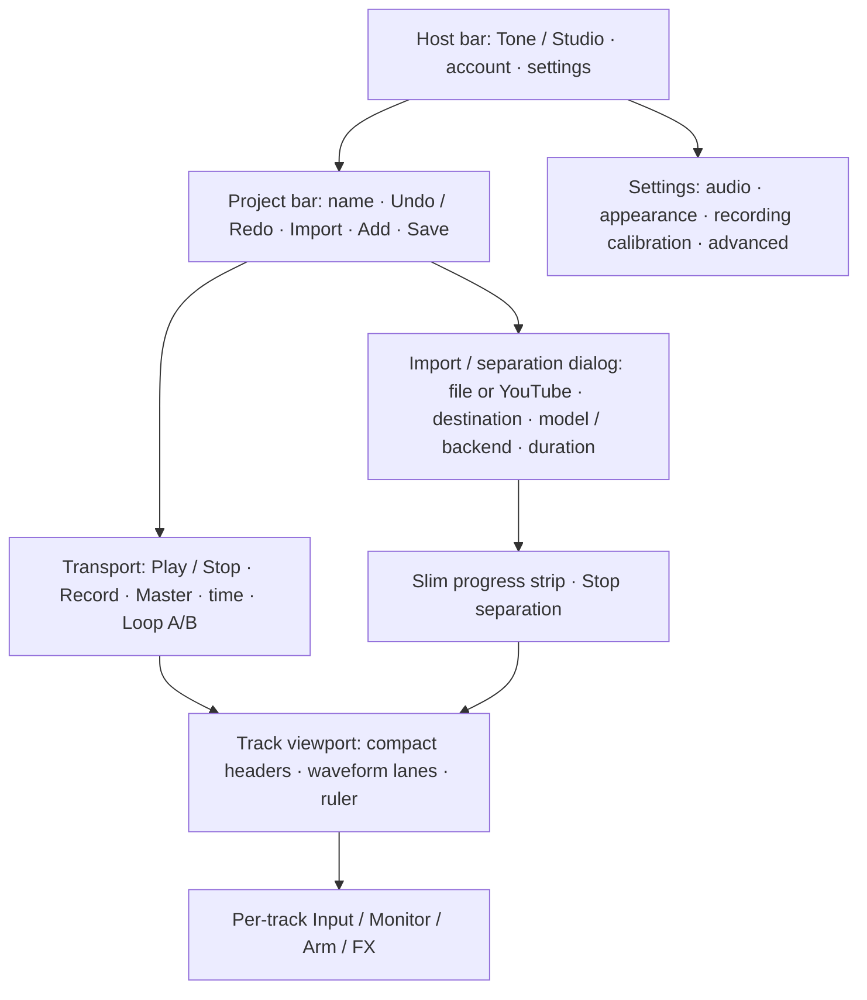

# Studio UI — compact workspace and appearance

Branch: `codex/studio-integration`. Scope: the guitar/bass studio, its Tone round trip and shared host UI. No DAW regions, new audio engine or change to separation/recording algorithms.

## Goals and layout

Studio should use the available viewport rather than grow into a long document. Keep the musical task visible: project, transport, tracks and active operation. Secondary configuration belongs in accessible dialogs. Retain existing capabilities and keyboard shortcuts.

Desktop target: 1280×720 and larger at 100% zoom; comfortable at 1440×900. Header and transport remain visible. Track area consumes remaining height with internal vertical scrolling when necessary; horizontal scrolling is reserved for timeline zoom. Never shrink indefinitely to show arbitrary track counts. At small viewports, high zoom or large text, prioritise access and readable controls over strict no-scroll. Dialogs may scroll internally. No page-wide overflow hiding that makes controls inaccessible.

## Task 1 [DONE] — shared appearance foundation

Offer Dark (existing default), Studio Light (soft grey/white, teal accent), Warm Studio (ivory/sand, blue accent) and Follow system (Dark or Studio Light). Selection in Settings → Appearance applies immediately to Tone, Studio and host dialogs and is stored locally, separate from projects/presets/history. No account write. Follow system responds to OS changes only when selected. Invalid/unavailable storage falls back safely to Dark; same-browser tabs observe preference changes. Restore before body paint to avoid a flash of the wrong palette.

Use semantic design tokens inherited through host web-component shadow roots. Use dark readable waveforms on light clips, visible playhead/loop borders, distinct recording red and meter states. Redraw cached waveform envelopes once when appearance changes; never restart transport, re-decode PCM, recreate audio graphs or dirty the project. Third-party WAM GUIs may retain their own styling. Plugin pedal artwork and recording colours retain their meaning.

Acceptance: all four modes selectable by keyboard; persisted reload; live system-mode changes; storage-denied fallback; light/warm host dialogs, controls, waveforms and Tone shell remain readable. Tests cover preference lifecycle, UI wiring, packaging and token contrast. Browser QA covers actual Rails Settings and Studio/Tone rendering. This task does not yet implement the compact layout.

## Task 2 [DONE] — viewport workspace and compact project/transport bars

Separate fixed host/project/transport bars from the flexible track viewport. Combine project operations into one row, preserve master and A/B controls, reduce default gaps. Collapsible sidebar with project library remains discoverable and remembers local preference. Let narrow widths wrap or collapse labels with accessible names. Keep import, Save and transport available without page scrolling on target desktop sizes.

Tests: viewport geometry for empty / 4 / 6 / many tracks, expanded/collapsed sidebar, zoom and keyboard focus; transport/recording operation unchanged. Verify no lost or hidden controls at 200% zoom.

## Task 3 [DONE] — dialogs for separation and secondary configuration

Move remaining bulky separation options to the existing import/separation workflow; retain model/backend/duration and advanced choices. Default full song. Keep a slim visible progress/status strip with Stop while separation runs, even with dialog closed. Reopening shows the current operation. Audio devices and calibration remain reachable from Settings; retain confirmation and monitoring-isolation behaviour.

Tests: all import sources, current/new project, direct WebNN eligibility, cancel/change model, partial mix, pending recording guards and focus return. Closing configuration must not cancel audio or separation implicitly.

## Task 4 [DONE] — compact track headers and recording controls

Move selected-track Input/Monitor/Arm into appropriate personal-track headers; use the shared transport Record/Stop. Remove redundant large recording panel only after parity. Track headers retain name, meter, volume, pan, Mute/Solo, FX, delete and accessible overflow actions. Provide comfortable/compact density and track height where useful. Accompaniment/stems never acquire editable personal-part presets accidentally.

Tests: arm eligibility, live vs playback meters, monitor safety, recording waveform append, delete confirmation/undo, FX round trip, empty/saved/read-only tracks. No additional PCM copies or change to latency compensation.

## Task 5 [TODO] — responsive/accessibility and end-to-end qualification

Keyboard, focus rings, tooltips, reduced motion and contrast across themes. Verify Studio ↔ Tone, save/restore, file/YouTube import, separation/Stop/partial mix, recording/calibration and FX editing. Test target desktop sizes and smaller screens, no focus traps outside dialogs, recording and separation under load. Rebuild dist and sync Rails; update README and HANDOFF with exact tests and remaining hardware/browser qualifications.

### Task 2 delivery — 2 November 2026

Desktop Studio now uses a 56px host bar, compact project actions (including the existing Import and New project commands) and a flexible track scrollport. The ruler is sticky inside the same scrollport as the lanes, so vertical scrollbars cannot misalign it. Sidebar toggle stays in the project bar, remembers its browser-local state and removes the collapsed sidebar from keyboard focus; Tone keeps its sidebar. Full names/descriptions remain available via hover and accessibility text.

The viewport layout applies from 1100×650 CSS pixels. Smaller effective viewports use ordinary document flow and wrapping controls; no body overflow lock. Secondary separation/recording sections have bounded internal scrolling until tasks 3–4 replace their presentation. No audio/recording algorithms changed.

Validation: 545 JavaScript tests and 141 Rails tests / 1220 assertions pass. Browser fixture uses the real host markup, UI components, ProjectTimeline and WaveSurfer renderer with synthetic peak envelopes, without audio/account writes. Empty, 4, 6 and 20 tracks tested around 1280×720, no document overflow; 1440×900 tested with separation and recording settings expanded. At 640×360 effective viewport (equivalent space to 200% zoom on 1280×720), controls remain in normal flow and document width stays within the viewport. Keyboard focus reveals the last track while the ruler/transport remain fixed. Actual Rails guest UI verified toggle persistence, Tone isolation and relocated Import opening the sign-in flow; no login or project writes. Screenshot: `/tmp/studio-compact-layout.png`.

## Validation record — Task 1

Results are recorded in HANDOFF after the final regression run. Native WebNN inference and physical audio latency are outside this visual task; no new performance claim follows from UI tests.

### Regression correction — 2 November 2026

RAM previews keep visible, disabled structural controls with Save/Stop guidance rather than removing Delete. Undo/Redo use labelled buttons and remain legible while unavailable. Arming stays specific to empty personal guitar/bass tracks; existing audio and temporary previews explain why arming is unavailable. Add track is disabled and guarded during separation, without switching mode, detaching the preview player or interrupting peak updates. After Stop/completion, confirmed addition first publishes the partial/full instruments through the existing lossless save path; publication failure retains the RAM result and creates no personal track. Timeline rebuilds also flush current preview peaks. Regression tests cover two successive audio/peak packets, blocked creation, publication failure, and Stop → Add guitar → Arm.

### One visible timeline — 2 November 2026

Remove the Project / Separation preview toggle. During processing, available instruments appear in the same Studio timeline and stay visible after Stop/completion, with explicit processing or Unsaved instruments status. Save project persists the available audio using the existing lossless save path. The source original remains available under Audio to separate for another run; selecting a source does not switch the visible timeline. A legacy internal request to show the original must not hide or detach an unsaved instrument result. Saved separation history remains under Options. Structural edits retain the prior Stop/Save guidance. No automatic background account write is introduced by separating.

Validation: 549 JavaScript tests and 141 Rails tests / 1220 assertions pass. Regression covers streaming → legacy original request → Stop, keeping the same visible tracks/player and preserving the original reference, plus status labels. Native six-track synthetic UI confirms zero mode buttons, visible live status, unchanged viewport fit and no console errors. Distribution and Rails rack synchronized.

### Recording controls refinement — 2 November 2026

Independent speaker monitoring and microphone arming replace ambiguous I/R-only controls. R is a guarded keyboard shortcut. Armed input remains visible on the track meter without audible monitoring; ordinary playback meters the played signal. Speaker can toggle during capture. Tempo label opens project BPM/signature; transport adds count-in Off/1/2 bars (one by default) and optional continuing click. One audio clock schedules count-in, DI capture and backing playback. Imported audio gets a dismissible, opt-in tempo suggestion from a bounded Worker. This delivers recording functionality; the broader task 4 compact-header redesign remains pending.

### Task 3 delivery and FX return simplification — 2 November 2026

Project options and Recording settings now open native dialogs instead of expanding secondary panels in the timeline. The same bound nodes move into the modal and return on Close/Esc; values/listeners and running separation/playback survive. Workspace/project/account changes close the dialog. Source/history, removed-track restore, model/backend/cache and export range remain available; compensation and calibration keep their existing handlers. Import/separation model choice remains its existing dialog with default whole song and 4/6-track buttons. Progress and Stop stay in the main strip. No decoding, rack rebuilding or audio scheduling is performed when opening/closing options.

FX return is a local project edit, including a take in RAM. Tone shows Return to Studio, does not save or ask a destination, and does not create an edit for an unchanged visit. Only Studio Save project offers an optional reusable-preset checkbox for actually edited FX sounds. Original capture metadata/DI remain intact; upload cannot overwrite a retouched playback snapshot. No timed autosave introduced. Task 4 (compact headers/removal of the redundant recording panel) and task 5 full end-to-end/hardware qualification remain pending.

Validation task3 : 569 JS tests; 142 Rails tests /1241 assertions, all passing. Native synthetic FX workflow validates zero saves on return and Studio-only choice; modal controls preserve values/focus and operation status across Esc/reopen. Source UI at1280×719 has no document overflow. Distribution/Rails rack rebuilt and synchronized. No physical input or user-account writes performed.

### Task 4 delivery — compact headers and shared recording transport, 2 November 2026

Removed the redundant recording panel and its duplicate Arm/Monitor buttons. Personal-track headers contain the speaker and microphone; the global transport contains one Record and one Stop. Record targets the armed track, selecting it before preparation even if another row was selected. It refuses an unpublished separation preview; the existing Stop/Save/Arm publication rules remain. Stop handles playback, capture and count-in cancellation, and is unavailable during finalization/calibration. A thin status line identifies the armed/selected personal track and displays input/count-in/capture/RAM-take information. Source/channel stays in Audio devices. Recording settings remains in the transport gear, including Use current Tone sound, Discard unsaved take and calibration.

During count-in/capture, only the armed track's speaker stays available in the track list. Mute/Solo, faders, pan, structural edits, track selection, seek and ruler changes stay locked; prior disabled states restore afterwards. This avoids making the new speaker unusable with a blanket inert list. The speaker changes only live routing, never capture/transport/PCM. Monitoring is independent of arming and playback meters still observe played audio.

Track density defaults Compact (~76 px per row in the reference viewport); Comfortable restores the more spacious metadata layout. Project options stores this browser-local UI preference, independent from project/preset/history/audio. Compact metadata remains available on name hover/accessibility description. Every row retains vertical meter, name, volume/pan, M/S and applicable FX/edit/delete/reorder; stems hide personal-input controls and never receive an arm button.

Validation: 577 JavaScript tests, 143 Rails tests /1248 assertions, all pass. New guards cover armed-vs-selected target, capture locks/speaker access, disabled-state restoration, shared Stop and unpublished previews; density restore/cleanup and markup uniqueness are covered. Native synthetic capture passes raw metering, silent arm, four-beat shared-clock count-in, speaker on/off during capture, waveform append (zero ordinary rerenders, one initial full repaint), playback metering and Stop cancellation with zero empty takes. Layout:1280×719 transport one54px row, all track rows76px;20-track keyboard navigation scrolls lanes while page remains at0;640×360 effective viewport uses normal vertical page flow without horizontal overflow. No physical input, account writes or long endurance qualification. Task5 remains next.

### Track-control notation preference — 2 November 2026

Settings → Appearance adds a labelled Track control style selector and live monitor/arm preview: Logic-like I/R, Ableton-like IN/record-circle, Reaper-like speaker/microphone (current default). These are visual conventions only, not copied DAW behaviour. Binary independent monitoring and arming/R shortcut remain unchanged. All glyph variants are aria-hidden inside the same button; accessible names, active/disabled state, focus and click listeners stay intact. CSS switches glyph visibility using one root dataset. No track rebuild, waveform repaint, audio command or project/history change. Browser-local preference validates values, tolerates blocked storage, synchronizes storage events and restores on reload; invalid/cleared values use Reaper-like. Settings listener released on close. Themes remain independent.

Validation:581 JavaScript tests and143 Rails tests /1248 assertions pass. Native preview/track checks show I/R and IN/record with identical button labels/disabled state; row height remains76px at1280×719 without horizontal overflow. Actual Rails Settings reload restores Logic choice; initial Reaper choice restored after test. No console errors/audio/account writes. Screenshot /tmp/studio-track-controls-preference.png. Dist/Rails rack synced.
