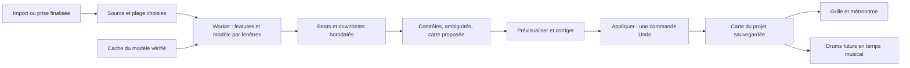

# Carte de tempo depuis un morceau ou une prise de guitare

Date : 3 novembre 2026. Branche de travail : `codex/studio-integration`.
**[DONE — T1/T2, validation locale]** Banc numérique WASM/WebGPU et préécoute avec waveform, clic, corrections et plage A/B. Aucun changement du tempo des projets. Prochaine tâche : T3, carte de tempo et persistance ; qualification multi-machines/musicale en T7.

## 1. Objectif et cas d’usage

Le Guitar Studio doit pouvoir suivre un morceau dont la pulsation change, et permettre de construire un accompagnement autour d’une rythmique enregistrée librement. La carte décrit le temps musical de l’audio ; son application ne réécrit pas les échantillons, ne quantifie pas le musicien et n’effectue aucun time-stretch.

Trois parcours prioritaires :

1. Importer un morceau produit à tempo régulier, obtenir une suggestion de BPM fixe et garder un parcours rapide.
2. Importer une prise live, détecter ses pulsations et premiers temps, vérifier puis appliquer une carte de tempo variable ; le clic et la grille suivent les musiciens.
3. Enregistrer une rythmique guitare/basse sans clic, analyser cette prise après Stop, appliquer sa carte, puis ajouter ultérieurement un pattern de drums qui suit le guitariste. Le morceau peut accélérer ou ralentir naturellement.

« Live » est une indication de l’utilisateur, pas une preuve : un concert peut être au clic, et un morceau studio peut varier. Les intitulés doivent exprimer le résultat attendu : **Tempo fixe / Suivre le morceau**.

## 2. État réel du projet

- `TempoAnalysis.js` : estimation d’un seul BPM par autocorrélation d’une enveloppe d’attaques, environ60–180BPM, suggestion à confirmer.
- `TempoDetection.js` et `tempo-worker.js` : au plus60secondes du premier canal déjà décodé, analyse hors UI. Aucune liste de beats/downbeats ni carte.
- `ProjectTiming.js` : BPM fixe de noire et signatures2/4,3/4,4/4,5/4,6/8,7/8. En6/8, les clics actuels sont des croches ; ne pas confondre pulsation détectée et unité de notation.
- `ProjectPlayer`, capture WAM/ring buffer/Worker et compensation utilisent l’horloge audio et les frames. A/B sert au punch si Loop est décoché, aux prises successives si coché.
- Le projet conserve un BPM et une signature ; pas de persistance de carte. Les drums adaptatifs décrits ici n’existent pas encore.

Ces comportements restent la référence de compatibilité jusqu’à livraison et validation des étapes ci-dessous.

## 3. Politique à l’import : rapide par défaut, avancé au choix

### Nouveau projet

Ajouter au dialogue d’import existant un choix compact, valable pour fichier et YouTube, avec ou sans séparation :

| Choix | Effet proposé |
|---|---|
| **Tempo fixe — rapide** (défaut initial recommandé) | Estimation légère actuelle ; appliquer/ignorer le BPM proposé |
| **Suivre le morceau — prise live / tempo variable** | Analyse ML beats/downbeats sur l’audio complet, puis proposition de carte |
| **Ne pas analyser** | Conserver le tempo du projet sans travail supplémentaire |

Pas de deuxième assistant obligatoire et aucune attente avant l’import ou l’écoute. L’analyse avancée s’exécute en fond avec progression, annulation et état d’erreur. Le choix de quatre/six stems reste indépendant.

### Projet déjà ouvert

Par défaut **conserver la carte/le tempo actuel**. Proposer « Analyser cette nouvelle piste » sans changer la référence du projet. Plusieurs accompagnements importés ne doivent pas écraser successivement la carte. Choisir une source de référence puis **Appliquer au projet** est explicite.

### Préférences

Prévoir une préférence « Analyse rythmique à l’import » : rapide / proposer le choix / avancée automatique / désactivée. L’analyse avancée automatique pourra devenir le défaut après qualification des performances et de la qualité ; elle n’est pas le défaut imposé de la première livraison.

Le premier téléchargement ML affiche modèle, taille réelle du manifeste, progression et cache ; l’utilisateur l’autorise. Une préférence automatique ne doit pas déclencher silencieusement le premier gros téléchargement. Les imports suivants peuvent réutiliser le modèle autorisé/cache. **Analyse automatique n’implique jamais application automatique d’une carte** : le projet actif n’est pas modifié sans validation. Annulation/indisponibilité garde le tempo existant et propose éventuellement le BPM simple, clairement identifié.

## 4. Analyser une piste déjà enregistrée

Commande dans le menu de piste personnelle : **Détecter le tempo de cette piste**. Disponible après finalisation, sur une prise en RAM ou sauvegardée, sans imposer Save project ni un passage dans Tone.

Parcours « guitare d’abord » :

1. Enregistrer librement une rythmique, éventuellement sans clic ; Stop.
2. Lancer l’analyse de la prise sélectionnée ou de sa plage utile.
3. Afficher les beats proposés sur la waveform, écouter avec un clic de prévisualisation indépendant et corriger le premier temps/double ou moitié tempo si nécessaire.
4. Choisir **BPM fixe** ou **Suivre cette piste**, puis **Appliquer au projet**.
5. Dans une étape future, **Ajouter des drums qui suivent le projet** et choisir un pattern simple.

La DI est la source d’analyse initiale : pas d’impression du preset dans la prise. Si elle donne un résultat insuffisant, proposer ultérieurement d’analyser un rendu du son de la piste, utilisant le renderer offline existant quand il est qualifié. Cette option doit indiquer la chaîne effectivement analysée ; aucun remplacement implicite de la DI ni rendu sec silencieux en cas d’échec du preset.

Exclure le padding de placement, les silences initiaux et les zones sans signal fiable de l’estimation utile ; conserver le décalage exact vers le temps du projet. Pour une prise punch ou un passage de boucle, proposer **ce passage / piste entière**. N’analyser que la prise sélectionnée, pas tous les passages retenus automatiquement. Dans une piste composite, ne pas confondre les métadonnées du dernier punch avec tout l’audio historiquement présent.

Une guitare seule, syncopée ou arpégée peut rendre la pulsation ambiguë. Prévoir choix d’un segment représentatif, correction ×2/÷2 et indication manuelle du premier temps. Absence de résultat fiable : ne pas inventer de mesures. L’utilisateur peut garder le tempo manuel.

Si une carte existe déjà, expliquer l’impact avant de la remplacer. La nouvelle guitare peut aussi être analysée sans devenir la référence, pour comparer son placement avec la grille existante. Cette analyse n’est ni une correction automatique du jeu ni une évaluation pédagogique de précision.

## 5. Beat This! et qualification du moteur

Candidat prioritaire : **Beat This!, checkpoint `final0`**. Il produit des positions de beats et downbeats ; il ne génère pas de drums, ne fournit pas à lui seul une carte éditable et ne garantit pas une signature correcte pour chaque passage.

Références consultées le3novembre2026 :

- [Article ISMIR2024, Foscarin/Schlüter/Widmer](https://arxiv.org/abs/2407.21658) : suivi des beats/downbeats, sans contraintes DBN fixes de tempo/métrique ; erreurs et ruptures de continuité restent possibles.
- [Code officiel d’inférence](https://github.com/CPJKU/beat_this/blob/main/beat_this/inference.py) : référence PyTorch, `final0` par défaut, prétraitement et découpage/agrégation à reproduire fidèlement.
- [Conversion tierce musetric ONNX/WebGPU](https://huggingface.co/musetric/beat-this-onnx) : candidate technique, distincte d’une publication officielle JKU. Le graphe couvre le réseau ; extraction des features et post-traitement restent à intégrer.

La carte du modèle ONNX décrit des fenêtres de1500frames, soit30s, avec chevauchement ; ne pas traiter chaque fenêtre comme un morceau indépendant ni perdre l’offset temporel aux jointures. Épingler les octets exacts, SHA256, prétraitement, export et licence/code/poids avant intégration. Les annonces de parité/vitesse du fournisseur sont des hypothèses à vérifier ici, pas des résultats du projet. Vérifier notamment le graphe choisi et les contournements WebGPU documentés par le convertisseur.

Priorité navigateur : Worker dédié, ONNX Runtime WebGPU quand validé, WASM/CPU comme solution de secours. WebNN reste une piste expérimentale après qualification, pas une promesse de compatibilité `final0`. Comparer sorties et événements à la référence officielle sur les mêmes extraits ; pas seulement un BPM médian.

Respecter le prétraitement du modèle, notamment conversion mono, fréquence d’analyse et calcul log-mel ; adapter la copie de travail uniquement si nécessaire. L’audio original garde sa fréquence et son placement. Tester les offsets induits par STFT/padding/segments et leur conversion en secondes du projet.

## 6. Architecture et ressources

Composants à prévoir : coordinateur d’analyse annulable, adaptateur Beat This!, construction/édition de carte, conversions temps musical↔secondes et planificateur de clic. Réutiliser le cache/manifeste/intégrité existants sans coupler les modèles rythmiques aux modèles de séparation.

Analyser progressivement les fenêtres de tout le morceau ; la limite60s de l’estimateur léger ne vaut pas pour une carte complète. Éviter la copie de tout le PCM à chaque fenêtre. Réutiliser le décodage déjà disponible et transférer des données bornées vers le Worker ; pas de spectrogramme ni d’inférence sur le thread UI. Le transport de blocs peut reprendre les outils existants ; un nouveau ring buffer n’est pas exigé si des transferts bornés suffisent.

Priorité à l’audio interactif. Limiter par défaut à un calcul lourd de fond : séparation et analyse ML ne saturent pas simultanément le GPU sans validation. Suspendre/mettre en attente l’inférence pendant une capture ou une calibration ; garder la lecture/annulation réactives. Afficher distinctement téléchargement, préparation, traitement, nombre de fenêtres et pourcentage.

Budgets mémoire/concurrence et durée admissible à fixer par les tests de faisabilité, puis exposer les limites réelles. Refuser proprement un manque de mémoire. Un résultat tardif d’un autre projet/compte/son ou d’une ancienne version audio ne s’applique pas. Libérer sessions, tensors et buffers en cas d’annulation.

## 7. Carte de tempo : contrat musical

Séparer trois objets : **détections brutes**, **proposition corrigée/lissée**, **carte appliquée**. Garder la provenance sans transformer une activation du réseau en probabilité de fiabilité calibrée. Les scores/ambiguïtés éventuels doivent être qualifiés.

La carte appliquée contient au minimum :

- version de schéma, identifiant/révision et mode fixe/variable ;
- source : piste, version/checksum du fichier ou session RAM, plage analysée, décalage source→projet, canal et recette d’analyse ; jamais une blob URL durable ;
- modèle/checkpoint, SHA, version du pré/post-traitement et backend utilisé ;
- ancres strictement ordonnées `(position en noires, temps en secondes du projet)`, premier temps validé et signature ;
- corrections utilisateur, zones indéterminées et politique d’extrapolation.

Noter la position musicale en **noires**, indépendante de la signature. L’unité de pulsation détectée doit être explicite : une croche, une noire ou une noire pointée ne représentent pas le même BPM. Ne pas supposer que chaque beat ML vaut une noire ; demander une correction en cas d’ambiguïté, notamment en6/8. Le BPM affiché reste celui de la noire, conformément au projet actuel.

Entre deux ancres validées, une interpolation linéaire de la position musicale donne un tempo constant local. Le BPM local est `60 × différence de position en noires / différence de temps en secondes`. Les conversions inverses doivent être monotones, stables et cohérentes aux frontières. Les temps de mesure dérivent de la signature et de l’ancre de premier temps, pas du simple début du fichier.

Éviter une carte qui transforme chaque microvariation d’attaque/swing en changement de tempo. Prévoir lissage réglable et conservation des événements bruts pour revenir en arrière ; ne pas lisser au point d’effacer un vrai ralentissement. Les grands trous, beats manquants et hésitations ne doivent pas être comblés comme des mesures certaines sans avertissement.

Première livraison : signature choisie manuellement et constante, comme actuellement. Les downbeats aident à valider phase/mesures ; changements automatiques de signature, métriques complexes et carte de métrique variable sont une extension ultérieure.

Avant le premier beat et après le dernier, utiliser le tempo local valide le plus proche, clairement indiqué comme extrapolé ; les lacunes internes restent signalées. Une anacrouse est possible : premier temps de mesure après le début audio, sans décaler les samples pour l’amener artificiellement à zéro.

## 8. Effets sur le Studio

- **Grille/règle** : positions des mesures et temps calculées depuis la carte ; affichage du BPM local au playhead, pas seulement une moyenne.
- **Click** : programmation AudioContext à partir des timestamps musicaux, hors timers UI ; on/off et absence de clic dans la DI inchangés.
- **Décompte** : une mesure selon signature et tempo local au départ, gelé pendant ce décompte initial ; puis suivi de la carte. Pas de redémarrage du décompte à chaque passage de boucle.
- **A/B** : les bornes existantes restent ancrées en secondes/frames lors de l’application d’une carte. Seuls leurs libellés musicaux changent ; un calage sur la grille est une action explicite. Punch sans Loop, prises répétées avec Loop restent inchangés.
- **Boucle** : rejouer le même fragment de carte sur chaque tour, B exclusif, sans clic doublé à la jonction. Une variation de tempo entre début et fin de la boucle peut se répéter ; ne pas warper l’audio pour lisser cette jonction.
- **Enregistrement** : capture et compensation restent en frames ; une seule correction de latence. Le métronome suit la carte, pas l’inverse. Geler la carte pendant capture/décompte/calibration et ne jamais appliquer automatiquement une nouvelle analyse après Stop.
- **Projet existant** : l’audio des pistes séparées/personnelles reste placé en secondes. La carte commune peut guider de nouveaux événements musicaux ; elle ne déforme pas les pistes déjà présentes.
- **FX** : ne pas modifier silencieusement les paramètres des WAM. La synchronisation de délais/LFO de plugins sur cette carte est une tâche séparée.
- **Modification de source** : une nouvelle prise/punch, suppression ou remplacement peut rendre une analyse obsolète. Signaler la provenance périmée et proposer de réanalyser ; conserver la carte appliquée tant que l’utilisateur ne la remplace pas. Undo de la source et de la carte reste cohérent.

## 9. Drums qui suivent la guitare : extension préparée

Beat This! fournit des repères ; il ne choisit ni kick/snare/charley ni style. Prévoir ensuite un générateur de patterns simple, sans dépendre d’un modèle génératif.

Les événements sont définis en positions musicales, avec vélocité et instrument. Leurs timestamps audio sont calculés depuis la carte appliquée. Exemple4/4 : kick aux premier/troisième temps, snare aux deuxième/quatrième, charley en croches. Le pattern accélère/ralentit avec la rythmique de référence, sans retoucher cette dernière.

Prévoir choix de pattern/kit, volume, mute/solo, longueur et humanisation facultative, désactivée pour la validation de synchronisation. Le pattern ne doit pas amplifier un défaut de la détection en déplaçant arbitrairement les coups. Commencer par une préécoute, puis créer une piste d’accompagnement.

Pour respecter le Studio sans régions : un pattern décrit la piste entière ou une plage choisie et se rend en un fichier audio aligné au projet. Garder sa recette et la révision de carte pour le régénérer. Son WAV/MP3 rendu s’intègre au mixer, aux exports et à Save project comme les autres accompagnements. Un changement ultérieur de carte propose une régénération ; le fichier déjà rendu n’est pas time-stretché silencieusement. L’export de mix utilise exactement les timestamps validés en lecture.

La synthèse/les samples du kit et leurs licences seront choisis lors de cette tâche. Import MIDI, comping, régions, génération de variations complexes et time-stretch de boucles audio sont hors de cette première extension.

## 10. Persistance, historique et partage

Une carte par projet au départ, avec une source de référence explicite. Rails conserve la carte appliquée et sa provenance via un contrat versionné, borné en taille et protégé par version attendue. Projet à BPM fixe existant compatible sans migration audio. Un projet partagé en lecture seule peut utiliser sa carte, pas la remplacer sur le serveur.

Analyser/prévisualiser ne change pas le projet. Appliquer une carte ou une série de corrections constitue une commande Undo/Redo de métadonnées ; pas de copie d’audio ni consommation artificielle des deux opérations d’historique audio. Conserver BPM fixe/signature antérieurs pour revenir à l’ancien mode. Recharger restaure la carte sauvegardée et la source choisie, pas un résultat temporaire non confirmé.

Résoudre les références RAM après publication de la prise lors de Save project ; valider source/version et carte de manière cohérente, avec retry idempotent. Si la sauvegarde échoue, garder la proposition et la prise. Les assets/poids ML restent dans le cache local, pas dans chaque projet. Aucun envoi d’audio d’analyse vers un service tiers dans le parcours local.

## 11. Tâches incrémentales

| Tâche | Statut | Livraison et validation requise |
|---|---|---|
| T0 | [DONE — spécification uniquement] | Parcours import/guitare, contrat et étapes décrits ici ; aucun moteur modifié |
| T1 | [DONE — qualification numérique locale] | Banc isolé Beat This! final0 : manifeste, cache, extraction features, référence officielle et ONNX, WASM/WebGPU, annulation/progression ; mêmes beats/downbeats aux tolérances définies |
| T2 | [DONE — banc isolé] | Afficher beats/downbeats sur waveform ; première mesure, ×2/÷2, plage et corrections simples ; écoute du clic de prévisualisation ; aucun changement de projet sans appliquer |
| T3 | [TODO] | Modèle TempoMap et conversions bidirectionnelles, phases/6/8/anacrouse/lissage, Undo et persistance Rails/version/ACL ; compatibilité projets fixes |
| T4 | [TODO] | Grille, règle, BPM local, Click/décompte et A/B sur carte ; capture inchangée ; tests d’horloge et absence de doublons aux boucles |
| T5 | [TODO] | Intégration compacte à l’import fichier/YouTube et commande sur piste enregistrée RAM/sauvegardée ; source de référence, résultats périmés et préférence d’analyse |
| T6 | [TODO] | Patterns drums suivant la carte, préécoute, rendu en une piste, recette/persistance/exports ; guitare originale intacte |
| T7 | [TODO] | Qualification live/guitare réelle, cas difficiles, CPU/mémoire/UI, comparaison backends et documentation des limites avant changement du défaut |

La livraison T0 était documentaire. L’utilisateur a ensuite autorisé le démarrage de T1 ; le banc isolé est maintenant implémenté, T1/T2 sont livrées dans le banc isolé, T3–T7 restent à venir. Un changement vers ML automatique par défaut dépend de T1/T7 et reste une décision produit réversible. Chaque tâche logicielle ajoute ses tests et n’est proposée à l’essai qu’après leur réussite.

## 12. Plan de validation

- **Référence annotée** : clics synthétiques à tempo fixe, accélérations/ralentissements connus, changements par paliers, rubato, silence, anacrouse, swing et ambiguïtés moitié/double. Ajouter des extraits live et rythmiques guitare avec annotations humaines ; leurs noms, durées, provenance/droits, position analysée et corrections sont consignés.
- **ML** : mêmes fichiers/features pour PyTorch et export navigateur ; scores bruts et événements, pas uniquement BPM moyen. Vérifier fenêtres/jointures, fichiers courts, silence, durées longues, fréquence d’entrée et décalage source/projet. Aucun score de benchmark honnête sur un corpus d’entraînement non identifié.
- **Qualité musicale** : précision/rappel et continuité beats/downbeats avec protocole explicite, erreurs de phase, ×2/÷2, métrique et dérive finale. Cibles initiales à confirmer : erreur médiane≤30ms et95epercentile≤80ms sur repères appariés ; publier aussi les temps manqués/surnuméraires, qu’un appariement seul masquerait. Ces nombres ne sont pas des mesures déjà obtenues ni une garantie tous genres.
- **Carte** : ancres monotones, doublons/NaN refusés, conversion noire↔seconde réversible, distinction croche/noire pointée, extrapolation signalée et trous explicites ; signature constante de première version respectée.
- **Transport** : à timestamps synthétiques connus, clic/drums programmés à±1frame de la carte à44,1/48/96kHz, indépendamment de l’erreur ML. A/B avant/pendant/après, boucles à tempo variable et décompte unique, pas de clic dans la DI.
- **Intégrité** : samples et checksums de la guitare inchangés après analyse/application ; compensation non répétée, changement de prise/source rendant le résultat périmé, Save/reload/Undo/Redo/partage et conflits Rails.
- **Ressources** : téléchargement interrompu, cache corrompu, modèle absent, GPU indisponible/perdu, refus mémoire, annulation et réponses tardives ; lecture et UI réactives. Mesurer chargement initial, features, inférence, post-traitement, temps total, mémoire et traitement par minute d’audio.
- **Drums** : nombre/positions des coups et rendu identiques à la recette, loop sans doublons, changement de carte demandant régénération ; pas de déplacement ni d’altération de la prise de référence.

Les tests unitaires de base restent indépendants des gros poids téléchargés, avec fixtures numériques bornées. Les validations ML réelles sont des tests d’intégration séparés avec manifeste/poids requis explicitement ; leur absence n’est pas un faux résultat positif de qualification. Conserver les rapports et résultats réels dans la documentation d’évaluation, distincts des cibles ci-dessus.

## 14. Implémentation T1 — 3 novembre 2026

Banc accessible avec Rails : <http://localhost:3001/rack/projects/tempo/beat-this-benchmark.html>. Code et protocole : `examples/wam/projects/tempo/README.md`. La dist produit inclut cette page isolée et les modules, sans poids Beat This! embarqués. Le Studio et son détecteur actuel restent inchangés.

Livré : manifeste épinglé/SHA-256, téléchargement distant explicite et cache IndexedDB, progression sans polling, suppression du cache du modèle, Worker annulable par terminaison, import audio/durée limitée à120s, calcul log-mel, fenêtrage/agrégation, post-traitement minimal, affichage des événements et mesures en secondes, export JSON. Les WAV PCM16 à22050Hz ont une lecture exacte indépendante du décodeur navigateur pour la qualification. L’audio original reste intact.

Validation : tests unitaires légers avec fixture PyTorch/torchaudio indépendante ; référence lourde explicite `tools/validate-beat-this.py`, poids ignorés par Git. Comparaisons numériques sur même PCM et même graphe statique ; ce n’est pas une mesure de précision musicale contre annotations. Résultats détaillés/versionnés dans `examples/wam/projects/tempo/qualification-2026-11-03.json`.

Réserves initiales, conservées pour tracer la qualification (résolues localement ci-dessous) :

1. **WebGPU corrigé sur la machine de développement** : divergence localisée dans `ReduceL2`, reproduite par un cas minimal de cache de shader mélangeant des largeurs32/64. Patch GPU uniquement : carré/somme/racine pour25 normalisations, avec modèle source/patch/graphe dérivé liés par SHA-256. Poids inchangés ; référence WASM originale conservée. Sur le MP3 utilisateur (30s) :50beats/13downbeats identiques, écart maximal0,000066. Contrôle par fenêtre et événements identiques toujours obligatoire. Restent les autres navigateurs/machines.
2. Le graphe tiers impose1500frames. Sur un extrait musical de10,88s, la référence officielle à longueur variable trouve21beats/6downbeats, la version complétée à30s11/5. Le banc affiche donc « diagnostic seulement » pour ces fenêtres courtes. Qualifier un export dynamique ou une autre stratégie de contexte avant l’analyse des riffs courts enregistrés.

### Qualification des fenêtres courtes et livraison T2

Les fenêtres courtes conservent maintenant leur contexte réel, sans remplissage à 30 s. Un graphe dynamique est reconstruit dans le Worker à partir des poids vérifiés déjà en cache et d’une recette de 3,31 Mo (aucun poids appris dupliqué dans la distribution). Attention découpée par groupes de huit têtes ; WebGPU impose NCHW pour cette variante. Comparaison native sur huit longueurs de 14 à 1500 frames : erreur maximale 6,08e-6 contre PyTorch. Même extrait musical PCM16 de 10,8805 s : 21 beats / 6 downbeats identiques, erreur navigateur/native 3,34e-5. Les GPU restent vérifiés contre WASM à chaque fenêtre.

T2 ajoute waveform, repères, premier temps, ×2/÷2, regroupement en trois ou quatre battements, plage A/B et lecture de l’audio original avec clic indépendant. Horloge Web Audio commune ; couper le clic conserve la lecture. Les corrections exportées sont séparées des événements bruts. Aucun bouton n’applique encore une carte au Studio. Tests unitaires de proposition immuable, stéréo, bornes, calendrier audio, arrêt/annulation et minuterie navigateur ; parcours natif vérifié. T7 reste nécessaire pour la qualité musicale et les autres appareils. Aucun défaut ML automatique activé.

## Décision UX — 3 novembre 2026

À la demande de Michel, ne pas exposer de bouton d’analyse tempo sur les pistes de Studio avant que la carte variable ne puisse être appliquée au projet. Le banc T1/T2 reste accessible séparément pour qualification. T3–T5 restent à réaliser ; aucune entrée partiellement intégrée dans le parcours d’enregistrement.
