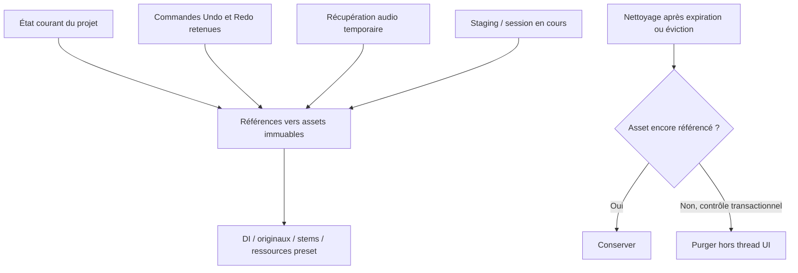

# Undo / Redo de Studio et conservation limitée des fichiers audio

Date : 27 octobre 2026. **[IMPLEMENTED — historique de session ; rétention serveur à compléter]**

## Livraison du 27 octobre 2026

**Fonctionnel dans Studio** : boutons SVG Annuler/Rétablir et raccourcis Mac/Windows/Linux ; volume/pan (un geste = une action), mute/solo, noms/instrument/preset associé, ordre des pistes, nom/tempo du projet, boucle A/B, création de piste et suppression/restauration. Les imports dans le projet ouvert et les séparations publiées/changements de résultat sont groupés et annulables sans relancer l’inférence. Une piste ou un projet chargé initialement constitue le point de départ ; l’import dans un nouveau projet ne supprime pas ce projet par Undo.

Pile limitée à **30 commandes dont deux opérations audio**, Undo et Redo réunis. Aucune copie de PCM dans le journal. Save des réglages conserve la pile ; Undo après Save marque à nouveau les réglages comme modifiés. Chargement/rechargement d’un projet, changement de compte et abandon confirmé des modifications réinitialisent l’historique. Les actions sur les previews RAM non publiées restent gérées par Stop/Cancel, avec Undo désactivé jusqu’à leur sortie/publication.

Les commandes structurelles utilisent les fichiers déjà sauvegardés ; visibilité et sélection de séparation sont modifiées atomiquement avec préconditions côté Rails. Un groupe déjà entièrement dans l’état demandé est accepté comme retry idempotent ; un état intermédiaire ou divergent est refusé. La suppression/restauration simple est également réessayable. Les contrôles sont bloqués pendant une commande en cours et une réponse tardive ne modifie pas le nouveau projet.

**Encore à faire** : récupération audio bornée après rechargement, budget serveur de 512 MiB, délai de 24 h, baux et nettoyage des blobs. Les plafonds 30/2 bornent les commandes de cette session, **pas encore l’ensemble du stockage des archives existantes**. Aucune purge d’audio n’est exécutée par cette livraison. Le raccordement de la future prise DI reste à faire lorsque l’enregistrement sera implémenté.

## Proposition

Ajouter Annuler / Rétablir à Studio pour corriger une erreur sans transformer l’application en DAW complet. Une suppression de piste devient une action annulable, au même titre qu’un réglage de volume ou un remplacement de prise.

Michel souhaite un historique limité, notamment pour les fichiers audio, et évoque les deux dernières opérations sans fixer définitivement ce nombre. La proposition ci-dessous est un point de départ, pas une préférence déjà confirmée :

| Limite proposée | Valeur initiale | Sens |
|---|---|---|
| Actions de Studio | 30 maximum par projet ouvert | Petites commandes : volume, pan, nom, ordre, etc. |
| Opérations retenant des versions audio | 2 maximum par projet, Undo **et** Redo réunis | Une séparation de six instruments compte comme une opération, pas six |
| Surcoût audio de récupération | 512 MiB maximum par projet, sous réserve des quotas existants | Taille des blobs historiques distincts ; aucune copie si le même blob est déjà référencé |
| Récupération audio après inactivité | 24 h proposées | Délai de récupération, sans archivage indéfini des prises supprimées |

**Recommandation : 30 petites actions, dont au maximum 2 opérations audio.** Deux clics seulement seraient vite insuffisants : après supprimer une piste, changer son volume ailleurs puis le pan, on aurait déjà perdu la possibilité d’annuler la suppression.

Les plafonds de nombre, de taille et de durée s’appliquent ensemble. Deux opérations audio restent un maximum, pas une garantie si leurs fichiers dépassent le budget disponible. Le projet courant, ses fichiers nécessaires et ses originaux réservés ne sont pas supprimés pour satisfaire le budget d’Undo.

Le document conserve ci-dessous le plan complet de rétention à terme. **La livraison décrite en tête ajoute Undo/Redo et ne purge aucun audio.**

## Périmètre fonctionnel

Première version : historique du **document Studio**, séparé pour chaque projet et chaque compte. Le mécanisme de commandes sera réutilisable plus tard dans Tone, mais l’historique de la chaîne live de Tone n’est pas inclus implicitement dans celui d’un projet.

| Action | Comportement prévu |
|---|---|
| Volume / pan de piste | Une commande par geste complet, valeurs avant/après |
| Mute / solo | Annuler la modification des états concernés |
| Renommer piste ou projet, changer tempo | Restaurer les valeurs avant/après ; le tempo restaure aussi les conséquences sur la boucle |
| Réordonner une piste | Restaurer l’ordre exact avec les mêmes IDs |
| Changer le preset d’une piste personnelle | Restaurer le snapshot du preset et ses ressources, sans modifier la DI |
| Ajouter une piste vide | Retirer/rétablir la piste ; aucune allocation audio inutile |
| Importer un fichier, avec ou sans séparation | Retirer/rétablir le groupe publié, sans téléchargement ni inférence à refaire |
| Supprimer une ou plusieurs pistes | Retirer/rétablir les pistes, leur place, leur audio et leur configuration ; monitoring reste coupé par sécurité |
| Remplacer une prise | Restaurer l’ancienne DI et son preset de lecture, ou rétablir la nouvelle, après finalisation réussie |
| Nouvelle séparation d’un original | Restaurer l’état précédent du projet et des instruments concernés, sans toucher aux autres sources |
| Définir la boucle A/B | Un geste = une commande ; restaurer bornes et activation |
| Restaurer depuis Removed tracks | Une commande explicite, réversible |

Play, pause, seek, zoom, sélection de piste et ouverture de panneaux ne remplissent pas l’historique. La sélection restaurée est un confort visuel, pas une autorisation de rouvrir un microphone.

Monitor, armement, périphériques, permissions micro, calibration, connexion au compte, partage et suppression du projet entier sont hors Undo. La suppression d’un projet garde sa confirmation propre. Save project ne devient pas une commande à annuler : il sauvegarde l’état obtenu. Exporter un mix vers Tone ne doit pas être « annulé » en supprimant silencieusement un fichier déjà utilisé ; annuler le mixage dans Studio n’altère pas un MP3 exporté auparavant.

L’import YouTube produit une commande seulement lorsque l’audio est disponible et intégré au projet. Undo ne redéclenche jamais un téléchargement YouTube. Annuler un calcul ou un upload encore en cours reste **Cancel / Stop**, distinct d’Undo.

## Interface

Deux boutons discrets près de Save project, utilisant les composants de boutons existants du host et deux **icônes SVG** cohérentes avec son style : flèche courbée vers la gauche pour Annuler, vers la droite pour Rétablir. Ajouter ces dessins à la bibliothèque d’icônes existante ; pas d’emoji ni de police d’icônes supplémentaire. Même taille, contraste et états hover/focus que les autres commandes.

Infobulles contextualisées : « Annuler : supprimer Bass (⌘Z) », « Rétablir : volume Guitar (⌘⇧Z) » sur Mac ; adapter les raccourcis affichés sur Windows/Linux. Boutons désactivés quand la pile correspondante est vide ou qu’une mutation est en attente. Noms accessibles explicites, SVG décoratifs masqués aux lecteurs d’écran ; état désactivé effectif et focus clavier visible. Les boutons utilisent exactement les mêmes commandes que les raccourcis.

| Système | Annuler | Rétablir |
|---|---|---|
| macOS | **⌘Z** | **⌘⇧Z** |
| Windows | **Ctrl+Z** | **Ctrl+Y**, également **Ctrl+Shift+Z** |
| Linux | **Ctrl+Z** | **Ctrl+Shift+Z**, également **Ctrl+Y** |

Utiliser `metaKey` pour Mac et `ctrlKey` pour Windows/Linux, sans capturer les combinaisons avec Alt/AltGraph. Exposer le raccourci principal avec `aria-keyshortcuts`. Une touche maintenue ne doit pas répéter des opérations serveur en parallèle : ignorer les répétitions clavier pour les commandes de l’historique et sérialiser les demandes.

Dans un champ texte, un textarea ou un élément éditable, conserver l’Undo natif du champ. Ne pas intercepter les raccourcis d’une fenêtre WAM, d’un dialogue ou d’un autre espace de travail. N’appeler `preventDefault()` que lorsque Studio traite effectivement la commande et qu’elle est disponible ; ne pas installer un gestionnaire global qui vole les raccourcis du navigateur.

Un seul drag de fader, de pan, de poignée A/B ou de piste doit créer **une seule** entrée. Les événements `input` continuent à actualiser le son et l’affichage en direct ; le geste terminé fixe la commande. Un retour à la valeur initiale n’ajoute rien. Une saisie clavier de slider est regroupée sur une interaction cohérente, terminée au blur ou après une courte période d’inactivité à qualifier.

Conserver la confirmation de suppression demandée par Michel. Après confirmation : retrait immédiat, message « Piste retirée — Annuler ». Ce raccourci utilise la même pile, pas un second mécanisme concurrent. Les restaurations prolongées restent accessibles dans Options tant que les ressources sont récupérables.

Avant une opération qui nécessiterait de renoncer à une récupération encore disponible : annoncer précisément la limite atteinte et les actions qui ne seront plus annulables. Ne jamais afficher un bouton Undo dont l’audio a déjà été purgé.

## Règles de la pile

Une commande porte un ID, le projet, les entités concernées, un libellé, les valeurs avant/après, les références d’assets et, si nécessaire, la version serveur attendue. L’Undo applique l’inverse ; Redo réapplique les mêmes données enregistrées. Ni l’un ni l’autre ne recrée une commande ordinaire.

Une nouvelle modification après Undo abandonne la branche Redo. Ses assets deviennent candidats au nettoyage uniquement s’ils ne sont plus référencés ailleurs. Les limites audio s’appliquent à **toutes les commandes conservées**, des deux côtés du curseur ; sinon plusieurs Undo suffiraient à contourner le plafond.

### Garder un historique continu

Ne pas supprimer arbitrairement une ancienne commande au milieu : des commandes plus récentes peuvent dépendre de la piste ou de la version créée par celle-ci. Lorsqu’une limite est dépassée, avancer le point de départ de l’historique et retirer un **préfixe complet**, jusqu’à retrouver un suffixe valide sous tous les plafonds. Si le curseur n’est pas en fin de pile, la nouvelle action abandonne d’abord Redo, puis le calcul de rétention est effectué sur le nouvel historique.

Exemple : import A → réglages → remplacement B → réglages → remplacement C. Trois commandes retiennent de l’audio. Le point de départ avance après l’import A ; B et C restent annulables, ainsi que les commandes intermédiaires compatibles. L’audio A reste conservé s’il constitue encore l’état avant de B. Le nombre de commandes et le nombre de fichiers ne sont donc pas interchangeables.

Exemple simple de prises : la piste contient A, puis on enregistre B, puis C. L’état courant est C ; Undo ramène B, puis A. Les fichiers A et B sont l’historique et C le fichier courant. Après une nouvelle prise D, on pourra revenir à C puis B ; A devient purgeable s’il n’est référencé nulle part ailleurs.

Un échec d’Undo serveur laisse la pile, le curseur et l’affichage courant cohérents ; il n’annonce pas une annulation réussie. Les requêtes sont sérialisées, idempotentes et protégées contre les réponses tardives d’un autre projet/compte.

## Conservation des fichiers : références plutôt que copies

Les versions audio sont immuables et identifiées par ID/checksum. L’historique ne contient pas de copies de Float32Array ni d’AudioBuffer : uniquement des références et des métadonnées. Undo d’une suppression réutilise le fichier existant ; Redo d’une séparation réutilise les résultats publiés.

Racines à protéger : audio des pistes courantes, originaux réservés nécessaires à une séparation encore conservée, presets et ressources de lecture, commandes conservées, opérations en staging et autres usages légitimes du même blob. Une provenance de mix peut garder checksum/paramètres sans imposer de conserver éternellement tous les anciens PCM, si le MP3 exporté est autonome. Ne pas purger un fichier par simple ancienneté ou par son nom.

Le budget de récupération compte l’union des blobs nécessaires à Undo/Redo/récupération mais absents des racines courantes. Le calcul de quota de stockage continue à compter tous les octets réellement retenus, y compris les anciennes prises. Une séparation groupée peut dépasser 512 MiB : un nombre de deux opérations ne suffit pas à borner sa taille.

Avant une opération audio : estimer/reserver l’espace de staging et de récupération. Si la deuxième récupération ne tient pas, proposer une réduction explicite de l’historique ; si même l’état avant la nouvelle opération ne peut pas être préservé, proposer d’annuler l’opération ou d’accepter clairement qu’elle ne sera pas annulable. Le chemin normal conserve l’ancien audio jusqu’à publication réussie du nouveau. Une simple estimation ne doit pas autoriser un upload qui dépasse les quotas : revalider les octets réels avant publication.

Pas de purge anticipée si l’opération échoue. Le nettoyage définitif est un job Rails qui vérifie à nouveau les références et la version, dans un protocole résistant aux accès concurrents. Les fichiers en cours de lecture ou d’écriture ne sont pas supprimés sur un simple signal de fermeture d’onglet.

### Session, rechargement et récupération

Pour éviter de construire immédiatement un système de versionnage complet :

- Undo/Redo des commandes fines est **limité à la session du projet ouvert** dans la première version. Save project ne vide pas la pile de cette session. Recharger ou quitter le projet remet cette pile à zéro ; prévenir avant de perdre des modifications non sauvegardées.
- Les deux dernières opérations audio récupérables sont décrites côté serveur, avec assets, budget et échéance. Elles restent accessibles après rechargement via un petit panneau « Récupération récente », sans prétendre reconstituer la pile des réglages non sauvegardés.
- Le délai proposé de 24 h depuis la dernière opération audio confirmée du projet fixe la récupération après inactivité. Une session active renouvelle un bail borné ; sa disparition ne dépend pas uniquement de `beforeunload`. Après expiration de ce bail et du délai de récupération, les commandes correspondantes ne sont plus utilisables et leurs blobs non référencés sont nettoyables.
- Les métadonnées nécessaires à une récupération ne survivent pas sans leur audio : le serveur expose l’éligibilité et l’échéance, l’UI masque les actions expirées. La restauration crée une nouvelle action normale et revient dans l’état courant du projet.

Une pile complète persistante après fermeture sera une extension séparée si l’usage le justifie. Les limites de taille et de nombre seront alors conservées.

## Intégration au code actuel

État avant cette livraison : `ProjectsWorkspace` garde des modifications de mix locales jusqu’à Save, alors que suppression/restauration/import sont sauvegardés immédiatement. `removed_at` retire une piste sans détruire son audio. Les séparations ont des versions et des sources réservées. Le gestionnaire Undo/Redo de session est désormais ajouté ; la purge bornée reste à faire.

Introduire un gestionnaire de commandes au-dessus de ces mutations, sans modifier le moteur audio pour stocker l’historique. Chaque type de commande définit application, inversion, regroupement et dépendances d’assets. Les IDs de pistes ne changent pas lors d’un Undo/Redo ; leurs places et les paramètres sont restaurés explicitement. Le player et `TrackTones` reçoivent ensuite l’état courant comme aujourd’hui, et libèrent les voix/racks inutilisés.

Les petites commandes restent locales jusqu’à Save. Une commande destructive déjà persistée applique son inverse par l’API ; elle ne doit pas sauvegarder accidentellement les autres réglages locaux. Le panneau de récupération après rechargement reflète uniquement les opérations effectivement publiées côté serveur. Save sauvegarde l’état actuel sans effacer les commandes encore valides ; Undo après Save rend le projet modifié à nouveau si des champs locaux changent.

Les commandes de suppression réutiliseront le retrait actuel. La restauration dans Options devra progressivement être raccordée au même gestionnaire et limitée aux entrées récupérables. **La conservation actuelle de tous les anciens résultats n’est pas automatiquement compatible avec ce nouveau budget** : prévoir un passage explicite aux états « courant / récupérable / provenance seulement », avec suppression des liens de récupération expirés. Conserver un original encore utilisé pour une nouvelle séparation reste une obligation, pas un historique supplémentaire gratuit.

La migration des données existantes ne purge rien automatiquement à son installation. Afficher d’abord l’espace récupérable et la politique proposée ; toute purge rétroactive fera l’objet d’une action explicite de l’utilisateur, puis seules les futures expirations suivront la politique acceptée. Conserver des métadonnées historiques n’autorise pas à laisser une option de restauration pointant vers un blob supprimé.

Pour le serveur : opérations de restauration atomiques, révision de projet, tokens idempotents, autorisations propriétaire/CSRF, staging et job de nettoyage. Un autre onglet qui a changé la révision provoque un conflit explicite, pas l’application aveugle d’un inverse ancien. Le mode partagé reste en lecture seule ; pas d’annulation des actions d’autres utilisateurs dans cette première version.

## Opérations asynchrones et prise future

Une séparation ou un import groupé ajoute une commande quand son résultat est intégré avec succès. Tant que le calcul n’est pas publié, l’UI emploie Stop/Cancel et ne mélange pas les résultats RAM avec l’historique durable. Une nouvelle séparation restaure aussi la visibilité des versions précédentes lorsqu’on l’annule.

Pour l’enregistrement décrit dans [RECORD_TRACKS_SPECIFICATION.md](RECORD_TRACKS_SPECIFICATION.md) : après Stop, finalisation puis publication, créer **une commande « Remplacer la prise »**, contenant DI précédente/nouvelle, snapshots de preset et métadonnées de placement/compensation. La confirmation de remplacement demeure. Un Undo ne refait ni calibration ni compensation : il restaure une version déjà finalisée. Le monitoring et l’armement ne sont jamais réactivés automatiquement.

Pendant capture, finalisation, publication ou application d’un Undo serveur, désactiver Undo/Redo. Préserver le rythme de la lecture quand le changement est compatible ; une mutation structurelle peut nécessiter une pause explicite du transport et une resynchronisation. Ne pas promettre une commutation d’audio sans clic avant qualification.

## Découpage incrémental

| Tâche | Livraison | Critère de fin |
|---|---|---|
| U1 **[DONE]** | Gestionnaire de commandes locales : mix, noms, ordre, boucle ; boutons/raccourcis | Gestes regroupés, limites, branche Redo, champs texte et état après Save testés |
| U2 **[DONE]** | Suppression/restauration et piste vide dans la même pile | Confirmation, mêmes IDs, audio inchangé, sélection et playback cohérents |
| U3 **[PARTIAL]** | Opérations audio groupées, récupération récente et budget serveur | Deux opérations maximum, budget réel, originaux protégés, conflits et échecs atomiques |
| U4 **[TODO]** | Nettoyage borné et adoption explicite pour données anciennes | Aucun asset encore référencé purgé ; expiration visible et restauration impossible jamais proposée |
| U5 **[TODO]** | Commande de remplacement DI + preset lors de l’implémentation de l’enregistrement | Ancienne prise restaurable et nouvelle prise rétablissable sans réencodage ni décalage supplémentaire |

Les plafonds et leur explication seront visibles dans l’aide de récupération, pas dans le parcours courant. Pas de curseur demandant à l’utilisateur de régler la mémoire du navigateur.

## Tests à prévoir

- Application/inversion de chaque commande, regroupement d’un drag et d’une saisie, no-op, branche Redo abandonnée, limites 30/2 et éviction d’un préfixe valide.
- Exemple A→B→C→D ; Undo/Redo combinés avec changements de volume ; aucune rétention cachée côté Redo ni copie PCM dans le journal.
- Supprimer, annuler, rétablir une piste séparée ; noms, ordre, volume, pan, mute, solo et preset restaurés ; monitoring toujours coupé. Ne pas restaurer d’autres sources par erreur.
- Import ou séparation de six pistes = une commande ; publication partielle/échec/Stop = aucune commande durable de résultat complet.
- Save puis Undo, projet devenu modifié ; rechargement avec réglages non sauvegardés, récupération serveur des deux opérations audio seulement ; changement de compte/projet et réponses tardives.
- Quota insuffisant avant et après calcul, échec upload/encodage, double clic, retry et conflit multi-onglets. L’ancien audio reste disponible tant que la nouvelle publication n’a pas réussi.
- Références partagées, original réservé, fichiers de preset, staging, blob courant et fichiers expirés : seul un blob devenu non référencé est purgeable. Concurrence restauration/purge et renouvellement du bail couverts.
- Test d’horloge simulée pour expiration 24 h ; UI n’annonce plus une récupération après son expiration. Migration existante sans purge automatique.
- Navigation clavier : mêmes résultats par clic SVG et raccourci ; ⌘Z/⌘⇧Z sur Mac et Ctrl+Z/Ctrl+Shift+Z/Ctrl+Y sur Windows/Linux. Champs éditables, WAM et dialogues conservent leurs raccourcis ; AltGraph et répétition de touche ne déclenchent aucune commande inattendue. Libellés/infobulles adaptés au système, focus visible, boutons bloqués pendant une mutation, lecture et waveform après Undo.
- Test d’intégration Rails après fermeture/rechargement : les entrées de récupération retenues survivent, aucune conservation indéfinie créée par une simple ligne `removed_at`.

Avant de proposer un essai, tous les tests automatisés de l’étape implémentée devront passer. Les plafonds de la pile 30/2 sont appliqués ; le budget et le délai serveur restent proposés. Aucun fichier audio historique n’est purgé par cette livraison.
