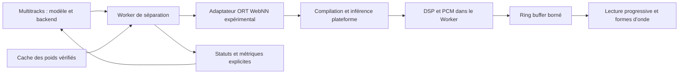

## 29 octobre 2026 — Banc déployable pour Firefox expérimental [IMPLEMENTED / FIREFOX VALIDATION PENDING]

**Déploiement mesures + écoute :** la distribution complète `dist/NAM_A2_WAM/` contient désormais aussi ce banc à `source-separation/webnn-diagnostics.html`, l’hôte/onglet Multitracks et le lecteur direct `source-separation/`. Un seul dossier à publier en HTTPS. Les imports WebNN et Demucs4 sont adaptés aux chemins locaux de la dist ; le catalogue conserve SHA/version/provenance. `WEBNN_TESTING.md`, `_headers`/`.htaccess` et `source-separation/build-info.json` sont fournis. Voir [guide de déploiement](examples/wam/source-separation/WEBNN_DEPLOYMENT.md). Le dossier autonome `dist/WebNN_Benchmark/` reste une variante mesures seules, sans lecteur. Les tests unitaires restent dans le dépôt. Le lecteur accepte déjà un fichier personnel et WebNN CPU/GPU/NPU pour les deux modèles compatibles, avec le même pipeline progressif et le lecteur ; décocher le repli CPU pour une qualification WebNN stricte. Firefox demeure à valider matériellement chez Paul.

Branche `multitracks`. Le build Firefox n’est pas installé sur la machine de développement ; Paul Adenot testera une version publiée sur sa machine. Nouveau protocole prospectif `webnn-browser-diagnostics-v1`, distinct des campagnes Canary antérieures. Commande `npm run dist:webnn-benchmark` → **`dist/WebNN_Benchmark/`**, autonome et servi en HTTPS : pas de Rails, de compte ou de CDN. Les deux checkpoints et ORT1.30.0 sont hachés et embarqués avec notices/licences. Source : `examples/wam/source-separation/webnn-diagnostics.html` ; guide [WEBNN_FIREFOX_BENCHMARK.md](examples/wam/source-separation/WEBNN_FIREFOX_BENCHMARK.md).

Demucs4 et BS Roformer SW6, cinq backends : WASM, WebGPU, WebNN CPU/GPU/NPU demandés. Graphe monolithique commun par défaut ; option Roformer WebGPU coopérative séparément identifiée. Sessions indépendantes, répétitions, warmups explicites, rotation d’ordre, durée d’extrait, audio personnel, threads WASM et timeout réglables. Toutes les erreurs/absences de support sont exportées ; aucun remplacement automatique de backend. Les replis d’opérateurs ORT restent de couverture inconnue et les préférences acceptées ne prouvent pas le matériel utilisé.

Mesures : entrée/décodage/SHA, démarrage Worker, poids fetch/hash, runtime vérification/import, contexte WebNN ou adapter/device GPU, création de session et compilation, première séparation et passages suivants, `session.run` réseau+transferts, DSP/assemblage, lectures de tenseurs, soumissions dispatch/write, validation hors intervalle de processing et nettoyage. Compteurs/traces d’API publiques, erreurs/stack/phase, empreintes des sources servies et build, visibilité et notes machine/build. Export JSON brut et CSV, checkpoints locaux sans PCM. Marques `webnnlab:` pour corrélation avec un enregistrement externe Firefox Profiler. Les durées imbriquées ne sont pas additives ni des chronos de kernels ; pas de taux de fallback, de consommation ou d’identité NPU inventés. Résultats Firefox attendus, aucun score historique requalifié.

## 27 octobre 2026 — Fichiers personnels et écoute multipiste [IMPLEMENTED / VALIDATION CANARY PENDING]

La branche `multitracks` propose maintenant **WebNN / GPU, WebNN / CPU, WebNN / NPU** dans Backend, pour **Qualité · Demucs 4 pistes ONNX** et **BS Roformer SW 6 instruments**. La sélection reste volontaire ; WebGPU reste recommandé par défaut. Les anciens modèles ORT 6s/FT et l’aperçu Demucs 2s ne sont pas admis sur WebNN.

Procédure : ouvrir `http://127.0.0.1:8765/examples/wam/source-separation/` dans Canary, importer son fichier dans **Input audio**, choisir le modèle puis le backend WebNN, télécharger les poids si nécessaire, choisir toute la durée ou un extrait, puis **Séparer le morceau**. Le même lecteur propose les instruments, volume/pan, mute/solo, boucle et mix. Dans l’onglet Multitracks du host, ces choix se trouvent dans **Change model / settings**. Le cache dépend de l’origine et du navigateur : un modèle installé dans Chrome n’est pas automatiquement installé dans Canary.

Le Worker `webnn-playback-worker.js` reçoit les poids vérifiés du cache habituel. ORT1.30 reste isolé d’ORT1.22 ; `WebNNRuntime.js` vérifie taille et SHA-256 des trois assets avant import. Préparation = création de contexte, compilation et préchauffage ; elle peut prendre plusieurs dizaines de secondes. Les sessions sont réutilisées. Demucs garde sa fenêtre de343980frames, Roformer176400frames ; cette intégration ne promet pas un premier son en1s. Les résultats sont raccordés puis transmis par le transport/ring buffer existant au lecteur progressif. DSP et inférence restent hors du thread UI.

CPU/GPU/NPU font partie de l’identité de session et du choix sérialisé. Changement confirmé de modèle/backend ou annulation détruit le Worker et invalide les anciennes réponses. Une perte de contexte rejette compilation/inférence. Le repli complet sur WASM est optionnel, visible et autorisé seulement avant le premier bloc ; ne jamais mélanger des backends en cours de flux. Les replis internes d’opérateurs restent possibles selon [ORT WebNN](https://onnxruntime.ai/docs/tutorials/web/ep-webnn.html). Le compteur de dispatchs, le type demandé et le matériel effectif inconnu figurent dans les mesures ; aucun NPU physique n’est certifié. Un compteur instrumenté à zéro après préchauffage provoque une erreur plutôt qu’une fausse réussite WebNN.

Build : `python3 tools/prepare-webnn-lab.py` prépare les assets locaux épinglés. Lorsqu’ils sont présents, la dist les inclut sous `source-separation/vendor/onnxruntime-webnn/` avec la licence et réécrit le chemin du loader. Sans ces assets, le reste du host fonctionne et une tentative WebNN explique leur absence. Les poids continuent à être téléchargés via le catalogue habituel.

Validation : tests automatisés du routage, clés de session, intégrité runtime, absence d’API, nettoyage, perte de contexte, annulation/repli et publication exacte des4/6pistes pour une entrée arbitraire. Le Worker réel est exercé avec inférence simulée : ce n’est pas une nouvelle mesure de modèle. Test natif Chrome : WAV importé de6s, Demucs4 WebGPU, quatre pistes visibles et Play/Stop fonctionnels ; WebNN indisponible est désactivé. Pilotage natif de Canary expiré pendant cette session : **le nouveau parcours WebNN de bout en bout reste à valider dans Canary**. Les anciens résultats des bancs fixes ne sont pas attribués à ce nouveau parcours. Aucun nouveau score audio, classement ni résultat matériel dans MODEL_EVALUATIONS.MD.

# Support expérimental de WebNN pour la séparation de sources

Version 0.6 — 25 octobre 2026 — branche `multitracks`.

Document évolutif demandé par l’utilisateur. L’étude avance pendant que les écoutes humaines sont prévues par l’utilisateur. WNN-0, WNN-1 et WNN-2 sont terminés. Demucs4 a produit des sorties musicales via WebNN dans Canary ; WNN-3 reste en validation pour les gardes numériques sur pistes faibles. Le lecteur propose maintenant WebNN expérimental pour les fichiers personnels (voir ajout ci-dessous) ; l’usage effectif du NPU reste inconnu.

## Objectif et périmètre

Évaluer WebNN comme backend supplémentaire du séparateur pour guitaristes et bassistes, avec accès aux accélérateurs disponibles sur la machine. Conserver le lecteur, le catalogue de modèles, la lecture progressive, l’arrêt de séparation et le transport PCM par ring buffer. Le résultat attendu est une décision mesurée par couple modèle/backend/machine, pas une migration générale du moteur.

Le fonctionnement actuel WASM et WebGPU demeure la référence et le secours. Pas de nouvelle dépendance au serveur pour l’inférence ; les poids continuent d’être téléchargés et vérifiés dans le cache local. Les projets audio, exports et futurs services de persistance restent indépendants de ce choix de calcul.

## État technique vérifié et incertitudes

ONNX Runtime Web documente un Execution Provider WebNN, un bundle `onnxruntime-web/all`, des préférences `deviceType` CPU/GPU/NPU, la fixation des dimensions libres et des échanges via `MLTensor`. Les opérateurs non pris en charge peuvent revenir sur WASM. Le transfert de tenseurs entre processeurs a un coût ; l’IO binding exige un contexte partagé. Ces possibilités doivent être vérifiées avec une version épinglée du runtime, distincte du bundle ORT1.22 actuellement utilisé en production. [Guide ORT WebNN](https://onnxruntime.ai/docs/tutorials/web/ep-webnn.html).

La spécification W3C du21octobre2026 est encore un Candidate Recommendation Draft. Elle expose les interfaces dans Window et Worker et emploie notamment `accelerated` et `powerPreference`. Ces préférences ne constituent pas une sélection matérielle universelle : ne pas confondre les options du wrapper ORT avec le contrat natif du navigateur. [Version datée du standard](https://www.w3.org/TR/2026/CRD-webnn-20261021/).

Le tableau d’implémentation distingue les chemins LiteRT, Windows ML et Core ML ; leur disponibilité et leurs opérateurs diffèrent. L’état est expérimental. La présence de WebGPU ne prouve pas celle de WebNN, et une création de contexte réussie ne prouve pas l’utilisation du NPU. [État officiel des implémentations](https://webmachinelearning.github.io/webnn-status/).

L’audit doit examiner les types, attributs et formes de chaque opérateur, pas seulement son nom. Les contraintes documentées des convolutions et des LSTM sont notamment pertinentes aux modèles candidats. Le tableau `main` est mutable : archiver sa révision lors des essais. [Opérateurs du fournisseur ORT](https://github.com/microsoft/onnxruntime/blob/main/js/web/docs/webnn-operators.md).

Sur le Mac utilisé jusqu’ici, **le graphe natif de contrôle puis Demucs4 ont été exécutés, sans identification du processeur physique utilisé**. Les possibilités CPU/GPU/NPU seront donc affichées comme préférences demandées, accompagnées du niveau de preuve disponible. Si l’accélérateur effectif n’est pas observable, écrire « non déterminé ».

## Architecture proposée

Le transport existant ne sera pas réécrit. Les tenseurs de calcul et le PCM publiable sont deux formats distincts : un ring buffer ne rend pas les tenseurs GPU/NPU directement lisibles par le lecteur. Le Worker demeure responsable des conversions, du raccord des fenêtres et de la publication ordonnée.

Les sessions compilées sont liées au modèle, à sa forme, au runtime et au contexte. Ne pas les confondre avec les poids persistants. Aucune persistance de graphe compilé ne sera présumée portable. Les ressources de session et de contexte seront libérées lors d’un changement de modèle, d’un arrêt ou d’une erreur.

## Tâches incrémentales

### WNN-0 [DONE] — cadrage et références

Présent document, architecture proposée et limites connues. Liens avec `MODEL_EVALUATIONS.MD`, `HANDOFF.md` et `SPECIFICATION_SOURCE_SEPARATION_MULTITRACK.md`. Cette tâche ne certifie aucun graphe compatible.

### WNN-1 [DONE, diagnostic synthétique] — diagnostic de capacités isolé

Utiliser **Google Chrome Canary**, demandé par l’utilisateur le25octobre2026. Installation locale vérifiée : version158.0.8122.0 dans `/Applications/Google Chrome Canary.app`. L’utilisateur indique que Canary dispose de WebNN et que Chrome normal ne le propose pas sur sa machine. Cette information guide le choix du navigateur ; elle ne remplace pas le test réel du graphe et du Worker. Les essais audio G1 ont été réalisés dans Chrome normal, pas dans Canary.

Créer une page de laboratoire accessible par URL dédiée. Tester séparément la présence des API dans la page et dans un Worker, la création d’un petit graphe et une inférence numérique connue. Rapporter erreurs, navigateur, OS, contexte sécurisé, options demandées et informations réellement exposées. Aucun changement automatique des flags du navigateur.

**Tests / passage :** API absente, refus de contexte, perte du contexte, absence dans Worker, options non reconnues et résultat numérique incorrect ; succès réel dans le Worker cible avant de passer à WNN-3. Un mock vérifie le contrat logiciel, jamais la disponibilité matérielle.

**Résultat du25octobre2026 :** Canary158.0.8122.0 réussit le graphe `[1,2] × [3,4]ᵀ = 11` dans Window et Worker, pour quatre jeux de préférences : défaut, CPU, GPU, NPU. **8/8 succès archivés** dans [le rapport Canary](examples/wam/source-separation/benchmarks/webnn-canary-capabilities-2026-10-25.json). Chrome normal154 retourne API indisponible dans les huit cas : [contrôle négatif](examples/wam/source-separation/benchmarks/webnn-chrome-capabilities-2026-10-25.json). Aucune modification de flags. La propriété `context.accelerated` n’est pas exposée ici ; des clés de dictionnaire peuvent être ignorées. Les huit succès ne sont donc pas huit preuves de matériel distinct et ne certifient aucun NPU.

Outillage : `webnn-probe.html/js`, `WebNNProbe.js`, Worker dédié. Tests unitaires de l’absence d’API, du résultat numérique, du refus de contexte, de la perte de contexte simulée et de la libération des ressources. Les pertes de contexte sont simulées en test, pas provoquées matériellement. La compatibilité d’un modèle audio reste conditionnée à WNN-2/WNN-3.

### WNN-2 [DONE] — runtime et inventaire de graphes reproductibles

Épingler un bundle expérimental complet avec version, URL, SHA-256 et licence, sans remplacer ORT1.22 globalement. Vérifier le chargement local en Worker et les en-têtes nécessaires. Inventorier les opérateurs/attributs/dimensions/types des graphes retenus et les confrontations aux backends. Toute réécriture ou quantification produit une variante identifiée, avec nouvelle validation de qualité.

**Tests / passage :** contrôle d’intégrité, fichiers manquants, chemins de distribution, import Worker et indépendance du runtime de production. Archiver l’inventaire et les motifs précis d’incompatibilité.

**Réalisation :** paquet npm officiel ORT1.30.0, SRI imposé, extraction de trois assets statiques et licence MIT, sous third_party/nam-webnn-probe. Runtime1.22 du host intact. `tools/prepare-webnn-lab.py`, manifeste `research/webnn-runtime.json`. Audit statique exact du Demucs4 déjà intégré,3268nœuds/opset17 et formes/attributs/constantes archivés dans `research/webnn-demucs4-audit.json`. Les groupes absents de la table ne sont pas automatiquement déclarés impossibles : constantes/contrôle de formes peuvent être repliés. Chargement réel des deux runtimes en Workers vérifié. Runtime/poids du laboratoire restent des dépendances locales de recherche, pas de nouveaux assets distribués dans le host.

### WNN-3 [CURRENT] — premier modèle et parité numérique

Commencer par le Demucs4 ONNX déjà fonctionnel en WASM/WebGPU. Employer les mêmes poids, normalisation, STFT/iSTFT, recouvrement et sorties. Fixer les dimensions lorsque nécessaire, sans prétendre réduire le contexte appris par un changement arbitraire de taille.

Comparer une entrée synthétique puis un extrait musical figé au **même graphe** sur le backend de référence. Contrôler formes, canaux, valeurs finies, niveaux, erreur RMS relative et erreur maximale. Seuil initial proposé RMS relatif≤1e−3, à confirmer avant exécution pour ce graphe ; tout dépassement reste un échec documenté, sans ajustement après observation. Vérifier également le PCM final et les raccords.

**Tests / passage :** mapping des sources, stéréo, padding exact, absence de sortie silencieuse, erreur de forme et fallback. Distinguer « WebNN avec repli WASM » d’une exécution dont la couverture WebNN a été effectivement observée. Si le profilage ne permet pas de chiffrer la couverture, indiquer cette limite.

**Résultat initial :**15 exécutions finies/alignées sur trois entrées (9musicales,6synthétiques), dont cinq candidates WebNN avec build+dispatch natifs observés. Contrôle WASM1.30/1.22 proche (RMS relatif global≤9,59e−7). WebNN passe le seuil global sur les cinq candidates ; garde relatif supplémentaire par source échoué sur des sorties très faibles de synthèse/DreamOn. Le contrôle Falcon ajouté ensuite passe aussi les gardes par source. Les échecs restent conservés. Voir MODEL_EVALUATIONS.MD§21, [le résumé](examples/wam/source-separation/benchmarks/webnn-demucs4-summary-2026-10-25.json) et [le protocole](examples/wam/source-separation/WEBNN_DEMUCS4_LAB.md).

**Reste pour WNN-3 :** motiver avant de nouveaux tests une éventuelle tolérance mixte absolue/relative pour les sorties faibles, puis vérifier sur davantage d’entrées sans effacer les échecs du protocole initial. Aucune cause FP16/Neural Engine affirmée sans preuve. Sur Falcon, session12,225s puis exécution+DSP2,442s contre0,690s+10,713s en WASM : premier job WebNN plus long ; réutilisation de session et débit chaud à mesurer. Pas de recommandation issue d’une seule série. Une annulation au début d’un Worker a été vérifiée ; les contrôles longs/lecture concurrente restent à faire.

### WNN-4 [TODO] — intégration progressive et réactivité

Brancher l’adaptateur sur les interfaces des runners existants. Compilation, inférence, DSP et copie des sorties restent hors du thread UI. Réutiliser la publication PCM bornée, la contre-pression et les identifiants de génération. Préserver l’original et les blocs déjà publiés lors d’un arrêt. Ne jamais concaténer deux backends au milieu d’un même résultat pour masquer une erreur.

**Tests / passage :** lecture pendant calcul, timeline monotone, scroll, annulation pendant préparation et inférence, rejet de blocs tardifs, saturation du ring buffer, changement de modèle et reprise explicite. Mesurer les longues tâches UI et les files mémoire sur un morceau long ; pas seulement l’animation d’une page vide.

### WNN-5 [CURRENT] — campagne CPU/GPU/NPU et décision

**[DONE] WNN-5a — première comparaison retenue en session :** campagne W4,12configurations,33séparations complètes sur Falcon6s. Demucs4 : WASM10,525s, WebGPU2,465s, WebNN CPU5,927s/GPU2,038s/NPU2,054s demandés. SW6 : WASM71,069s, WebGPU6,225s, WebNN GPU12,553s/NPU9,717s, CPU perte de contexte avant inférence. Compilation WebNNSW65–68s. Contrôles production WebGPU1.22 :2,487s/5,799s. Temps = médiane de deux répétitions après première exécution, pas attente totale. Deux sessions d’observation séparées par interruption, matériel WebNN effectif inconnu. [Protocole](examples/wam/source-separation/WEBNN_PERFORMANCE.md), MODEL_EVALUATIONS.MD§23.

**Reste WNN-5 :** réplications indépendantes, plusieurs extraits, mesures mémoire/lecture concurrente, identification matérielle si exposée. Parité SW WebNN inter-backend encore à faire ; les reprises n’avaient pas le PCM de référence. Garder WebGPU recommandé, WASM secours. Aucune admission globale WebNN sur la base de W4.

Pour chaque configuration réellement disponible, enregistrer :

- Identités modèle/runtime/DSP, machine, navigateur, flags, options demandées, accélérateur observé ou inconnu, repli et couverture lorsqu’ils sont observables.
- Téléchargement séparé du calcul ; chargement des poids, compilation, première inférence, premier PCM publiable, premier audio audible et temps total.
- RTF = temps de traitement/durée audio, mémoire mesurable avec ses limites, stabilité, fluidité et annulation. Énergie uniquement avec une méthode instrumentée ; aucun watt déduit d’un temps CPU.
- Au moins une exécution froide et trois répétitions chaudes, ordre alterné, charge concurrente contrôlée ; médiane et dispersion, erreurs conservées. Distinguer cache de poids et session précompilée.

Les extraits GHA fixés peuvent servir de diagnostic de parité et de récupération des stems assignés. Ils ne prouvent ni une qualité sur des stems purs ni une indépendance de l’entraînement. Ne pas mélanger six fenêtres de trois morceaux avec six compositions indépendantes. Ajouter une campagne indépendante et des écoutes humaines avant un classement scientifique général.

**Passage :** aucune recommandation automatique tant que vitesse, qualité et stabilité ne sont pas validées ensemble. Un NPU plus lent ou inaccessible est un résultat acceptable. Compléter `MODEL_EVALUATIONS.MD` avec les données brutes et interprétations.

### WNN-6 [TODO] — autres modèles par priorité instrumentale

Après Demucs4 : SCNet compact, puis BS Roformer SW six sources, puis réexamen Demucs6. SCNet compact n’est pas SCNet XL. Le dernier diagnostic Demucs6 GPU documente une dérive réseau de7,317% RMS ; WebNN ne sera pas présenté comme une correction implicite. Chaque modèle suit WNN-2 à WNN-5 avec son propre contrat. Les modèles purement vocaux ne sont pas prioritaires pour le projet.

### Choix CPU / GPU / NPU — exigence utilisateur

L’utilisateur demande explicitement les trois choix WebNN/CPU, WebNN/GPU et WebNN/NPU. Les conserver dans le futur écran Change model/settings, distincts de WASM/CPU et WebGPU. Mémoriser la préférence et l’inclure dans l’identité d’une session compilée ; un changement de préférence doit recréer le contexte et ne pas réutiliser une session du précédent processeur demandé. Un refus de contexte doit rester visible, sans remplacer le choix par un autre dans la GUI. La plateforme peut néanmoins ignorer une préférence matérielle : afficher « matériel effectif inconnu » faute de preuve.

**Déjà réalisé dans le laboratoire :** sélecteur explicite à trois choix, mémorisation locale, validation centralisée par WebNNDevice.js, transmission exacte au Worker/MLContext. Préférence NPU vérifiée sur Falcon, sortie valide et garde de parité réussi ; un dispatch WebNN observé. Résultat identique au GPU demandé, ce qui ne prouve ni présence ni absence d’exécution NPU. Le host n’expose toujours pas ce backend avant WNN-3/4/7. Voir MODEL_EVALUATIONS.MD§22.

### WNN-7 [TODO] — exposition optionnelle dans le host

Ajouter uniquement les couples validés à « Change model / settings », avec états indisponible, préparation, prêt, erreur et repli explicites. Le moteur conseillé reste fondé sur les mesures disponibles sur une configuration comparable ; aucun choix NPU par simple présence de l’API. Repli WASM/WebGPU visible avant publication, ou redémarrage explicite après erreur. Tests du catalogue, de l’arrêt et de la distribution, puis essai réel du host avant livraison.

## Journal et mise à jour

| Date | Travail accompli | Preuve / prochaine action |
|---|---|---|
| 2026-10-25 | Cadrage documentaire WNN-0 | Sources officielles consultées ; voir résultats WNN-1 ci-dessous. |
| 2026-10-25 | WNN-1 synthétique terminé dans Canary158 | Huit graphes natifs réussis ; Chrome normal absent. Voir essais musicaux ultérieurs ci-dessous ; aucun NPU prouvé. |
| 2026-10-25 | WNN-2 terminé, WNN-3 en validation | ORT1.30 isolé,15 exécutions Demucs4 finies ; parité globale réussie, garde de sorties faibles à traiter prospectivement. |

Pour chaque tâche future, remplacer `[TODO]` par `[CURRENT]`, puis `[DONE]` seulement après ses contrôles. Ajouter les liens vers rapports bruts, commandes reproductibles, échecs et versions exactes. Les notes d’écoute restent absentes tant qu’aucun participant n’en a fourni.

## Direct WebNN benchmark increment — 2026-10-30

- [DONE software] D1: offline extraction from both pinned checkpoints into graph recipes and raw typed weights; no ONNX parsing in browser. Source identities and generated hashes retained.
- [DONE software] D2: direct MLGraphBuilder/MLTensor lifecycle in benchmark Worker, default for WebNN requests, no neural ORT/WASM fallback; WASM/WebGPU unchanged; optional mediated comparison. Graph construction/build/allocation phases and implementation exported under diagnostics-v2.
- [DONE offline] D3a: seeded full neural-input conversion roundtrip yields identical float32 outputs for both models; Python unit tests and JS API/lifecycle tests. This is not native WebNN qualification.
- [CURRENT] D3b: native Canary/Firefox PCM parity against WASM and support/error collection; unsupported operations fail explicitly. No native WebNN-capable browser currently controllable.
- [TODO] D4: independent-session native performance/profiler campaigns, device evidence and analysis with Paul.

Details and deployment: examples/wam/source-separation/DIRECT_WEBNN_BENCHMARK.md. Ordinary multitrack playback remains the prior ORT-backed implementation; no production model/backend default changed.

### Native Demucs compilation isolation [CURRENT]

Provide compiler-only probes on original outputs, selected ancestor subgraphs and standalone endpoints, each with a new context. Export identity, timings, cut descriptors and raw errors. Do not assume failures are monotonic or claim native numerical qualification from successful compilation. Automated diagnostic tests required; native Canary/Firefox evidence remains pending.

### Candidat de compatibilité Demucs : sélection statique [CURRENT]

Le raffinement natif localise une transition gather693 compilable → reshape694 non compilable avec ses ancêtres. Export Demucs modifié en Slice+Reshape pour les26sélections scalaires constantes, même checkpoint ; Roformer inchangé. Vérification hors navigateur des deux sorties complètes : erreurs max et RMS relatives nulles. Qualification native requise avant de déclarer ce candidat fonctionnel. Les trois fichiers graph/weights/index doivent être livrés ensemble.

### Pont des sorties Demucs directes [CURRENT — code corrigé, PCM natif à qualifier]

Le rapport10:10 confirme la compilation/dispatch/readback pour les trois requêtes CPU/GPU/NPU avec le candidat Slice. La reconstruction JS échouait ensuite, car la clé numérique5073 était énumérée avant output. Des tableaux explicites préservent désormais l'ordre original des entrées/sorties ; validation des permutations et test de régression avec le véritable adaptateur Demucs. Aucun nouveau score ni parité audio native avant un essai complet réussi.

### Comparaison Direct WebNN / ORT→WebNN [DONE — outil]

Sélecteur Compare both : deux jobs indépendants par appareil WebNN sélectionné, données et paramètres identiques, identifiants/export explicites, ordre des implémentations alterné entre sessions. Baselines non-WebNN une fois. Conserver WASM pour la référence PCM ; ne pas attribuer automatiquement toute différence au runtime seul. Mesures natives appariées à recueillir.

### Heuristique de recommandation [DONE dans le banc ; intégration host future]

Comparer les backends réussis par modèle, disponibilité WebNN, durée de morceau et état d'initialisation. Agréger les médianes par session ; exclure échecs, données invalides et parité échouée. Afficher débit maximal et meilleur coût total projeté, avec provenance actuelle ou CSV de référence explicitement étiquetée. Module pur réutilisable :4pistes par défaut,6si guitare dédiée ; pas de choixWebNN basé uniquement sur navigator.ml, ni sur un classement d'une autre machine. Repli conservateur WebGPU détecté puis WASM. Support de l'appareil et session doivent être validés à l'exécution, avec invalidation des mesures quand les versions ou matériels changent.
