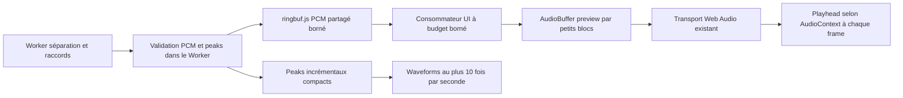

# Transport progressif avec ringbuf.js — proposition

Le 22 octobre 2026. Étude initiale, suivie ci-dessous de la mise en œuvre du transport partagé. La correction précédente des waveforms ne suffit pas selon le test utilisateur ; aucune amélioration CPU ou garantie 60 FPS n'est donc revendiquée.

## Constat dans notre code

`roformer-worker.js` calcule un bloc raccordé puis transfère ses tableaux avec `postMessage(..., transferList)`. Ce transfert cède la propriété sans structured clone du PCM. `PreparedDemucsRunner` et `AudioData.makeTracks` vérifient ensuite tous les échantillons sur le thread UI ; des AudioBuffer sont créés et alimentés, puis le Worker waveform reçoit à nouveau des copies PCM par blocs. L'entrée du morceau est aussi copiée et validée plusieurs fois au lancement. Le ring buffer ne supprime pas automatiquement ces scans/copies ni le coût de FFT/inférence. C'est le pipeline complet qui doit évoluer.

## Référence wam-studio examinée

Dépôt https://github.com/Brotherta/wam-refont, HEAD `4c268f7b5791bcb11be3c1cf510b1a4a7728dd02`, lu sans exécution dans /tmp.

- `public/src/Controllers/Recording/Recorders/SampleRegionRecorder.ts` : SharedArrayBuffer, recorder AudioWorklet producteur, Worker consommateur.
- `public/src/Audio/WAM/SampleRecorderProcessor.ts` : enqueue du PCM stéréo via AudioWriter.
- `public/src/Audio/Utils/wav-writer.js` : dequeue toutes les 100 ms, notifications d'audio courant toutes les 500 ms ; l'UI reconstruit les données de région.

C'est bien une référence de découplage production/consommation. Notre lecteur doit conserver des blocs incrémentaux, sans reconstruire le morceau cumulé à chaque notification.

Bibliothèque officielle : https://github.com/padenot/ringbuf.js/ ; SPSC, SharedArrayBuffer, licence MPL-2.0. Épingler version/commit et conserver licence/notice lors du vendoring.

## Architecture proposée

1. **Mesurer avant/après sur la même machine** : Long Tasks, intervalles RAF p95/max, temps de validation/copie/render, CPU, mémoire, délai premier bloc, sous-alimentations audio. Même morceau, modèle et backend ; tests instruments/mix, zoom, six sources et morceau long. Ne pas lancer plusieurs inférences pour ces mesures.
2. **Transport pilote** Roformer puis Aperçu : un producteur et un consommateur par ring. Si plusieurs Workers produisent, un ring par producteur et réordonnancement par startFrame. Ne jamais partager un ring SPSC entre plusieurs producteurs ou deux consommateurs.
3. **Paquets bornés** : sortie découpée en tranches d'au plus une seconde (queue finale plus courte). Métadonnées : session/génération, startFrame, nombre de frames, fréquence, ordre/nombre de canaux et séquence. Écrire entièrement le payload avant publication atomique de son descripteur ; un paquet partiel ne doit pas être consommé. Conserver le même startFrame sur toutes les sources.
4. **Backpressure** : queue de quelques secondes, mémoire fixe (six sources stéréo, float32, 44,1 kHz = environ 2,02 Mio par seconde de PCM). Si pleine, le Worker attend/yield sans écraser d'audio ni busy-spin. Annulation réveille/termine le producteur ; génération vérifiée avant consommation. Pas de Atomics.wait bloquant sur le thread UI.
5. **Consommation à budget** : drainer des sous-blocs, par exemple 16 384 frames maximum par tâche et une limite de temps mesurée ; yield entre tâches. Ne pas vider tout le backlog dans un RAF. Prioriser l'avance audio ; mise à jour des peaks décimée, jamais d'échantillon PCM parcouru dans RAF.
6. **Peaks dans le producteur** : validation de finitude et enveloppes avant publication, pas de nouveau transfert du PCM vers le Worker waveform. Pour le mix à réglages variables, conserver le calcul exact hors UI, sur une copie/archive accessible au Worker ; ne pas faire consommer le même ring par ce second Worker. Somme PCM puis peaks, pour respecter les annulations de phase.
7. **Archivage** : un ring est une file temporaire, pas le stockage du morceau. Garder les blocs consommés pour seek, A/B, export et sauvegarde ; ne jamais les recopier en un grand buffer cumulé à chaque publication. Les AudioBuffer nécessitent toujours une copie native pour le transport actuel. Une lecture directe via AudioWorklet serait une étape distincte, avec seek/loop/mix à concevoir.
8. **Déploiement** : SharedArrayBuffer utilisable si crossOriginIsolated avec en-têtes COOP/COEP appropriés. Le serveur local actuel ne les envoie pas. Tester l'isolation avec les plugins, iframes et ressources externes du host avant activation globale ; prévoir un repli explicite sur transfert ArrayBuffer borné quand indisponible. Documenter les en-têtes pour la dist et le serveur Rails. Ne pas activer un polling permanent quand aucune séparation n'est active ; reprendre sur visibilité après suspension d'onglet.
9. **Tests** : wrap-around, queue pleine/vide, débit inégal, paquet incomplet, fin de fichier, ordre des canaux, intégrité PCM bit à bit, annulation/reset/changement de modèle, messages tardifs, reprise onglet, fallback sans SAB ; intégration audio synchronisée, seek/loop/solo/pan, fidélité des peaks et rendu long sans croissance du travail UI avec l'historique.

Découper une sortie Roformer en tranches d'une seconde ne permet pas d'obtenir la première seconde avant la fin de sa fenêtre neuronale de quatre secondes. Le ring buffer améliore le transport et le lissage du travail UI ; il ne raccourcit pas cette dépendance ni le coût du modèle.

## Changement de modèle implémenté séparément

La fenêtre Change model / settings édite un brouillon ; Annuler/Escape n'interrompt pas le calcul. Valider un autre modèle ou backend invalide la génération courante avant d'arrêter les Workers. L'ancien résultat est libéré ; le lecteur affiche les pistes vides du nouveau modèle et Play est désactivé jusqu'à une nouvelle séparation. L'original est conservé. Les callbacks/finally de l'ancien calcul ne peuvent plus publier, sauvegarder ni modifier la nouvelle session. Une validation identique laisse le calcul en cours intact.

## Mise en œuvre — 22 octobre 2026

Le transport décrit ci-dessus est désormais intégré aux **quatre Workers progressifs** (Roformer, Aperçu, Demucs ONNX, Demucs 6s WASM). Les sections de proposition restent comme historique des décisions ; l'AudioWorklet de lecture directe et un stockage d'archive côté Worker restent des pistes futures.

- `vendor/ringbuf` contient **ringbuf.js 0.4.0 officiel inchangé**, MPL-2.0, tarball et SHA documentés dans NOTICE.md.
- `StreamTransport.js` fournit `StreamPublisher` dans le Worker et `StreamingWorker` côté consommateur. Un ring SPSC planar float32, trois secondes maximum, par session/producteur. Six sources stéréo = environ 6,06 Mio de PCM partagé, plus contrôle et petits descripteurs.
- Paquets <=44 100 frames (une seconde), queue finale exacte. Finitude et peaks 2 048 bins globaux sont calculés avant publication côté producteur. Une publication n'expose jamais un paquet incomplet. Ordre, séquence, longueur et ordre des canaux sont vérifiés côté consommateur.
- File pleine : attente par `Atomics.waitAsync` (ou `Atomics.wait` dans le Worker dédié uniquement), réveillée par le consommateur ; pas de boucle de polling active. Les descripteurs réveillent la consommation ; aucune tâche de drainage quand idle. Terminer le Worker annule également une attente.
- Lecture de **65 536 valeurs float32 maximum par tâche**, soit 256 Kio ; publication d'au plus un paquet audio par tâche. La création/copie native des AudioBuffer reste sur l'UI. Les tableaux validés sont identifiés localement via WeakSet, sans se fier à un simple booléen envoyé sur le fil. Les chemins anciens/non marqués conservent leurs contrôles PCM.
- Les enveloppes sont associées aux AudioBuffer via WeakMap. Le calcul waveform les utilise directement sans recopier le PCM vers le Worker waveform. Restitution après changement de durée/restauration, mix exact à réglages variables et ancienne audio restent gérés hors UI par le Worker waveform existant.
- Tous les runners gardent leurs contrôles de continuité et leur contrat onChunk. `done` reste derrière la dernière consommation. Une annulation ferme le consommateur, vide ses tâches et ignore les réponses tardives ; le changement de modèle conserve son mécanisme de génération.
- Repli sans isolation/SAB : mêmes paquets et peaks côté producteur, transport par ArrayBuffer transférables ; ce mode s'appelle `transfer`, le mode SAB `shared-ringbuffer`.
- Node local : COOP same-origin / COEP require-corp / CORP same-origin, mêmes valeurs que Rails déjà configuré. Redémarrer le serveur pour les appliquer. La dist génère `_headers` pour les hébergeurs compatibles ; sur Apache/Nginx/autre, définir ces trois en-têtes sur la page et les ressources. `file://` n'active pas ce chemin. Ne pas contourner les exigences CORS/CORP pour des plugins tiers : utiliser des ressources compatibles ou le repli.
- Diagnostic optionnel : ajouter `?uiMetrics=1` à l'URL du host, puis Change model / settings → Mesures du dernier traitement ONNX → UI performance. Reset UI metrics démarre une nouvelle fenêtre. Mesures : intervalles RAF p95/max, frames >50 ms et Long Tasks si API supportée, mode réel de transport et état d'isolation. Le code n'est activé qu'avec le paramètre. Une baisse de CPU machine ne se déduit pas des seuls intervalles RAF.
- Les copies/validations d'entrée du morceau et la compilation initiale du modèle n'ont pas encore été refondues. Les mesures de lecture régulière doivent être séparées de ce démarrage. La queue ne constitue pas une archive ; les AudioBuffer consommés restent disponibles pour seek/loop/export/sauvegarde.

### Vérification navigateur

- Musique6s Roformer WebGPU : transport **shared-ringbuffer**, douze canaux dans les seuils préexistants (RMS relative globale 6,45e-5 ; erreur absolue max 1,38e-4). Rapport `benchmarks/ringbuf-audio-2026-10-22.json`. Cette vérification compare le même algorithme/poids à la référence native ; pas une mesure de qualité de séparation sur des stems isolés.
- Host : Jet214,9s, lecture native simultanée, publications progressives et waveforms. Snapshot après reset des mesures : RAF p95 ~11,9ms, max ~2 630ms, 91 intervalles >50ms sur 2 435 intervalles, Long Tasks JS détectées :0 ; `crossOriginIsolated=true` et transport shared-ringbuffer. Rapport `benchmarks/ringbuf-ui-2026-10-22.json`.
- **Des pauses restent mesurées** : ne pas annoncer « super fluide » ni une baisse CPU quantifiée. Les intervalles RAF incluent le rendu/compositeur et les effets éventuels de l'automatisation. L'absence de Long Tasks détectées n'identifie pas à elle seule la cause, mais invite à profiler la contention GPU/le rendu pendant ONNX. Aucun profil CPU machine ni baseline instrumentée de l'ancienne version n'a été collecté ; p95 faible ne signifie pas absence de gros trous.
- Au démarrage, la lecture et la vérification du cache/compilation restent potentiellement coûteuses. Reset UI metrics après cette phase sépare l'analyse du régime courant.

### Correction timeline et cadence — après retour utilisateur

Le slider `#seek` avait `max = availableDuration` pendant la séparation. Le dénominateur changeait à chaque publication : à position5s, disponibilité6→9s, le thumb passait de83% à56% sans recul audio. `TransportTimeline.js` fixe l'axe à `engine.duration`, comme les waveforms ; seul seek est limité à availableDuration. Test reproduisant explicitement ce recul de ratio et vérifiant la progression après correction.

Le test de focus empêchait aussi la mise à jour automatique du range après un clic tant qu'il gardait le focus. `ProgressSlider` suspend seulement pendant un drag réel, avec capture/release/cancel du pointeur ; le focus clavier seul n'arrête plus l'animation.

Le ring publie plus souvent qu'auparavant. La couche UI redessinait les waveforms/règle à chaque paquet. `WaveformRefreshGate` regroupe les publications, au plus un refresh par250ms pendant le flux ; le clock/playhead/slider reste sur RAF et l'audio est publié immédiatement. Un rafraîchissement final est forcé à la fin. Pas de changement de fenêtre neuronale, de raccord ou de données PCM.

Auto reste segmentSeconds=0 : ONNX qualité7,8s/overlap25%→~5,85s publiées par calcul ; Aperçu2s/overlap1s→1s ; Roformer4s/overlap1s→3s. Le transport découpe ensuite ces résultats en paquets<=1s. Un paquet de1s n'impose donc pas une inférence de1s, ni un rafraîchissement complet du graphe par paquet. Les stalls GPU/rendu n'ont pas été identifiés formellement et ne sont pas déclarés résolus par ce correctif.

### Planification audio glissante et mesures par étape

Le transport ring ne doit pas entraîner la création de tous les futurs nœuds Web Audio à chaque reprise de lecture. `ProgressiveMultitrackEngine` planifie désormais seulement les blocs qui croisent les **huit prochaines secondes**, et complète l'avance toutes les250ms pendant la lecture. Les paquets futurs restent en mémoire pour le seek/export ; ils ne deviennent des BufferSource/Gain/Panner que lorsqu'ils entrent dans cet horizon. Pause, attente, changement de projet et destruction annulent la tâche de planification. Les boucles A/B déjà assemblées conservent leur lecture native.

Chaque bloc est planifié une seule fois par génération de lecture. Si un retard dépasse l'avance disponible, le lecteur saute les échantillons déjà écoulés dans le bloc retardataire et reprend sur la même horloge pour toutes les pistes, au lieu de rejouer le début du bloc dans le présent. Cette stratégie ne peut pas empêcher une interruption si le thread UI reste bloqué plus longtemps que l'horizon.

Le diagnostic `?uiMetrics=1` affiche également `scheduledVoices`, `audioLookAheadSeconds` et les coûts synchrones `stages.audioPublication`, `stages.waveformPublication`, `stages.controls` (nombre, total et maximum). Ces mesures n'incluent pas le temps de GPU/composition différé ; ne pas assimiler un appel JS court à un rendu GPU court. Pour reproduire le nombre de sources de l'ancienne stratégie seulement pendant un diagnostic, ajouter `&audioSchedule=all` ; ce paramètre est ignoré sans uiMetrics=1 et ne modifie pas les données PCM.

Tests : planification d'un morceau long bornée à l'horizon, remplissage sans doublon, reprise tardive synchronisée, seek et callbacks tardifs après pause, destruction des tâches, mode de référence illimité, mesures par étape y compris exceptions/reset. Suite405 tests réussis.

Relevés navigateur du contrôle de planification (`benchmarks/audio-scheduling-2026-10-22.json`) : même extrait Jet60s/ONNX4GPU en essais successifs, fenêtres de mesure de durées différentes. Référence non bornée :144 sources à position25,89s, RAFp95~9,35ms/max122,8ms. Horizon8s :36 sources observées en cours de calcul (17,55s disponibles, position7,94s), puis32 au relevé tardif (position53,14s), RAFp95~9,36ms/max145,6ms. Publication audio synchrone max0,35ms, waveform max1,56ms, contrôles max0,21ms dans la fenêtre bornée. Un Long Task136ms subsiste. Ces fenêtres ne constituent pas un A/B contrôlé de FPS : elles confirment le fonctionnement et le bornage, pas une baisse CPU quantifiée ni la résolution des pics.
